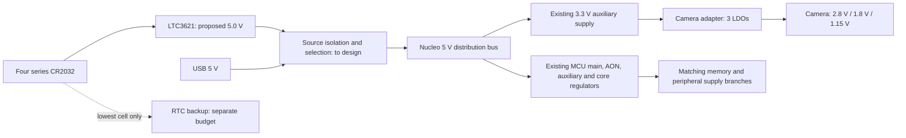
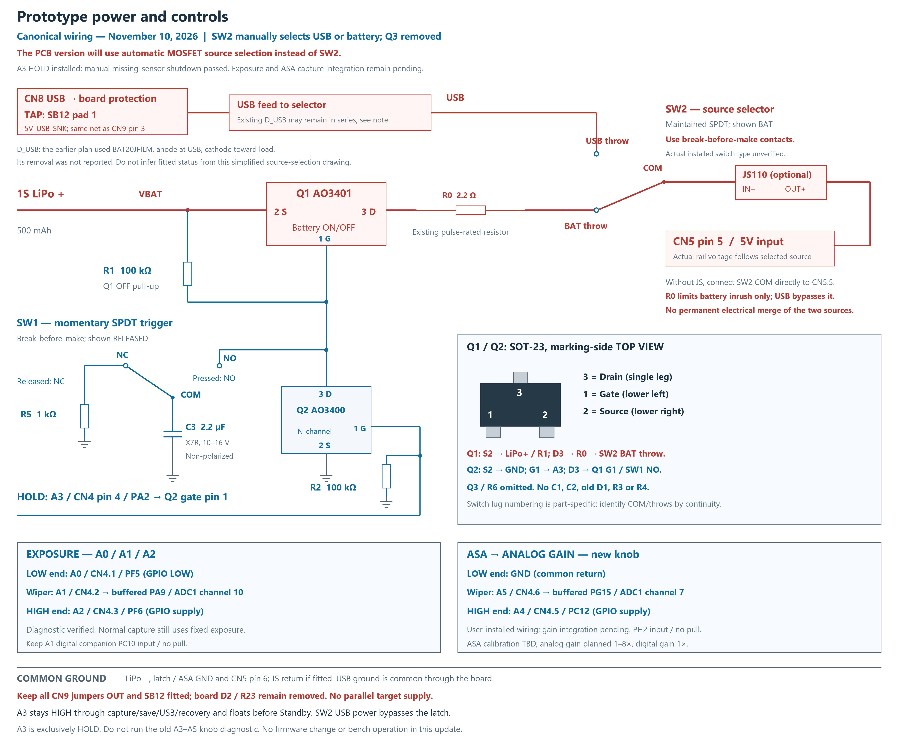
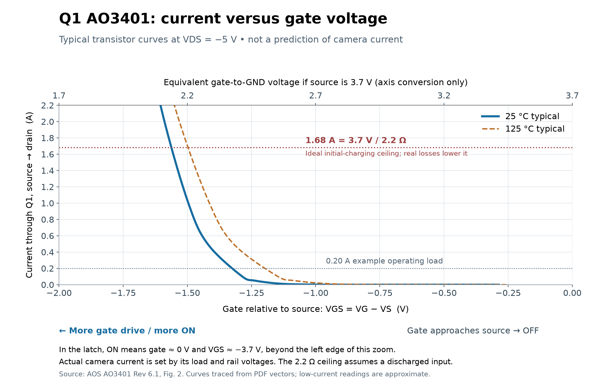

# Power-tree review: Nucleo prototype and compact camera

**November10 USB HOLD correction — offline, not installed:** drive A3 LOW
after the VBUS sample selects USB, before loading the application, and keep
it off through all USB service/error/shutdown paths. Ambiguous/failed VBUS
samples also release before parking. Battery capture and the pre-selection
boot/UART guard retain HIGH; E001 before selector loading has no VBUS result
and remains in that provisional state. The installed November9 firmware still
holds HIGH in USB mode. [Owning decision and exact boundaries](../../firmware/usb-ptp/NOTES.md#2026-11-10--keep-hold-off-after-usb-mode-selection).

**November 9 canonical controls:** HOLD is now **A3/CN4.4/PA2**;
the exposure knob is **A0/CN4.1/PF5 LOW**, **A1/CN4.2 wiper** and
**A2/CN4.3/PF6 HIGH**, as confirmed by the user. A1's conditioned analog
path is PA9/ADC1 channel 10; leave PC10 input/no-pull. New A3 capture/USB
firmware is **installed and readback-verified**. A3 HIGH, the A0/A1/A2 ADC
sweep and UART recovery passed on direct5V through JS. In the subsequent
manual trigger test, the user confirmed the missing-sensor two-flash code,
completion, camera power-off and **zero indicated current**. This provides
functional trigger/HOLD/cutoff confirmation; precise takeover/release timing,
held-button behavior and the off-current measurement floor remain unmeasured.
[Manual result](NOTES.md#2026-11-09--manual-trigger-test-confirms-missing-sensor-shutdown-and-load-cutoff).
[Installation and smoke evidence](../../firmware/control-smoke/evidence/2026-11-09-a3-live/README.md).
[Owning pin decision](../prototype/NOTES.md#2026-11-09--reserve-a3-for-hold-and-confirm-a0-a1-a2-exposure-roles).

**November 10 canonical prototype source selection:** the user replaced Q3,
the USB-controlled battery-cutoff MOSFET, with a separate **SPDT power
selector SW2** to simplify assembly. SW2 selects either USB power or the
output of the battery's 2.2-ohm R0 and feeds **CN5 pin5 / 5V**. There is no
direct USB/battery merge. Q1/AO3401, Q2/AO3400 and the momentary SPDT trigger
SW1 remain; Q1 source and R1 high end now connect directly to LiPo+.
Q3 and its R6 gate-bias network are no longer part of the canonical prototype.
The [complete diagram](lipo-latch-wiring.svg) shows SW1 and SW2 separately.

**PCB direction:** implement automatic MOSFET source control on the custom
PCB, replacing the prototype's physical selector. The prior Q3 circuit is
design history in [power notes](NOTES.md), not current prototype wiring.
The U6 [architecture SVG](u6-consolidated-power.svg) remains a deferred
alternative. Exact production source-control implementation remains to design.

The existing protected USB takeoff is **SB12 pad1 / CN9 pin3**. The user did
not report whether the former series D_USB remains; if present it stays only
in the USB throw's feed, with its cathode toward SW2. It must not connect USB
to the battery throw. All CN9 jumpers remain out. SW2 should be non-shorting
(break-before-make); its actual part and contact timing have not been checked.
Source switching may interrupt power and is not a seamless-handover claim.
R0 still limits only battery-path inrush; USB bypasses R0.

**ASA control added November 10:** a second pot has its high end on
**A4/CN4.5**, low end on **GND**, and wiper on **A5/CN4.6**. It will control
sensor **analog gain**, retaining the selected 1×–8× range and fixed 1×
digital gain. ASA calibration and knob-to-sensor integration remain pending.
Exposure remains A0 LOW/A1 wiper/A2 HIGH; A3 remains HOLD. This hardware
documentation update does not change the installed firmware.

**Firmware status, November 9, 23:01 EST:** the PA2/A3 combined capture/USB
package is installed; both NOR regions matched full readback. UART recovery
passed after flashing, after the ADC diagnostic and after an actual JS power
cycle. GPIO readback verified A3 HIGH, and stopping the control diagnostic
retained it while turning A2 LOW. With the sensor absent, error17 reached a
low plateau near3.21mA and retained SBF=1. This does not directly measure
physical A3 release, latch takeover/cutoff or AUX/main rail sequencing.
Tests used direct5V through JS with MCU USB and sensor disconnected, not
the physical trigger latch. At the end of that automated test JS output was
OFF with measured current zero and COM8 closed. The user has since operated
and modified the circuit; that is not a current bench-state report. The firmware
installed contract retained early assertion before the original UART guard
and HOLD through capture/save/USB/recovery/error display, with input/no-pull
release before Standby. The offline November10 correction supersedes only
the USB HOLD behavior; it has not changed that installed image.
The [earlier PD7 timing estimate](../../firmware/capture-raw/evidence/2026-11-08-spdt-hold/README.md)
is historical evidence, not a measurement of the new build.

**Current prototype assembly:** a 500 mAh single-cell LiPo feeds the Q1/Q2
latch and manual source selector, with the tested 2.2-ohm R0 retained in
the battery branch. All selected latch board contacts are on Arduino headers:
HOLD A3/CN4.4, target input CN5.5, common ground CN5.6. TP19/PWR_ON remains
onboard supply control, not the external HOLD connection.

**Exposure control:** A0 LOW / A1 wiper / A2 HIGH replaces the November 7
A3–A5 diagnostic hookup. Configure PF5 LOW before enabling PF6; after settling
and sampling the buffered PA9 input, drive PF6 LOW. PA2 is exclusively HOLD
and must not be driven LOW by the obsolete diagnostic. One 50 kohm track draws
about 66 µA at 3.3 V plus board-divider loads. Gain's old proposed A1 assignment
is superseded by A4 HIGH / GND / A5 wiper, reported November10. The remapped
RAM diagnostic does
not yet apply exposure to the camera. Its November9 functional sweep read
A1 from0 to3840 with A0 LOW/A2 HIGH; stop drove A2 LOW and retained A3 HIGH.
Settling, accuracy and sensor-exposure calibration remain to qualify.

**October 18 selected direction, D-47:** use **LTC3621 at 5.0 V**, retain the Nucleo/camera adapter downstream regulator tree, and exclude unnecessary loads from the capture path. The board is in hand; the earlier wait-for-arrival pause is superseded. The [consolidated assembly guide](../prototype/nucleo-assembly-guide.md) provides the current rework path and component-location diagrams. The user has confirmed the DC1863A adjustable LTC3621 evaluation board. No physical rework, battery performance, complete isolation or 100 nA OFF-current result is claimed.

**Historical review October 14, updated October 18.** The findings below explain the earlier 5.0 V LTC prototype architecture and preserve the direct-3.3 V/custom-board alternatives. The November LiPo/manual-selector plan above supersedes the four-series-CR2032/LTC prototype supply. The 50 ms exposure-start deadline, main-path OFF-current target and separate RTC budget are distinct requirements; the older voltage studies are not instructions to restore the old power path.

Review in order: (1) required rails and their activity through a cycle; (2) LTC3621 output; (3) downstream conversion, sequencing and USB source selection. Discuss one decision at a time. The September [recovered power tree](power-tree.md) and [RUN/HOLD study](../../power.md) remain historical implementation evidence, not a completed design for the selected camera and Nucleo.

## Selected prototype direction and supporting findings

**October 15 startup follow-up:** the [50 ms rail-startup review](../decisions/50ms-cold-start-review.md#power-and-rail-startup-follow-up--october-15) prioritizes coin-cell sag/inrush and repeated resets, then main/AON/AUX sequencing, camera power/clock overlap and button-to-HOLD continuity. The camera adapter oscillator specifies up to 5 ms startup; start it early where electrically valid. Component typical timings do not establish total board startup. Qualify one clean startup under allowed battery conditions before assigning a rail budget. These findings select no new circuit values or modifications.

**Separate bring-up finding from UM3417 Rev4 §7.4.3:** ST requires unused `VDDSMPS` and `VDDA1V8PMU` to be grounded in external-core-SMPS mode and says the board schematic does not implement that recommendation. Check the delivered board against this requirement before initial power-up/rework. This does not change the debugger-isolation method. [Manual, p20](https://www.st.com/resource/en/user_manual/um3417-stm32n6-nucleo144-board-mb1940-stmicroelectronics.pdf).

**Debugger-isolation follow-up:** the user requested a concrete isolation plan for realistic power measurements. The [debugger study](nucleo-debug-isolation.md) confirms ST's CN12 MCU-rail shunts, identifies D2 as the candidate main debugger-supply disconnect, and maps the remaining signal/sense paths. CN9 source selection and JP3 reset do not provide complete isolation. Separately USB-powered debugging is useful for development measurements; standalone battery qualification requires verified supply and interface separation. Exact pads and delivered-board behavior remain unverified.

**Energy comparison follow-up:** the [battery-energy estimate](power-cost-comparison.md) gives approximately 0.39 J/photo for a standard 5 V board with an illustrative debugger load, 0.25 J with that debugger isolated, 0.22 J for modified 3.3 V and 0.15 J for a custom PCB. These are assumptions, not measurements. Removing the debugger and power LED first reduces the 5 V example to 0.23 J, leaving about a 7% conversion saving versus a similarly stripped 3.3 V board. This supported retaining 5 V for initial bring-up; D-47 now selects that architecture. The estimates are not measured power results.

**Direct 3.3 V feasibility, not selected:** the user previously asked about eliminating the Nucleo's 5 V intermediate rail. The [study](#direct-33-v-nucleo-operation--feasibility-study) remains background; D-47 now selects 5.0 V with the existing downstream regulators. Do not combine the proposed main/AUX regulator bypasses with the current assembly guide.

**Selected under D-47: 5.0 V LTC3621 output for the NUCLEO-N657X0-Q prototype, retaining the Nucleo and camera adapter's downstream regulators.** The Nucleo has a 5 V internal distribution bus; feeding a single 3.3 V header does not supply its complete regulator tree. Follow the [assembly guide](../prototype/nucleo-assembly-guide.md) for feed, jumpers and isolation. The VIN header requires 7–12 V and is not the selected 5 V input. [Nucleo manual, Rev 4, pp16–20 and31](https://www.st.com/resource/en/user_manual/um3417-stm32n6-nucleo144-board-mb1940-stmicroelectronics.pdf).

The user-confirmed DC1863A evaluation board uses the **adjustable LTC3621EMS8E#PBF** and has a 5 V selection at JP7. Its 5 V performance row specifies input at least 5.2 V and output up to 1 A. The user confirmed this board on October 18; use JP7/5 V, JP2/BM and initially JP1/ON. The older fixed `LTC3621EMS8E-3.3#PBF` study cannot be changed to 5 V by adjusting a feedback divider. Converter ratings do not establish the CR2032 pack's pulse capability. [DC1863A manual, pp1–2 and BOM](https://www.analog.com/media/en/technical-documentation/user-guides/dc1863af.pdf), [LTC3621 datasheet](https://www.analog.com/media/en/technical-documentation/data-sheets/ltc3621-3621-2.pdf).

For a future compact PCB, **3.3 V from LTC3621 is a candidate**, with efficient conversion to 1.8 V and local camera regulation. Direct 1.8 V remains an alternative requiring camera-analog voltage generation plus changes to RTC backup and HOLD interfaces. Neither custom-board choice is selected. Compare measured energy per complete capture, startup time, area and shutdown behavior before choosing; a voltage alone does not determine system efficiency.

## Direct 3.3 V Nucleo operation — feasibility study

The [Nucleo manual, Rev 4, §§7.4 and8.5](https://www.st.com/resource/en/user_manual/um3417-stm32n6-nucleo144-board-mb1940-stmicroelectronics.pdf) documents USB-derived 5 V or VIN 7–12 V supply modes, not a 3.3 V external-source jumper mode. CN5.4 is marked a 3.3 V output. Simply applying 3.3 V there does not power all regulator inputs and can drive an unpowered regulator backwards.

The power architecture has two different 3.3 V domains. Main `VDDIO` must remain valid while auxiliary `VDD3V3` shuts down; shorting them together would defeat sequencing. The following circuit-level modification is an unselected historical proposal, not the current assembly instructions:

| Existing branch on MB1940 C02 | Proposed treatment with a 3.3 V upstream supply |
|---|---|
| U33, LD39020 3.3 V main regulator | Isolate its output and feed the main domain directly from the external regulated 3.3 V. |
| U34, ST1S31 3.3 V auxiliary buck | Isolate its output and feed the auxiliary domain through a PWR_ON-controlled load switch with suitable discharge. Preserve independent AUX shutdown. |
| U17, TPS62088 core buck | Retain; its supported input range includes 3.3 V. Keep hardware PWR_ON control and the existing core voltage selection. |
| U23, LD39020 1.8 V AON; U26, LD56100 1.8 V AUX | Retain subject to circuit checks. U23 can receive 3.3 V upstream; U26 continues receiving the switched 3.3 V auxiliary rail. |

Component references and domain separation come from the [official MB1940 C02 schematic, sheet9](https://www.st.com/resource/en/schematic_pack/mb1940-n657x0q-c02-schematic.pdf), available in indexed text. R102 and R132 are apparent candidate links around the two 3.3 V outputs; **their exact net placement and suitability for isolation have not been visually verified, so they are not removal instructions**. Prefer confirmed removable links to an irreversible trace cut. Removing a current-measurement bypass alone is insufficient: CN12's measurement paths retain parallel precision shunts, including R112/R111 on VDDIO. Check every remaining path before injection.

Regulator feasibility is supported by [TPS62088: 2.4–5.5 V input](https://www.ti.com/lit/ds/symlink/tps62088.pdf), [LD39020: 1.5–5.5 V input](https://www.st.com/resource/en/datasheet/ld39020.pdf), and [ST1S31: 2.8–5.5 V input with finite minimum off-time](https://www.st.com/resource/en/datasheet/st1s31.pdf). U33 cannot regulate a full 3.3 V from an equal input; U34 likewise cannot guarantee its 3.3 V output at a 3.3 V input. LD39020 also limits VOUT to VIN + 0.3 V in its absolute ratings, reinforcing the need to isolate its output when externally fed. Merely reducing the original 5 V bus to 3.3 V without modifying these branches is not the proposed solution.

A [TPS22918](https://www.ti.com/product/TPS22918) is an example load-switch candidate: 1–5.5 V input, adjustable rise time and output discharge, 53 milliohms typical at 3.3 V; an [evaluation board](https://www.ti.com/tool/TPS22918EVM) exists. This would replace a voltage-conversion function with a controlled connection, adding little voltage drop. It is not selected, and current capacity, ramp/discharge timing and reverse-current behavior must be checked for this application. It does not by itself solve USB isolation. Placing it downstream of LTC3621 means it has no direct battery feed when the main rail is fully off.

Keep USB/ST-LINK raw 5 V isolated from any bus repurposed for 3.3 V, including during debugging. The existing CN9 source jumpers must not reconnect raw 5 V to that modified bus. USB operation would require a regulated/protected path into the new architecture. Retained unused regulators and board features also contribute load; check their enable/feedback behavior rather than leave a disconnected feedback loop active. Preserve AON startup tracking and main hold-up until all AUX/core rails discharge. Actual board revision, disconnect pads, complete load paths and startup/shutdown waveforms remain to verify.

Expected savings depend on load distribution: the core and existing auxiliary 3.3 V stages already use switching converters. A 5-to-3.3 V linear branch has about 66% ideal conversion efficiency, but that ratio is not the efficiency of the entire board. Compare measured energy per capture for the modified arrangement.

**Evidence boundary:** the full schematic exceeded the web reader's size limit and direct HTTPS downloads from ST's global/China hosts did not produce a usable PDF. A community attachment redirected to HTML and was not accepted as schematic evidence. This study combines the manufacturer manual, indexed official schematic text and regulator datasheets. No exact trace cut, complete rework recipe, hardware change or demonstrated operation is claimed.

## Rails and consumers

| Rail / domain | Nominal voltage | Purpose and generation |
|---|---|---|
| Proposed bench input | **5.0 V** | LTC3621 during battery operation; protected USB route in USB mode. Supplies the Nucleo's existing regulator tree. |
| MCU main supply / selected IO domains | **3.3 V or 1.8 V**, bank-dependent | Nucleo generates/configures these locally. Custom MCU VDD may be either; peripheral supply, IO-bank voltage and software configuration must agree. |
| MCU main always-on analog domain | **1.8 V** | `VDDA18AON`, needed to start the MCU and supervise auxiliary power. It remains valid through auxiliary shutdown, but need not stay powered between camera cycles. |
| MCU auxiliary analog / internal-SMPS input when used | **1.8 V** | PLL, CSI analog, ADC/reference and applicable PMU/SMPS pins. Separately controlled from AON. Internal-SMPS input wiring differs from external-core-SMPS mode. |
| MCU core and CSI digital core | **0.81 V**, or **0.89 V** for the higher-performance mode | Nucleo defaults to an external switching regulator. A custom design can use the MCU's internal SMPS and required external passives. This is not the camera's core rail. |
| CAM-6G3-073CLR analog | **2.8 V** | Sensor operating range 2.65–2.95 V. Camera adapter produces this with an LDO from 3.3 V. |
| CAM-6G3-073CLR IO | **1.8 V** | Sensor range 1.7–1.9 V. Adapter provides regulation and host-side level shifting. |
| CAM-6G3-073CLR core | **1.15 V** | Sensor range 1.08–1.26 V. Adapter produces this with an LDO from 3.3 V. Do not inherit the old camera's rail values without review. |
| Alliance candidate image NAND | **1.8 V** | AS5F14G04SND-10LIN range 1.7–1.98 V. Requires a matching IO bank or translators. Candidate/evaluation recommendation, not a frozen production BOM or confirmed receipt. |
| Flash 5 Click alternative test board | **3.3 V** | MIKROE-3780/W25N01GV uses 3.3 V supply and logic. It is not electrically interchangeable with the 1.8 V Alliance device; its 1 Gbit capacity also differs. |
| Boot NOR | **Board-specific; Nucleo flash uses 1.8 V** | Must be available for boot. Historical custom CAD uses 3.3 V NOR; a 1.8 V custom replacement was researched but not selected. Sleeping NOR later depends on execution/memory placement. |
| Accelerometer | **1.8 V candidate** | LIS2DW12 supports this supply/IO level. Required around orientation sampling; verify startup/sample latency and unpowered-bus behavior. |
| RTC main / backup | **3.3 V switched main / approximately one cell on backup** | Retained RV-3028-C8 architecture. Backup survives full main OFF and is budgeted separately. Reconcile the C7 evaluation-board recommendation with actual purchased hardware. |
| Exposure potentiometer | **Switched 3.3 V at the header; nominal 1.8 V ADC domain after onboard conditioning** | A0/PF5 LOW, A1/PA9 ADC1 channel 10 wiper, A2/PF6 HIGH; 50 kohm track. Settle/sample/latch, then PF6 LOW. PC10 stays input/no-pull; PA8/PA10/PA12 stay analog/Hi-Z. A3/PA2 is separate HOLD. ASA uses separate A4 HIGH/GND/A5 wiper; both camera-control integrations remain deferred. |
| USB PHY | **3.3 V and 1.8 V** | Required for target-USB operation. Nucleo provides these; final gating/isolation is architecture-dependent. |
| Status/error LED | **Drive-dependent; no new rail selected** | Use the board LED for initial bring-up if suitable. Exact external LED/drive is open. Photographic flash remains deferred. |

MCU supply evidence: [DS14791 Rev 11, supply characteristics pp140–143](https://www.st.com/resource/en/datasheet/stm32n657x0.pdf), [AN5967 Rev 6](https://www.st.com/resource/en/application_note/an5967-getting-started-with-hardware-development-for-stm32n6-mcus-stmicroelectronics.pdf). `V08CAP` is an internal-regulator capacitor node, not an additional external distribution rail. Shared 1.8 V designs must satisfy the intersection of all connected loads' tolerances, including USB and SMPS limits, ripple and transients.

Camera evidence: [CAM-6G3-073CLR schematic Rev 2, August 2026](https://www.st.com/resource/en/schematic_pack/cam-6g3-073clr-schematic.pdf), [VD56G3 DS12968 Rev 12, pp6 and31](https://www.st.com/resource/en/datasheet/vd56g3.pdf). The module exposes all three supplies and has no regulators generating them. [STEVAL-CAM-M0I adapter schematic, sheet2](https://www.st.com/resource/en/schematic_pack/steval-cam-m0i-schematic.pdf) supplies them using three LD39050 adjustable LDOs from `P3V3`, and includes a 12 MHz oscillator and interface circuitry.

Peripheral evidence: [Alliance NAND datasheet, p45](https://www.alliancememory.com/wp-content/uploads/AllianceMemory_AS5F_QSPI_NAND_Flash_3V-1Gb-8Gb_1p8V-2Gb-4Gb-8Gb_Ver3.1_O.pdf), [Flash 5 Click documentation](https://www.mikroe.com/flash-5-click), [LIS2DW12 datasheet](https://www.st.com/resource/en/datasheet/lis2dw12.pdf), [RV-3028-C8 application manual, pp45–47](https://www.microcrystal.com/fileadmin/Media/Products/RTC/App.Manual/RV-3028-C8_App-Manual.pdf). With a direct roughly 3 V backup, simply lowering RTC main VDD to 1.8 V can leave it in backup with I2C unavailable. The retained 3.3 V-main arrangement uses Level Switching Mode; exact margins still need verification across cell voltage and tolerances.

## When power is needed

This table describes the desired functional state. Existing evaluation boards may keep regulators, pull-ups, LEDs or interface circuits powered until their upstream rail disappears. Independent gating is not established merely by a sensor reset signal.

| Phase | MCU and boot memory | Camera's three rails | Image NAND | Other loads / source |
|---|---|---|---|---|
| Fully OFF, no USB, button released | Off | Off | Off; retained photos need no supply | Only RTC backup remains active. Main battery path targets 100 nA at room temperature. |
| Button press and cold boot | Main/AON start, then auxiliary/core; boot NOR available | Start and initialize in time for exposure | Power/recover allocation state as required; avoid a new startup delay on the capture path | Read timestamp, orientation and exposure pot. All prerequisites for the saved exposure must fit 50 ms. |
| Exposure and frame readout | Core/RAM/CSI active | All three on | May stay powered for simplicity; no need to read existing image payloads | Keep the source and HOLD valid. |
| Save, optional readback and commit | Core/RAM/storage interface active | No longer needed after the entire frame is safely in RAM and sensor shutdown completes | On through program/status/required commit verification and optional payload readback | Finish status indication and prepare shutdown. |
| Controlled shutdown | Auxiliary supplies discharge first; main/AON held valid until safe | Stop and turn off | Finish/abort consistently with accepted integrity policy, then off | Enter Standby and release HOLD using a circuit that preserves electrical sequencing. |
| Button still held after cycle | Lowest attainable supported state; no new capture | Off or lowest available board state | Off or lowest available board state | Buck remains enabled by button; this is not the 100 nA fully-OFF state. |
| USB photo access | MCU/RAM/storage interface and USB PHY active | Not functionally needed | On for requested read/delete and storage metadata work | USB supplies system; battery buck disabled; shutter inactive; RTC main available. |

For first bring-up, keeping NAND powered throughout an active cycle avoids unnecessary switching and signal-isolation complexity. That is a recommendation, not a frozen separate NAND-gating policy. Camera rails should be shut down after readout when the board/interface permits it; save time does not require the sensor to remain active.

## How the bench rails are generated

The [MB1940 C02 schematic, sheet9](https://www.st.com/resource/en/schematic_pack/mb1940-n657x0q-c02-schematic.pdf) identifies main 3.3 V and AON 1.8 V LDOs, a PWR_ON-controlled external core buck, a PWR_ON-controlled 3.3 V auxiliary buck and a downstream 1.8 V auxiliary LDO. The internal-SMPS option requires a different resistor configuration. The current [Nucleo manual, p20](https://www.st.com/resource/en/user_manual/um3417-stm32n6-nucleo144-board-mb1940-stmicroelectronics.pdf) also flags grounding requirements for unused SMPS/PMU inputs in external mode that existing schematics do not implement; inspect delivered revision/configuration before changes.

Manual CN9 positions select ST-LINK USB, target USB or the VIN regulator; they do not provide automatic USB/battery priority. The October 14 review could not visually verify the full schematic. The later [assembly guide](../prototype/nucleo-assembly-guide.md) supersedes that feed/isolation research status using the current board review. Do not parallel sources, infer reverse isolation from RUN low, or substitute a 5 V feed on the 7–12 V VIN input.

## Compact-board candidate, not selected

One practical custom arrangement to evaluate is:

- LTC3621 produces **3.3 V main** for MCU main logic, RTC main and local branches.
- A separate **1.8 V AON supply** follows MCU main-supply timing requirements, including reaching its POR threshold within 250 microseconds after main VDD reaches its POR threshold.
- A **PWR_ON-controlled 1.8 V auxiliary buck**, with a discharge path, supplies the relevant analog/IO loads and the MCU internal-SMPS input. Exact domain grouping must follow AN5967; AON and AUX cannot simply be the same permanently connected net.
- The MCU internal SMPS produces its **0.81/0.89 V core** supply.
- Camera **2.8 V** comes from a gated LDO off 3.3 V; camera **1.8 V** from the appropriate auxiliary branch; camera **1.15 V** from a suitable LDO off 1.8 V. Regulators, gating and interface isolation remain to select.
- NAND and its MCU IO bank use matching supply/IO domains and compatible startup/shutdown. USB source selection feeds the system while inhibiting the battery path; exact conversion path is open. The USB PHY's 3.3 V supply is an auxiliary domain, so a permanently enabled VBUS-fed regulator cannot be assumed to satisfy MCU sequencing.

Using an efficient buck for a substantial 1.8 V load avoids dissipating the whole 3.3-to-1.8 V drop in an LDO. Small local camera LDOs can still be useful for simplicity and low noise. For scale, VD56G3's 60 fps typical rail currents are 8.5 mA IO, 57 mA core and 22.8 mA analog, about **145 mW delivered to the sensor**. Three LDOs supplied from 3.3 V draw approximately **3.3 V × 88.3 mA = 291 mW**, excluding oscillator, regulator quiescent current and interface losses. This calculated example explains why the evaluation adapter's efficiency should not set the final design; it is not a measured single-shot energy budget. [VD56G3 consumption table, p32](https://www.st.com/resource/en/datasheet/vd56g3.pdf).

## Sequencing and qualification that remain open

1. **MCU startup/shutdown:** main supplies precede auxiliary supplies. During controlled shutdown all auxiliary rails, including core/CSI, must discharge below **0.6 V** while main supplies remain valid. Main/AON also have tracking/timing constraints. PWR_ON enables AUX in hardware before firmware can run. At Standby entry PWR_ON falls and ordinary HOLD releases; hardware must preserve main/AON validity until AUX discharge completes. Firmware cannot wait after entering Standby. Design hold/discharge paths and verify traces at real loads. [AN5967 §§3.4–3.5](https://www.st.com/resource/en/application_note/an5967-getting-started-with-hardware-development-for-stm32n6-mcus-stmicroelectronics.pdf). RM0486's PWR_ON minimum-low-time setting is not a source of main-supply hold-up.
2. **Camera:** hold XSHUTDOWN low while supplies/clock start, then release it after valid. For normal power-down, stop streaming, wait for SW_STANDBY completion, assert XSHUTDOWN low and remove supplies/clock. No inter-rail order is imposed by that sensor sequence. Isolate or park control lines so an unpowered 1.8 V camera is not fed through I2C, reset, GPIO or clock. [VD56G3 pp26–27 and31](https://www.st.com/resource/en/datasheet/vd56g3.pdf). Exact adapter enable-net wiring and independent gating need visual schematic/board verification.
3. **USB and HOLD:** USB must power the camera system with the battery converter disabled, even if the shutter is pressed. Firmware ignoring a press cannot inhibit its physical RUN divider. Prevent reverse current into converter/battery and contention between sources. A 5 V board input does not establish the HOLD GPIO's output voltage; verify the actual bank and diode/threshold margin.
4. **Current and energy:** measure boot inrush, initialization, exposure/readout, save/readback, USB and held-button Standby. Establish cell sag/contact resistance, input capacitance, peak/output-current margins and end-of-life battery thresholds. The earlier 3.3 V/250 mA study is not a bound for this prototype. Keep the specified 50 ms startup goal until measured, rather than asserting compliance from converter soft-start alone.
5. **Leakage:** the LTC3621's typical shutdown current already equals the 100 nA main-path target; its maximum and demo-board extras differ. DC1863A's complete leakage cannot be inferred from the IC alone. Budget and measure every battery-side path; use the Nucleo setup to establish function and timing, and separately qualify an appropriately implemented low-leakage power stage.

No hardware tests or schematic changes were performed for this review. The original October 14 findings used some indexed schematic text; the October 18 selection and assembly guide supersede those earlier proposal/status statements. Electrical compliance remains to be measured.

## November 3 single-cell LiPo and 3.3 V LDO feasibility

The user is considering a single-cell LiPo and direct 3.3 V supplies. This is a feasibility review, not a selected or performed modification. The existing main regulator U33 is already a 3.3 V LD39020 LDO. A simpler candidate than replacing both 3.3 V sources is therefore raw LiPo into the existing target `5V` distribution bus, retaining U33, U23 (1.8 V AON), and U17 (core buck), and replacing the function of U34 with a separate 3.3 V LDO enabled by `PWR_ON`. U26 remains downstream of the switched auxiliary 3.3 V rail. This input would be the battery voltage, not regulated 5 V; all alternative target sources must remain disconnected.

The now-available C02 sheet 9 image and manufacturing ODB++ confirm the isolation links below, superseding the tentative link identification in the original direct-3.3 V study:

| Link | Verified connection | Implication |
|---|---|---|
| R102, 0 ohm | U33 measurement/output side to main `VDDIO`; pin 2 is net11/VDDIO | Can isolate the existing main LDO if a separate main source is eventually used. |
| R115, 0 ohm | U34 output net315 to auxiliary net20/`VDD3V3`; pin 2 is the load side | Separates the auxiliary buck output from TP5, CN5.4 and the downstream auxiliary loads. |
| R132, 0 ohm | Input net380/`5V` to U34 input net8 | Input disconnect, **not** an output bypass link. |
| R134, 560 ohm | U34 PG net243 to its output net315 | Power-good pull-up; not an input-to-output connection. |

For an initial reversible trial, remove only R115, retain U34's input/enable connections, and supply auxiliary `VDD3V3` at TP5 or CN5.4 from the new LDO. Connect the new LDO input to raw LiPo and its enable to `PWR_ON` (TP19). The original buck then operates unloaded during the awake interval; its remaining consumption is unmeasured. Its C75/C73 output capacitors remain on the isolated side of R115: the new LDO needs its own specified input/output decoupling and must be stable with the actual downstream board capacitance. Component selection and waveform qualification are prerequisites to treating this as assembly instructions.

For a later removal of the redundant buck, removing U34 avoids leaving its control input driven while unpowered. **Do not merely remove R132 while retaining the direct PWR_ON connection:** ST1S31 absolute ratings limit EN to VIN. Removing R132 and R115 together does not fix that enable-pin condition. Alternatively, separate and safely terminate its enable as well as its supply/output.

Do not join main `VDDIO` and auxiliary `VDD3V3` into one permanently powered rail. The replacement auxiliary LDO must support the required enable timing and active discharge, with main/AON remaining valid until auxiliary supplies are below 0.6 V. Main `VDDIO` is at CN3.5; auxiliary `VDD3V3` is at CN5.4. A single external 3.3 V source feeding both domains would instead require a separately controlled auxiliary load switch and feeds for the retained core/AON regulators.

A LiPo/LDO solution stops providing regulated 3.3 V when the loaded cell voltage falls below 3.3 V plus the actual dropout. It does not use the full discharge range as a buck-boost can. LDO current capacity and pulse response must cover each rail's load, including SD peaks on U33's 200 mA-rated main branch. No precise battery cutoff or energy improvement is measured. The earlier approximately 4 V board-input estimate was only a test starting point: ST1S31's typical 94 ns off-time description and its 95%-minimum/100%-typical maximum-duty table do not justify a guaranteed 3.84 V cutoff.

**November5, direct500mAh LiPo follow-up:** a fully charged cell may operate the present board, but operation through approximatelyhalfSOC cannot be guaranteed from capacity or nominal voltage. ST1S31 Figure4 onpage9 is more restrictive than a simple reading of its maximum-duty table: its zero-load maximum-output curve crosses3.3V around4.1V input and shows roughly3.1V at3.8V input; load reduces output further. These are approximate graphical readings, not a guaranteed board cutoff. The apparent inconsistency between Figure4, the typical94ns explanation and the duty-cycle table remains unresolved. U34PG does not gate U26; U26EN connects directly toPWR_ON. Thus reduced AUX3.3 does not by itself prove failure, but downstream camera2.8V regulation and all required rail limits must be measured during startup/capture/save before selecting direct LiPo.

MainU33/LD39020 is less concerning at3.8V: its table lists200mV typical/350mV maximum dropout at200mA under the specified2.8V-output test conditions, not a universal guarantee for this3.3V branch. MainSD current is also limited by its200mA rating. CoreTPS62088 operates from2.4–5.5V and the1.8VAON path has substantial nominal headroom. The measured historical133mA1ms peak at5V corresponds to about175mA at3.8V under a rough constant-power assumption, or0.35C for500mAh; actual branch current, battery resistance/protection and the separate unqualified7–8A startup transient still matter. No direct-LiPo test or supply change occurred. Proposed qualification sweeps regulated4.2/4.0/3.8/3.6V while observing main3.3,AUX3.3 and camera2.8V plus complete-image readback; do not infer success from input voltage/current alone.

### Button start and GPIO shutdown without LTC3621

The selected LiPo feed uses a master high-side switch upstream of **all** battery-fed main/AON/core/auxiliary branches. Its control replaces the LTC RUN function: a capacitor-coupled SPDT shutter starts the supply, and an isolated MCU HOLD signal maintains it after boot. The November 8 circuit below uses Q1/AO3401, Q2/AO3400 and the existing 2.2-ohm series resistor. It omits the former C1/D1 shutdown delay and C2 gate-source capacitor by explicit user choice.

Firmware releases HOLD immediately before Standby. With the trigger released, there is no deliberately added main-supply off-delay; with it held, the trigger capacitor charges and eventually allows cutoff. This prototype choice does not resolve the separate AN5967 AUX-before-main shutdown-order question. [Selected tradeoff](NOTES.md#2026-11-08--accept-no-separate-q2-shutdown-delay-for-the-spdt-prototype).

PWR_ON was considered as an automatic master-HOLD source because it asserts before firmware and falls on Standby. **The user instead selected GPIO HOLD to keep the power assembly on Arduino headers.** Do not add a TP19 connection to this plan. PWR_ON continues its onboard role controlling core/auxiliary regulators; the external latch uses PA2/A3.

TPS22919 is a candidate master switch (1.6–5.5 V, 1.5 A, 90 milliohm typical at 3.6 V, 2 nA typical shutdown current), not a selected part or a demonstrated 100 nA whole-system OFF result. Its approximately 1.75 ms typical turn-on time at 3.6 V belongs in the startup budget. Package, actual startup current, output-discharge connection, off-delay behavior, USB isolation and all battery-side leakage paths still require circuit qualification. Switching only the new auxiliary LDO would leave main/AON and other input branches connected to the battery. [TPS22919 datasheet](https://www.ti.com/lit/ds/symlink/tps22919.pdf).

Sources: [MB1940 C02 schematic, sheet 9](https://www.st.com/resource/en/schematic_pack/mb1940-n657x0q-c02-schematic.pdf), local `tmp/hardware-review/nucleo-modifications/power-sheet9.png` and the accompanying `odb/odb/steps/pcb/` component/net records; [LD39020](https://www.st.com/resource/en/datasheet/ld39020.pdf); [ST1S31, tables 2 and 4 and section 4.1](https://www.st.com/resource/en/datasheet/st1s31.pdf); [AN5967, section 3.5](https://www.st.com/resource/en/application_note/an5967-getting-started-with-hardware-development-for-stm32n6-mcus-stmicroelectronics.pdf). No firmware or instrument action accompanied this review.

## Canonical LiPo, USB and A3 HOLD wiring — November 10

**Canonical November 10 revision:** the prototype uses the manual source
selector SW2 after the battery-path R0, in place of Q3 and the wired USB
merge. SW2 COM feeds CN5.5, optionally through JS110 for measurement.
The separate momentary trigger SW1 retains C3=2.2uF: COM to C3 top,
NC/released through R5=1kohm to ground, NO/pressed to Q1 gate/Q2 drain.
**C1, C2, D1 and R4 remain omitted.** Component numbers below refer to the
external circuit, not identically named Nucleo PCB components.

[Vector version](lipo-latch-wiring.svg). Regenerate both drawings with `tools/build_lipo_usb_power_wiring.py` (the older `tools/build_lipo_latch_wiring.py` entry point also regenerates this complete circuit). The picture uses pin-labelled functional blocks, with physical SOT-23 orientation in the inset.

**Canonical HOLD contact:** **Arduino A3 / CN4 pin4 (PA2)**, through fitted
SB6. Target input remains **CN5 pin5** and common ground **CN5 pin6**.
PA2 belongs to main VDD (3.3V on this board), not selectable VDDIO4; no PCB
rework is needed. CN3.34 is the same MCU-side signal but is not the selected
assembly endpoint. A3's existing 470 kohm / 560 kohm conditioning branch adds
about 3.2 µA load at 3.3 V and feeds PA12; keep that buffered analog companion
analog/Hi-Z. PE6 UART recovery is unchanged. A0/PF5 LOW, conditioned A1/PA9
wiper and A2/PF6 HIGH are reserved for the exposure knob; the old gain-on-A1
proposal and old A3–A5 diagnostic must not be reused. [Current control table](../hardware-firmware-interface.md#current-behavior-and-firmware-contract).

| External component | Value | Exact connection |
|---|---|---|
| Q1, main switch | AO3401 P-channel, kit A19T | Pin2 source directly to LiPo+ and R1 high end; pin3 drain to R0; pin1 gate to Q2 drain, R1 and SW1 NO. |
| Q2, control | AO3400 N-channel, kit A09T | Pin3 drain to Q1 gate; pin2 source to GND; pin1 gate directly to PA2 and the top of R2. |
| SW2, source selector | SPDT; use non-shorting/break-before-make contacts | COM to CN5.5/5V, or JS IN+ then JS OUT+ to CN5.5 when measuring. Battery throw to R0 output; USB throw to protected USB feed. Physical lug numbers/contact timing not supplied. |
| Q3 / R6 | Q3 removed; R6 no longer required | Automatic MOSFET source selection is for the PCB version, not the prototype. R6 physical removal was not reported. |
| D_USB, previous USB feed diode | Presence after SW2 installation not reported | If retained: anode A to SB12 pad1; cathode K/band to SW2 USB throw only. No connection to the battery throw. This diode is not the source selector. Board D2 remains removed. |
| R0 | Existing 2.2 ohm pulse-rated resistor | Q1 drain to SW2 battery throw. USB throw bypasses R0. |
| R1 | 100kohm | Q1 gate to Q1 source / raw LiPo+. Defaults Q1 OFF. |
| SW1 | Momentary SPDT, break-before-make | **COM** to C3 top; **NC/released** to R5; **NO/pressed** to Q1 pin1 gate / Q2 pin3 drain. Identify the actual switch contacts by continuity; their physical order is not specified here. |
| C3, trigger | 2.2uF X7R ceramic, 10–16V | Top to SW1 COM; bottom to GND. This capacitor has no polarity. |
| R5, trigger reset | 1kohm | SW1 NC/released contact to GND; limits C3 discharge current. It is not in the pressed/NO path. |
| R4 | Omitted; direct wire | PA2 / Arduino A3 / CN4 pin4 directly to Q2 pin1 gate. No diode or series resistor. |
| R2 | 100kohm | Q2 pin1 gate to GND; defaults Q2 OFF when PA2 floats. |
| C1, C2, D1, R3 | Omitted | No separate Q2-gate off-delay, Q1 gate-source capacitor, diode or old button-feed resistor. |

Both fitted MOSFETs use the standard SOT-23 assignment1=gate,2=source,3=drain. Viewed from the marking side with the single lead at the top: top=3/drain, bottom-left=1/gate, bottom-right=2/source. Verify actual kit parts before attachment. The exact SPDT part is unspecified, so use verified COM/NC/NO contacts rather than invented physical lug numbers.

**Power boundary:** LiPo+ goes directly to Q1 source and R1 high end;
Q1 drain feeds R0, whose output feeds SW2's battery throw. USB feeds the
other throw. SW2 COM feeds CN5 pin5, optionally through JS IN+/OUT+ when
measuring. A JS in that position measures selected target current but misses
the upstream R1/trigger/Q2 bias branch; it cannot establish total battery
OFF leakage. LiPo negative, latch GND, USB GND, measurement return and
CN5 pin6 share ground. The exact current JS placement was not reported.
Leave SB12 fitted, all CN9 shunts OUT and board D2/R23 removed; no parallel
target feed should bypass SW2. CN10 separately powers the debugger and is
not the selected USB takeoff.

**Manual USB selection:** protected SB12 pad1 is the same net as CN9 pin3
(`5V_USB_SNK`). Route that USB feed to SW2's USB throw, through the previous
D_USB only if it remains fitted. Selecting USB powers the camera independently
of Q1/HOLD, while the battery branch is disconnected from the target by SW2.
Selecting battery connects only R0 output to the target; USB cable presence
alone no longer selects the power source. Firmware still selects PTP from
CN8 VBUS at boot, independently of the physical selector position. Thus a
USB cable left connected in battery position can select PTP while the battery
supplies the target. For USB operation, select the USB throw. The switch does
not charge the LiPo or guarantee uninterrupted handover; change sources when
the card is idle. USB inrush bypasses R0. Automatic MOSFET selection is the
custom-PCB plan, with the exact circuit and qualification still pending.

SW2 disconnects the battery's **load branch**, not its Q1/R1/Q2 control
network. The installed November9 firmware still asserts HOLD in USB, so it
can draw nominal battery bias `VBAT / 100kohm` (about37 µA at3.7 V), plus
leakage. The November10 offline correction holds PA2 LOW after USB detection,
turning Q2 off rather than maintaining that bias. Neither case is a measured
whole-circuit zero-leakage result. With USB selected and HOLD off, unplug may
cut power immediately during transfer/deletion; software polling cannot
provide battery hold-up. This is deliberate battery-latch behavior, with
power-loss deletion still unqualified.

**Operation:** released SW1 connects C3 to ground through R5. Pressing it connects the discharged C3 to Q1 gate, initially pulling that gate low and turning on the supply. Firmware drives PA2 HIGH directly into Q2 gate, turning Q2 on to maintain power after button release. **The press must last until GPIO takeover:** releasing SW1 disconnects C3 from Q1, so this circuit does not stretch a too-short tap. Contact bounce can interrupt or retrigger the pulse.

**November 8 simplification:** omit R4 by user choice; retain R2=100kohm and R5=1kohm. Direct GPIO drive is the prototype baseline. If gate ringing, overshoot or GPIO-drive trouble is observed, restore a series resistor starting with the previous1kohm value and recheck the waveform. Transient amplitude at the GPIO transition matters; settling before the button is released is not proof of harmless transients. No gate waveform or hardware change was measured here. R4 does not set the R1/C3 trigger window, and its omission needs no firmware change. [Decision and revisit condition](NOTES.md#2026-11-08--omit-r4-and-retain-gate-damping-as-a-measured-follow-up).

When PA2 floats before Standby, R2 pulls Q2 gate low. If SW1 is released, R1 pulls Q1 gate toward LiPo+ without a deliberate external delay. If SW1 is held, C3 charges through R1 until Q1 turns off; the held-trigger path then draws only leakage. Q2 keeps C3 discharged while HOLD is HIGH, so this timeout begins after HOLD releases and does not stop firmware stuck asserting HOLD. This cuts power in SW2 battery mode; SW2 USB mode maintains target power independently of Q1. No independent AUX/main shutdown interval is claimed. The user explicitly accepts this prototype tradeoff; [the shutdown-order question remains open](NOTES.md#2026-11-08--accept-no-separate-q2-shutdown-delay-for-the-spdt-prototype).

**Initial timing estimates:** R1/C3 gives a nominal220ms time constant. With ideal constant VBAT, the gate-drive magnitude is `VBAT × exp(-t / 220ms)` before Q2 takeover. It remains at least2.5V for approximately40/86/114ms at3.0/3.7/4.2V, respectively. This uses the AO3401's specified on-resistance gate voltage, not its low-current threshold, and does not predict the actual cutoff instant or prove board operation at those battery voltages. Effective capacitance under bias, tolerance, battery droop and actual kit devices need measurement. R5/C3 resets to within1% in about11ms nominal; a partial reset can weaken the next startup pulse.

**Press-duration estimate from earlier runs:** expect the early HOLD hook at roughly25ms after input power arrives. The older approximately23ms first-GPIO measurements used a much smaller image; allowing for the current prefix's additional ROM loading gives about 25 ms. Approximately26ms is a rounded allowance based on later observed events in the current camera startup, not a guaranteed bound for this untested latch. Allow about30ms for assembly planning and use roughly100ms presses for the first manual tests, so firmware can establish HOLD before release. These estimates do not replace a new PA2/power trace. The November9 direct5V GPIO/ADC/UART smoke test does not establish real-latch takeover time. [Historical timing basis and current firmware boundary](../../firmware/capture-raw/evidence/2026-11-08-spdt-hold/README.md).

**Firmware contract, November10:** preload PA2 HIGH before selecting
low-speed push-pull/no-pull output at the earliest custom bootstrap point,
before the unchanged UART guard. This provisional boot/recovery state exists
before VBUS classification. If VBUS is absent, keep HIGH through capture,
final card acknowledgement/deinit and capture-error display; float before
final Standby, retaining/reasserting only on the capture refusal/return paths.
If VBUS is present or ambiguous/failed, drive PA2 LOW after sampling and
before USB load/parking. USB mode never reasserts it, even on errors, refused
shutdown or WFI return. E001 before selector loading remains pre-selection
HIGH. New PA2 packages disallow forced capture with USB. The correction is
offline, not installed; November9's image still holds throughout USB.
The existing user manual trigger test verifies battery error cutoff, not
the new USB policy. [Owning decision](../../firmware/usb-ptp/NOTES.md#2026-11-10--keep-hold-off-after-usb-mode-selection).

**Limits for first test:** repeated shots require actual power removal/reset and sufficient released time to reset C3. Removing C2 gives up its battery-attachment transient suppression even if the battery is normally soldered in. Minimum press, actual held-button cutoff, low-state current, main/AUX rail falls, UART recovery continuity and direct-LiPo headroom remain to measure. The previous5V+2.2ohm image tests do not establish LiPo margins. [Canonical circuit selection](NOTES.md#2026-11-08--make-the-capacitor-spdt-latch-the-canonical-prototype-wiring).

Sources: [UM3417 Rev4 Table17](https://www.st.com/resource/en/user_manual/um3417-stm32n6-nucleo144-board-mb1940-stmicroelectronics.pdf#page=31), [DS14791 PA2 and supply note2](https://www.st.com/resource/en/datasheet/stm32n657x0.pdf#page=90), MB1940 C02 sheet10/SB6/R159/R158/U8B and ODB PA2 net213, [AO3401](https://www.aosmd.com/sites/default/files/res/datasheets/AO3401.pdf), [AO3400](https://www.aosmd.com/sites/default/files/res/datasheets/AO3400.pdf), [AN5967 section3.5.2 power-off ordering](https://www.st.com/resource/en/application_note/an5967-getting-started-with-hardware-development-for-stm32n6-mcus-stmicroelectronics.pdf#page=9). This diagram preserves the selected circuit; the November9 firmware installation and direct5V smoke evidence are linked above. Precise latch timing, held-button behavior and source switching remain unqualified.

### Q1 current versus gate voltage

[Vector chart](ao3401-gate-current.svg), [digitized data and provenance](ao3401-transfer-data.json); regenerate with `tools/plot_ao3401_gate_current.py`. The curves follow the vector centerlines of Figure2 in the official AO3401 Rev6.1 datasheet (February2024), at **VDS=-5V** and 25/125°C. They are typical transistor characteristics, not measured kit-device behavior or a prediction of camera current. The low-current region is approximate because the original figure spans 20A; do not interpret the stored interpolation precision as device accuracy.

The upper axis only translates VGS into gate-to-ground voltage assuming a 3.7V source; it does not change the datasheet's drain-source test voltage. Gate equal to source selects OFF; pulling the gate near ground gives VGS approximately -3.7V and strongly enhances Q1. Actual current then depends on the load and supply rails. The independent dotted reference, 3.7V/2.2ohms=1.68A, is an ideal initial-charging ceiling with the board input discharged; at 4.2V it is 1.91A. MOSFET, battery and wiring losses reduce those ceilings. The 0.20A line is an illustrative operating load, not a LiPo measurement. No clipping of the transfer curve into a supposed board-current model is justified. No hardware or firmware changes accompanied this chart.
