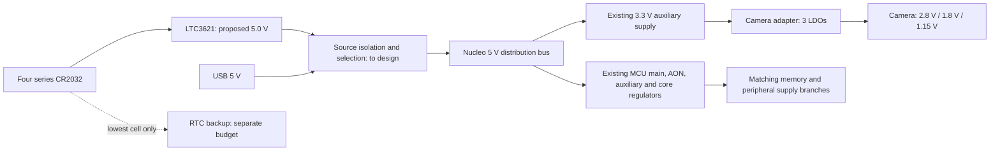

# Power-tree review: Nucleo prototype and compact camera

**October 15 status:** at the user's request, prototype PCB modifications, debugger isolation and related physical rework are paused until the Nucleo board is in hand. Preserve the studies and verification tasks for that point; continue other design decisions now. No hardware change or additional voltage approval is implied.

**Reviewed October 14, 2026. Status: engineering findings and proposals, awaiting the user's voltage/topology decision.** No new output voltage, regulator part, wiring instruction or CAD change is approved by this review. The user redirected the discussion to power fundamentals before prototype wiring. The accepted four-series-CR2032/LTC3621 direction, 50 ms exposure-start deadline, 100 nA main-path OFF target and separately powered RTC remain in force.

Review in order: (1) required rails and their activity through a cycle; (2) LTC3621 output; (3) downstream conversion, sequencing and USB source selection. Discuss one decision at a time. The September [recovered power tree](power-tree.md) and [RUN/HOLD study](../../power.md) remain historical implementation evidence, not a completed design for the selected camera and Nucleo.

## Recommendation for discussion

**October 15 startup follow-up:** the [50 ms rail-startup review](../decisions/50ms-cold-start-review.md#power-and-rail-startup-follow-up--october-15) prioritizes coin-cell sag/inrush and repeated resets, then main/AON/AUX sequencing, camera power/clock overlap and button-to-HOLD continuity. The camera adapter oscillator specifies up to 5 ms startup; start it early where electrically valid. Component typical timings do not establish total board startup. Qualify one clean startup under allowed battery conditions before assigning a rail budget. These findings select no new circuit values or modifications.

**Separate bring-up finding from UM3417 Rev4 §7.4.3:** ST requires unused `VDDSMPS` and `VDDA1V8PMU` to be grounded in external-core-SMPS mode and says the board schematic does not implement that recommendation. Check the delivered board against this requirement before initial power-up/rework. This does not change the debugger-isolation method. [Manual, p20](https://www.st.com/resource/en/user_manual/um3417-stm32n6-nucleo144-board-mb1940-stmicroelectronics.pdf).

**Debugger-isolation follow-up:** the user requested a concrete isolation plan for realistic power measurements. The [debugger study](nucleo-debug-isolation.md) confirms ST's CN12 MCU-rail shunts, identifies D2 as the candidate main debugger-supply disconnect, and maps the remaining signal/sense paths. CN9 source selection and JP3 reset do not provide complete isolation. Separately USB-powered debugging is useful for development measurements; standalone battery qualification requires verified supply and interface separation. Exact pads and delivered-board behavior remain unverified.

**Energy comparison follow-up:** the [battery-energy estimate](power-cost-comparison.md) gives approximately 0.39 J/photo for a standard 5 V board with an illustrative debugger load, 0.25 J with that debugger isolated, 0.22 J for modified 3.3 V and 0.15 J for a custom PCB. These are assumptions, not measurements. Removing the debugger and power LED first reduces the 5 V example to 0.23 J, leaving about a 7% conversion saving versus a similarly stripped 3.3 V board. This supports retaining 5 V for initial bring-up and measuring before more involved supply rework. No voltage choice is newly approved.

**Follow-up on direct 3.3 V, October 14:** the user asked whether the Nucleo could be modified to eliminate the 5 V intermediate supply. A direct 3.3 V architecture appears feasible with rework to both 3.3 V domains; investigate it before freezing the output voltage. The 5 V recommendation below is the convenient baseline using existing regulation, not an intrinsic requirement of the image-capture electronics. Neither output is approved. See the [modification study](#direct-33-v-nucleo-operation--feasibility-study) below.

**Use a 5.0 V LTC3621 output for the NUCLEO-N657X0-Q bench prototype, retaining the Nucleo and camera adapter's existing downstream regulators.** The Nucleo has a 5 V internal distribution bus; feeding a single 3.3 V header does not supply its complete regulator tree. This recommendation concerns architecture, not an approved external-power connection. The board VIN header requires 7–12 V; do not connect the proposed 5 V there. Resolve the bus feed, jumper positions, USB isolation and actual board revision before wiring. [Nucleo manual, Rev 4, pp16–20 and31](https://www.st.com/resource/en/user_manual/um3417-stm32n6-nucleo144-board-mb1940-stmicroelectronics.pdf).

The recommended DC1863A evaluation board uses the **adjustable LTC3621EMS8E#PBF** and has a 5 V selection at JP7. Its 5 V performance row specifies input at least 5.2 V and output up to 1 A. Exact order contents have not been supplied. The older fixed `LTC3621EMS8E-3.3#PBF` study cannot be changed to 5 V by adjusting a feedback divider. Converter ratings do not establish the CR2032 pack's pulse capability. [DC1863A manual, pp1–2 and BOM](https://www.analog.com/media/en/technical-documentation/user-guides/dc1863af.pdf), [LTC3621 datasheet](https://www.analog.com/media/en/technical-documentation/data-sheets/ltc3621-3621-2.pdf).

For a future compact PCB, **3.3 V from LTC3621 is a candidate**, with efficient conversion to 1.8 V and local camera regulation. Direct 1.8 V remains an alternative requiring camera-analog voltage generation plus changes to RTC backup and HOLD interfaces. Neither custom-board choice is selected. Compare measured energy per complete capture, startup time, area and shutdown behavior before choosing; a voltage alone does not determine system efficiency.

## Direct 3.3 V Nucleo operation — feasibility study

The [Nucleo manual, Rev 4, §§7.4 and8.5](https://www.st.com/resource/en/user_manual/um3417-stm32n6-nucleo144-board-mb1940-stmicroelectronics.pdf) documents USB-derived 5 V or VIN 7–12 V supply modes, not a 3.3 V external-source jumper mode. CN5.4 is marked a 3.3 V output. Simply applying 3.3 V there does not power all regulator inputs and can drive an unpowered regulator backwards.

The power architecture has two different 3.3 V domains. Main `VDDIO` must remain valid while auxiliary `VDD3V3` shuts down; shorting them together would defeat sequencing. The following circuit-level modification is an engineering proposal, not verified assembly instructions:

| Existing branch on MB1940 C02 | Proposed treatment with a 3.3 V upstream supply |
|---|---|
| U33, LD39020 3.3 V main regulator | Isolate its output and feed the main domain directly from the external regulated 3.3 V. |
| U34, ST1S31 3.3 V auxiliary buck | Isolate its output and feed the auxiliary domain through a PWR_ON-controlled load switch with suitable discharge. Preserve independent AUX shutdown. |
| U17, TPS62088 core buck | Retain; its supported input range includes 3.3 V. Keep hardware PWR_ON control and the existing core voltage selection. |
| U23, LD39020 1.8 V AON; U26, LD56100 1.8 V AUX | Retain subject to circuit checks. U23 can receive 3.3 V upstream; U26 continues receiving the switched 3.3 V auxiliary rail. |

Component references and domain separation come from the [official MB1940 C02 schematic, sheet9](https://www.st.com/resource/en/schematic_pack/mb1940-n657x0q-c02-schematic.pdf), available in indexed text. R102 and R132 are apparent candidate links around the two 3.3 V outputs; **their exact net placement and suitability for isolation have not been visually verified, so they are not removal instructions**. Prefer confirmed removable links to an irreversible trace cut. Removing a current-measurement bypass alone is insufficient: CN12's measurement paths retain parallel precision shunts, including R112/R111 on VDDIO. Check every remaining path before injection.

Regulator feasibility is supported by [TPS62088: 2.4–5.5 V input](https://www.ti.com/lit/ds/symlink/tps62088.pdf), [LD39020: 1.5–5.5 V input](https://www.st.com/resource/en/datasheet/ld39020.pdf), and [ST1S31: 2.8–5.5 V input with finite minimum off-time](https://www.st.com/resource/en/datasheet/st1s31.pdf). U33 cannot regulate a full 3.3 V from an equal input; U34 likewise cannot guarantee its 3.3 V output at a 3.3 V input. LD39020 also limits VOUT to VIN + 0.3 V in its absolute ratings, reinforcing the need to isolate its output when externally fed. Merely reducing the original 5 V bus to 3.3 V without modifying these branches is not the proposed solution.

A [TPS22918](https://www.ti.com/product/TPS22918) is an example load-switch candidate: 1–5.5 V input, adjustable rise time and output discharge, 53 milliohms typical at 3.3 V; an [evaluation board](https://www.ti.com/tool/TPS22918EVM) exists. This would replace a voltage-conversion function with a controlled connection, adding little voltage drop. It is not selected, and current capacity, ramp/discharge timing and reverse-current behavior must be checked for this application. It does not by itself solve USB isolation. Placing it downstream of LTC3621 means it has no direct battery feed when the main rail is fully off.

Keep USB/ST-LINK raw 5 V isolated from any bus repurposed for 3.3 V, including during debugging. The existing CN9 source jumpers must not reconnect raw 5 V to that modified bus. USB operation would require a regulated/protected path into the new architecture. Retained unused regulators and board features also contribute load; check their enable/feedback behavior rather than leave a disconnected feedback loop active. Preserve AON startup tracking and main hold-up until all AUX/core rails discharge. Actual board revision, disconnect pads, complete load paths and startup/shutdown waveforms remain to verify.

Expected savings depend on load distribution: the core and existing auxiliary 3.3 V stages already use switching converters. A 5-to-3.3 V linear branch has about 66% ideal conversion efficiency, but that ratio is not the efficiency of the entire board. Compare measured energy per capture for the modified arrangement.

**Evidence boundary:** the full schematic exceeded the web reader's size limit and direct HTTPS downloads from ST's global/China hosts did not produce a usable PDF. A community attachment redirected to HTML and was not accepted as schematic evidence. This study combines the manufacturer manual, indexed official schematic text and regulator datasheets. No exact trace cut, complete rework recipe, hardware change or demonstrated operation is claimed.

## Rails and consumers

| Rail / domain | Nominal voltage | Purpose and generation |
|---|---|---|
| Proposed bench input | **5.0 V** | LTC3621 during battery operation; protected USB route in USB mode. Supplies the Nucleo's existing regulator tree. |
| MCU main supply / selected IO domains | **3.3 V or 1.8 V**, bank-dependent | Nucleo generates/configures these locally. Custom MCU VDD may be either; peripheral supply, IO-bank voltage and software configuration must agree. |
| MCU main always-on analog domain | **1.8 V** | `VDDA18AON`, needed to start the MCU and supervise auxiliary power. It remains valid through auxiliary shutdown, but need not stay powered between camera cycles. |
| MCU auxiliary analog / internal-SMPS input when used | **1.8 V** | PLL, CSI analog, ADC/reference and applicable PMU/SMPS pins. Separately controlled from AON. Internal-SMPS input wiring differs from external-core-SMPS mode. |
| MCU core and CSI digital core | **0.81 V**, or **0.89 V** for the higher-performance mode | Nucleo defaults to an external switching regulator. A custom design can use the MCU's internal SMPS and required external passives. This is not the camera's core rail. |
| CAM-6G3-073CLR analog | **2.8 V** | Sensor operating range 2.65–2.95 V. Camera adapter produces this with an LDO from 3.3 V. |
| CAM-6G3-073CLR IO | **1.8 V** | Sensor range 1.7–1.9 V. Adapter provides regulation and host-side level shifting. |
| CAM-6G3-073CLR core | **1.15 V** | Sensor range 1.08–1.26 V. Adapter produces this with an LDO from 3.3 V. Do not inherit the old camera's rail values without review. |
| Alliance candidate image NAND | **1.8 V** | AS5F14G04SND-10LIN range 1.7–1.98 V. Requires a matching IO bank or translators. Candidate/evaluation recommendation, not a frozen production BOM or confirmed receipt. |
| Flash 5 Click alternative test board | **3.3 V** | MIKROE-3780/W25N01GV uses 3.3 V supply and logic. It is not electrically interchangeable with the 1.8 V Alliance device; its 1 Gbit capacity also differs. |
| Boot NOR | **Board-specific; Nucleo flash uses 1.8 V** | Must be available for boot. Historical custom CAD uses 3.3 V NOR; a 1.8 V custom replacement was researched but not selected. Sleeping NOR later depends on execution/memory placement. |
| Accelerometer | **1.8 V candidate** | LIS2DW12 supports this supply/IO level. Required around orientation sampling; verify startup/sample latency and unpowered-bus behavior. |
| RTC main / backup | **3.3 V switched main / approximately one cell on backup** | Retained RV-3028-C8 architecture. Backup survives full main OFF and is budgeted separately. Reconcile the C7 evaluation-board recommendation with actual purchased hardware. |
| Exposure potentiometer | **Within the ADC/reference range, nominally 1.8 V at the MCU** | Feed from an appropriate switched analog supply/reference, not a permanent battery divider. The N6 ADC analog domain is 1.8 V; a 3.3 V GPIO bank does not make a 3.3 V ADC input valid. Check Nucleo header conditioning before selecting a connection. |
| USB PHY | **3.3 V and 1.8 V** | Required for target-USB operation. Nucleo provides these; final gating/isolation is architecture-dependent. |
| Status/error LED | **Drive-dependent; no new rail selected** | Use the board LED for initial bring-up if suitable. Exact external LED/drive is open. Photographic flash remains deferred. |

MCU supply evidence: [DS14791 Rev 11, supply characteristics pp140–143](https://www.st.com/resource/en/datasheet/stm32n657x0.pdf), [AN5967 Rev 6](https://www.st.com/resource/en/application_note/an5967-getting-started-with-hardware-development-for-stm32n6-mcus-stmicroelectronics.pdf). `V08CAP` is an internal-regulator capacitor node, not an additional external distribution rail. Shared 1.8 V designs must satisfy the intersection of all connected loads' tolerances, including USB and SMPS limits, ripple and transients.

Camera evidence: [CAM-6G3-073CLR schematic Rev 2, August 2026](https://www.st.com/resource/en/schematic_pack/cam-6g3-073clr-schematic.pdf), [VD56G3 DS12968 Rev 12, pp6 and31](https://www.st.com/resource/en/datasheet/vd56g3.pdf). The module exposes all three supplies and has no regulators generating them. [STEVAL-CAM-M0I adapter schematic, sheet2](https://www.st.com/resource/en/schematic_pack/steval-cam-m0i-schematic.pdf) supplies them using three LD39050 adjustable LDOs from `P3V3`, and includes a 12 MHz oscillator and interface circuitry.

Peripheral evidence: [Alliance NAND datasheet, p45](https://www.alliancememory.com/wp-content/uploads/AllianceMemory_AS5F_QSPI_NAND_Flash_3V-1Gb-8Gb_1p8V-2Gb-4Gb-8Gb_Ver3.1_O.pdf), [Flash 5 Click documentation](https://www.mikroe.com/flash-5-click), [LIS2DW12 datasheet](https://www.st.com/resource/en/datasheet/lis2dw12.pdf), [RV-3028-C8 application manual, pp45–47](https://www.microcrystal.com/fileadmin/Media/Products/RTC/App.Manual/RV-3028-C8_App-Manual.pdf). With a direct roughly 3 V backup, simply lowering RTC main VDD to 1.8 V can leave it in backup with I2C unavailable. The retained 3.3 V-main arrangement uses Level Switching Mode; exact margins still need verification across cell voltage and tolerances.

## When power is needed

This table describes the desired functional state. Existing evaluation boards may keep regulators, pull-ups, LEDs or interface circuits powered until their upstream rail disappears. Independent gating is not established merely by a sensor reset signal.

| Phase | MCU and boot memory | Camera's three rails | Image NAND | Other loads / source |
|---|---|---|---|---|
| Fully OFF, no USB, button released | Off | Off | Off; retained photos need no supply | Only RTC backup remains active. Main battery path targets 100 nA at room temperature. |
| Button press and cold boot | Main/AON start, then auxiliary/core; boot NOR available | Start and initialize in time for exposure | Power/recover allocation state as required; avoid a new startup delay on the capture path | Read timestamp, orientation and exposure pot. All prerequisites for the saved exposure must fit 50 ms. |
| Exposure and frame readout | Core/RAM/CSI active | All three on | May stay powered for simplicity; no need to read existing image payloads | Keep the source and HOLD valid. |
| Save, optional readback and commit | Core/RAM/storage interface active | No longer needed after the entire frame is safely in RAM and sensor shutdown completes | On through program/status/required commit verification and optional payload readback | Finish status indication and prepare shutdown. |
| Controlled shutdown | Auxiliary supplies discharge first; main/AON held valid until safe | Stop and turn off | Finish/abort consistently with accepted integrity policy, then off | Enter Standby and release HOLD using a circuit that preserves electrical sequencing. |
| Button still held after cycle | Lowest attainable supported state; no new capture | Off or lowest available board state | Off or lowest available board state | Buck remains enabled by button; this is not the 100 nA fully-OFF state. |
| USB photo access | MCU/RAM/storage interface and USB PHY active | Not functionally needed | On for requested read/delete and storage metadata work | USB supplies system; battery buck disabled; shutter inactive; RTC main available. |

For first bring-up, keeping NAND powered throughout an active cycle avoids unnecessary switching and signal-isolation complexity. That is a recommendation, not a frozen separate NAND-gating policy. Camera rails should be shut down after readout when the board/interface permits it; save time does not require the sensor to remain active.

## How the bench rails are generated

The [MB1940 C02 schematic, sheet9](https://www.st.com/resource/en/schematic_pack/mb1940-n657x0q-c02-schematic.pdf) identifies main 3.3 V and AON 1.8 V LDOs, a PWR_ON-controlled external core buck, a PWR_ON-controlled 3.3 V auxiliary buck and a downstream 1.8 V auxiliary LDO. The internal-SMPS option requires a different resistor configuration. The current [Nucleo manual, p20](https://www.st.com/resource/en/user_manual/um3417-stm32n6-nucleo144-board-mb1940-stmicroelectronics.pdf) also flags grounding requirements for unused SMPS/PMU inputs in external mode that existing schematics do not implement; inspect delivered revision/configuration before changes.

Manual CN9 positions select ST-LINK USB, target USB or the VIN regulator. They do not provide automatic USB/battery priority. Indexed schematic text places the common 5 V bus on CN9's even contacts; using that bus is a possible engineering adaptation, **not yet a verified assembly instruction**. The full schematic could not be visually reviewed in this pass, so exact feed wiring remains open. Arduino 3V3/5V pins are documented as outputs. Do not parallel sources, infer reverse isolation from RUN low, or substitute a 5 V feed on the 7–12 V VIN input.

## Compact-board candidate, not selected

One practical custom arrangement to evaluate is:

- LTC3621 produces **3.3 V main** for MCU main logic, RTC main and local branches.
- A separate **1.8 V AON supply** follows MCU main-supply timing requirements, including reaching its POR threshold within 250 microseconds after main VDD reaches its POR threshold.
- A **PWR_ON-controlled 1.8 V auxiliary buck**, with a discharge path, supplies the relevant analog/IO loads and the MCU internal-SMPS input. Exact domain grouping must follow AN5967; AON and AUX cannot simply be the same permanently connected net.
- The MCU internal SMPS produces its **0.81/0.89 V core** supply.
- Camera **2.8 V** comes from a gated LDO off 3.3 V; camera **1.8 V** from the appropriate auxiliary branch; camera **1.15 V** from a suitable LDO off 1.8 V. Regulators, gating and interface isolation remain to select.
- NAND and its MCU IO bank use matching supply/IO domains and compatible startup/shutdown. USB source selection feeds the system while inhibiting the battery path; exact conversion path is open. The USB PHY's 3.3 V supply is an auxiliary domain, so a permanently enabled VBUS-fed regulator cannot be assumed to satisfy MCU sequencing.

Using an efficient buck for a substantial 1.8 V load avoids dissipating the whole 3.3-to-1.8 V drop in an LDO. Small local camera LDOs can still be useful for simplicity and low noise. For scale, VD56G3's 60 fps typical rail currents are 8.5 mA IO, 57 mA core and 22.8 mA analog, about **145 mW delivered to the sensor**. Three LDOs supplied from 3.3 V draw approximately **3.3 V × 88.3 mA = 291 mW**, excluding oscillator, regulator quiescent current and interface losses. This calculated example explains why the evaluation adapter's efficiency should not set the final design; it is not a measured single-shot energy budget. [VD56G3 consumption table, p32](https://www.st.com/resource/en/datasheet/vd56g3.pdf).

## Sequencing and qualification that remain open

1. **MCU startup/shutdown:** main supplies precede auxiliary supplies. During controlled shutdown all auxiliary rails, including core/CSI, must discharge below **0.6 V** while main supplies remain valid. Main/AON also have tracking/timing constraints. PWR_ON enables AUX in hardware before firmware can run. At Standby entry PWR_ON falls and ordinary HOLD releases; hardware must preserve main/AON validity until AUX discharge completes. Firmware cannot wait after entering Standby. Design hold/discharge paths and verify traces at real loads. [AN5967 §§3.4–3.5](https://www.st.com/resource/en/application_note/an5967-getting-started-with-hardware-development-for-stm32n6-mcus-stmicroelectronics.pdf). RM0486's PWR_ON minimum-low-time setting is not a source of main-supply hold-up.
2. **Camera:** hold XSHUTDOWN low while supplies/clock start, then release it after valid. For normal power-down, stop streaming, wait for SW_STANDBY completion, assert XSHUTDOWN low and remove supplies/clock. No inter-rail order is imposed by that sensor sequence. Isolate or park control lines so an unpowered 1.8 V camera is not fed through I2C, reset, GPIO or clock. [VD56G3 pp26–27 and31](https://www.st.com/resource/en/datasheet/vd56g3.pdf). Exact adapter enable-net wiring and independent gating need visual schematic/board verification.
3. **USB and HOLD:** USB must power the camera system with the battery converter disabled, even if the shutter is pressed. Firmware ignoring a press cannot inhibit its physical RUN divider. Prevent reverse current into converter/battery and contention between sources. A 5 V board input does not establish the HOLD GPIO's output voltage; verify the actual bank and diode/threshold margin.
4. **Current and energy:** measure boot inrush, initialization, exposure/readout, save/readback, USB and held-button Standby. Establish cell sag/contact resistance, input capacitance, peak/output-current margins and end-of-life battery thresholds. The earlier 3.3 V/250 mA study is not a bound for this prototype. Keep the specified 50 ms startup goal until measured, rather than asserting compliance from converter soft-start alone.
5. **Leakage:** the LTC3621's typical shutdown current already equals the 100 nA main-path target; its maximum and demo-board extras differ. DC1863A's complete leakage cannot be inferred from the IC alone. Budget and measure every battery-side path; use the Nucleo setup to establish function and timing, and separately qualify an appropriately implemented low-leakage power stage.

No hardware tests or schematic changes were performed. Primary manufacturer documents were checked; some schematic topology was available only through indexed PDF text, as noted above. These are research findings and proposed architecture, not demonstrated electrical compliance.
