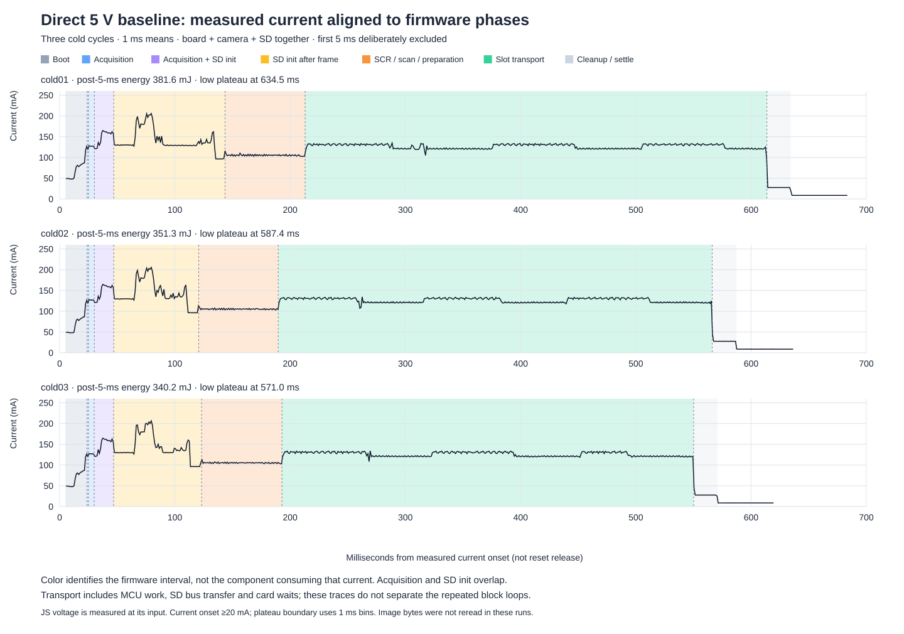
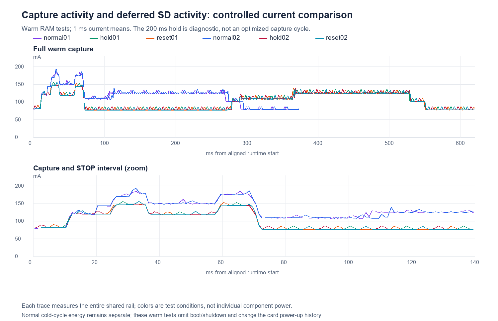
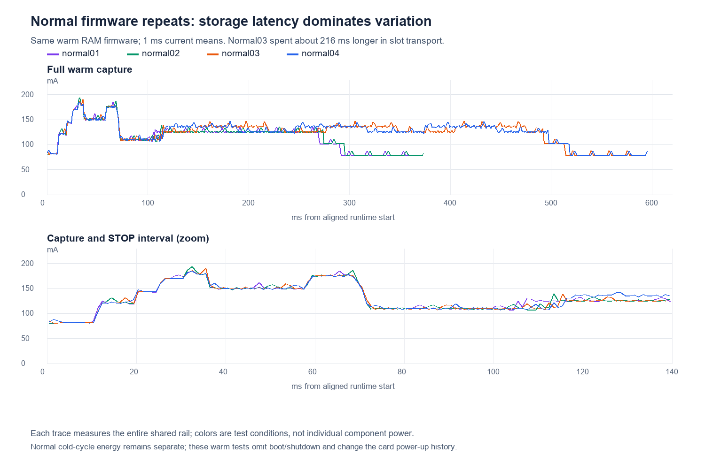
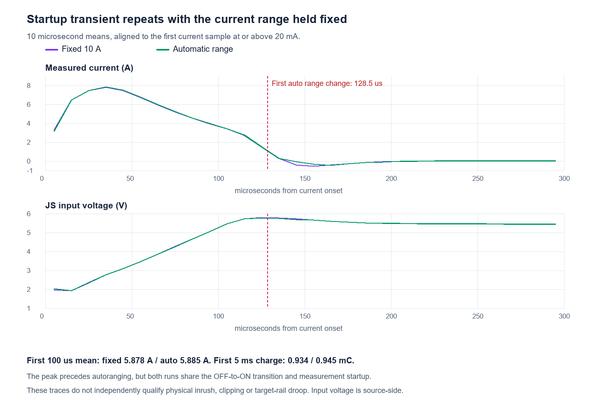
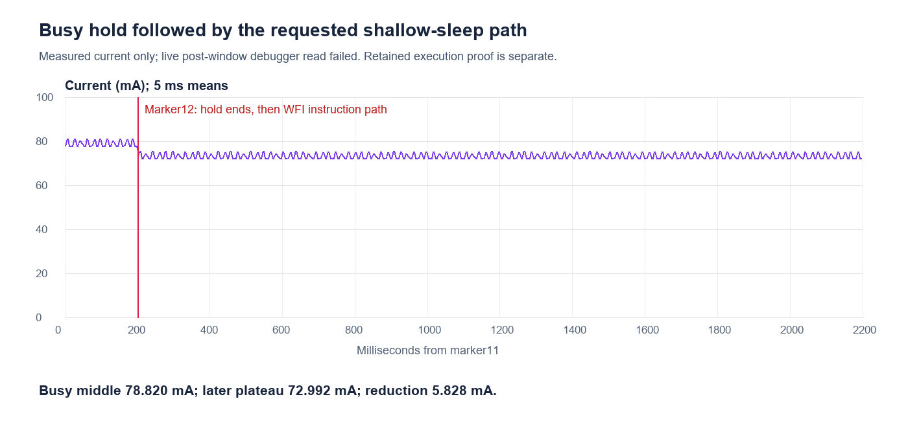

# Aligned power baseline and ablation — October 28, 2026

The dominant measured energy interval is **SD transport, including the whole
board's consumption while transferring and waiting**. Delaying SD activity
reduces the overlapping camera-period current by about 25–32 mA. Resetting an
already-stopped sensor and disabling its receiver save only about 1.63 mA
combined. These measurements do not yet isolate Ethernet or divide the total
into intrinsic MCU power and Nucleo overhead.

## Setup and measurement boundary

Regulated bench 5 V → JS110 → CN5.5; common return CN5.6. CN8 and LTC output
are disconnected; all CN9 shunts absent. CN10 separately powers ST-LINK, with
D2/R23 removed. U24 Ethernet PHY remains fitted. SD uses the selected twisted
CLK/GND pair, CN3.3/CLK, CN3.8/GND, CN3.5/main-VDDIO 3.3 V; no series resistor
or SD signal probes. JS IN0 observes PD12/CN15.21, IN1 observes PD0/CN15.33,
and GPIO ground is CN15.20. This is target-board input power, excluding LTC
conversion and coin-cell behavior. JS voltage is sensed at its input and is
not a direct measurement of the target-side rail during inrush.

The preceding [three cold normal cycles](../2026-10-28-direct5v-gpi/README.md)
provide the cold baseline. This campaign adds twelve successful warm RAM
captures, three selected complete image readbacks, two startup range controls,
one unsuccessful Ethernet-management control and one qualified-limited CPU
sleep-path observation. A final normal cold boot restores ordinary operation.
No NOR programming, card erase, physical rework or production optimization
was performed. Normal flash remains the previously verified error-handler-fix
build; fresh recovery-prefix checks bind that identity.

## Cold baseline: where the energy goes

Three-run means below partition the measured interval without double counting.
The first 5 ms are excluded because their analog behavior remains unqualified.
Full current-onset to low-current-plateau duration is 571–634 ms; energy after
the first 5 ms is 340–382 mJ.

| Interval | Time | Energy | Mean current |
|---|---:|---:|---:|
| After first 5 ms to receiver entry | 18.89 ms | 6.71 mJ | 71.2 mA |
| Receiver entry to strobe observation | 1.14 ms | 0.68 mJ | 121.0 mA |
| Acquisition before SD init starts | 4.99 ms | 3.15 mJ | 127.1 mA |
| Acquisition overlapping SD init | 16.87 ms | 12.48 mJ | 148.9 mA |
| After frame IRQ while SD init continues | 82.18 ms | 57.70 mJ | 141.6 mA |
| SCR, slot scan and write preparation | 69.44 ms | 36.38 mJ | 105.3 mA |
| SD slot transport: transfers and card waits | 377.94 ms | 237.53 mJ | 126.4 mA |
| Commit, storage deinit and final cleanup | 0.26 ms | 0.13 mJ | — |
| Pre-WFI marker to low-current plateau | 20.90 ms | 2.90 mJ | 27.8 mA |

Slot transport accounts for about two-thirds of this energy. That is an
interval attribution, **not a measurement of the SD card alone**. The CPU,
regulators, retained peripherals and board loads are included. The later
plateau is approximately 8.7 mA with input power still applied.

## Controlled changes and what they establish

| Experiment | Measured result | Interpretation |
|---|---|---|
| Defer the first SD command until frame completion and acknowledged sensor STOP | Camera-period average falls about 25–32 mA; peak 1 ms windows fall from approximately 190–200 to 148–156 mA | Overlapping SD activity materially increases peak load. This includes host/controller/card activity; it is not a card-only rail measurement. |
| Matched 200 ms post-STOP hold, two repeats | Middle hold averages 79.162 mA | Reference for the following two interventions; an artificial diagnostic wait, not proposed production behavior. |
| Assert sensor reset during the same hold, two repeats | 78.370 mA: **0.791 mA saved** | Small incremental benefit after an already acknowledged STOP, not the active sensor's consumption. |
| Also disable CSI/PHY operation, two repeats | 77.529 mA: **another 0.841 mA saved** | Combined saving 1.632 mA. Register/kernel clocks remain available; this is not complete peripheral clock gating. |
| Initialize SD before sensor START | Warm run 270.67 ms / 175.94 mJ versus early controls 269.61–274.00 ms / 172.99–175.74 mJ | Mostly shifts timing; no convincing energy improvement. |
| Increase exposure about tenfold to 109.8 ms | 379.50 ms / 271.18 mJ warm run | Also switches the writer from full-buffer IDMA to progressive partial-buffer PIO. This is not a clean exposure-only energy delta. |
| Replace a post-save busy loop with shallow WFI preparation | External current falls **78.82 → 72.99 mA**, about 5.83 mA / 28.94 mW | Sleep-path observation only: live status read failed, so no independently verified WFI PC or unchanged-register proof. See recovery limits below. |
| Ethernet MDIO control | No PHY acknowledgment; abort before any BMCR write or SD command | **No Ethernet power-down saving measured.** |

Camera-related high-current bands remain before any SD command in the deferred
tests, around 26–36 and 60–70 ms after receiver entry. The sensor STOP completes
near 72 ms. This supports testing earlier sensor shutdown after a validated
frame, but does not establish that an immediate hard reset is safe or that all
of those bands are sensor current. No such optimization was installed.

## SD variability is larger than the small component deltas

The identical normal RAM binary, same 3,730-sector payload and full-buffer IDMA
mode produced these results:

| Normal repeat | Slot transport | Transport energy | Whole measured warm interval |
|---|---:|---:|---:|
| normal01 | 164.52 ms | 103.42 mJ | 269.61 ms / 172.99 mJ |
| normal02 | 164.16 ms | 103.40 mJ | 274.00 ms / 175.74 mJ |
| normal03 | 380.63 ms | 251.02 mJ | 492.44 ms / 324.52 mJ |
| normal04 | 383.87 ms | 252.47 mJ | 496.93 ms / 326.54 mJ |

The source of the card's slower write state is unresolved. No automatic retry
or clock reduction hides it. Increasing occupied-slot scan length accounts
for only several milliseconds, not the approximately 216 ms transport change.
The scan itself costs about 73–81 ms in these normal runs, growing with used
slots. A validated next-slot hint remains a worthwhile separate optimization.

Warm runs exclude the cold bootstrap and normal shutdown and begin with
different card history. Never compare their total energy directly with the
cold baseline or attribute one long run to a small experimental change.

## Initial transient: fixed range versus automatic range

Both normal cold controls show the large recorded peak: about 7.87 A at 35.0 µs
with fixed 10 A range and 7.90 A at 35.5 µs with automatic ranging. Both occur on
raw range code 0 (10 A). The automatic recording first changes range at
128.5 µs, after the peak. First-5-ms charge is 0.934 and 0.945 mC; raw integrated
energy is 3.676 and 3.731 mJ.

Subsequent autoranging alone therefore cannot explain the peak. However, both
recordings retain negative-current/source-voltage transients, and the common
output-switch/measurement startup response has not been independently checked.
**Physical inrush magnitude and clipping remain unqualified.** These raw
integrals are not promoted into qualified whole-cycle energy. The direct hard
5 V turn-on also differs from LTC soft start and cannot be transplanted to the
battery-side trace. The recorded event is only a few millijoules, versus
hundreds of millijoules in sustained capture/save.

SDK range/suppression interpretation is recorded with source references in
the startup analysis. Raw range codes differ from the range-select command
values; the configured OFF-to-10-A interpolation spans roughly 4 µs, before
the approximately 35 µs peak.

## Integrity, exclusions and recovery

All twelve successful warm captures report complete frame/save and clean
storage cleanup. Slots **111 (sensor reset), 116 (receiver off), and 109 (long
exposure)** were independently read in full at 25 MHz, all 3,730 sectors each.
Every image byte matched its original camera RAM; PNG sample reconstruction
also passed. The sensor-reset preview was visually inspected and contains a
recognizable lit scene. Other captures are completion-proof results, not
independent source/readback equality claims. Image pixels remain in ignored
local storage rather than the public evidence archive.

The Ethernet control preserves failure 0x509, zero sectors written, zero PHY
register-write attempts, restored GPIO/RCC configuration, no CPU fault and
matching code. PF4/MDIO, PG11/MDC and address zero were checked against the
[Nucleo C02 schematic](https://www.st.com/resource/en/schematic_pack/mb1940-n657x0q-c02-schematic.pdf).
Future diagnosis should verify pad levels and read PHY IDs before attempting
[LAN8742 power-down](https://www.microchip.com/content/dam/mchp/documents/OTH/ProductDocuments/DataSheets/DS_LAN8742_00001989A.pdf).

The CPU diagnostic masked interrupts before both comparison intervals, then
emitted markers 11/12 around its 200 ms busy hold. This prevented the installed
UART interrupt listener from providing a software reset. The later debugger
read could not identify the core; AP1 and AP0 warm-reset recovery attempts did
not produce a verified early park. Their failure logs are retained. A measured
15-second power-off/on with the UART stimulus restored the exact installed
early recovery park, with nine good pulses and zero bad. Retained sleep proof
was deliberately abandoned. The observed lower plateau is useful evidence,
but is not a completed internally verified sleep qualification or total MCU
power measurement. No storage work was active in the diagnostic.

## Reproducibility and next priorities

Raw analog/GPI/range files remain under
`tmp/bringup/power-ablation-20261028`; per-run hashes and native sample IDs bind
them. This compact archive contains operations, proofs, counters, analysis,
plots and frozen RAM builds. `manifest.json` checks every archived file.
Analysis scripts retain their original working-path assumptions; restore the
working layout to replay against the local raw streams. `build-snapshots.zip`
contains exact generated sources/binaries. The separate sleep stub is retained.

All scoped measurement windows are finite/contiguous and raw hashes match.
The original 71 initial NaN current samples remain explicit. Analog channels
are aligned by native sample ID, not file index; the final unspecified packed
GPIO tail is excluded. Counter boundaries are mapped between GPIO anchors;
sub-microsecond precision is not claimed. Legacy phase 7 occurs after transport
in the magic-slot path despite its older `padded_payload_ready` name.
204 capture tests and the separate MDIO framing checks passed; disabled probe
builds match the earlier normal binary byte for byte.

Recommended next priorities, not changes adopted here:

1. Resolve Ethernet management or measure its supply separately; its overhead
   remains unquantified.
2. Separate SD transfer from card-busy time and test CPU sleep during the waits,
   retaining a working recovery interrupt and matching card state.
3. Test earlier sensor/receiver shutdown after frame validity is established.
4. Reduce allocation scan cost with a validated hint.
5. Measure individual rails and conversion losses before claiming a precise
   custom-board saving or sizing the coin-cell energy reservoir.

Final live state and settings restoration are recorded in `support/final-state.json`
and the latest repository bench checkpoint. No experiment is promoted into
normal flash by this report.
