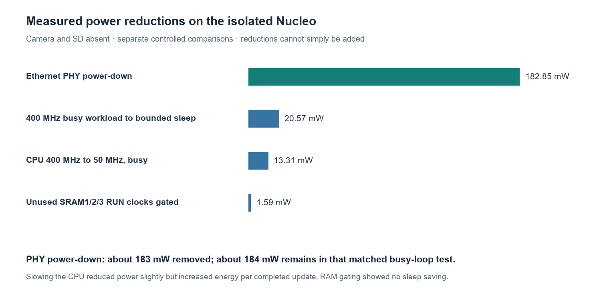
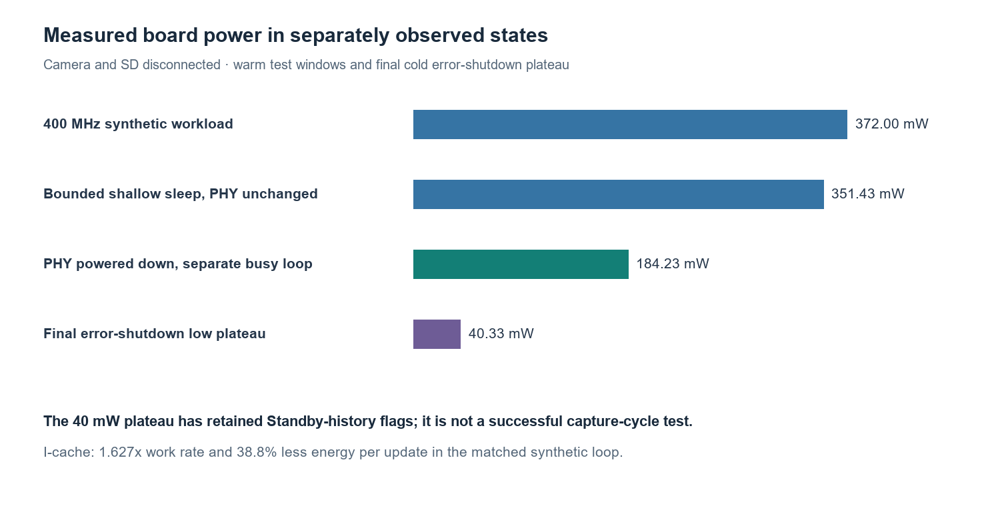
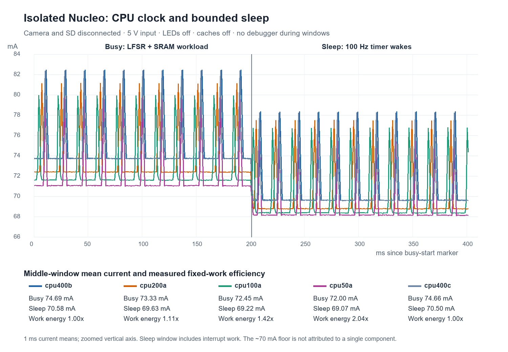
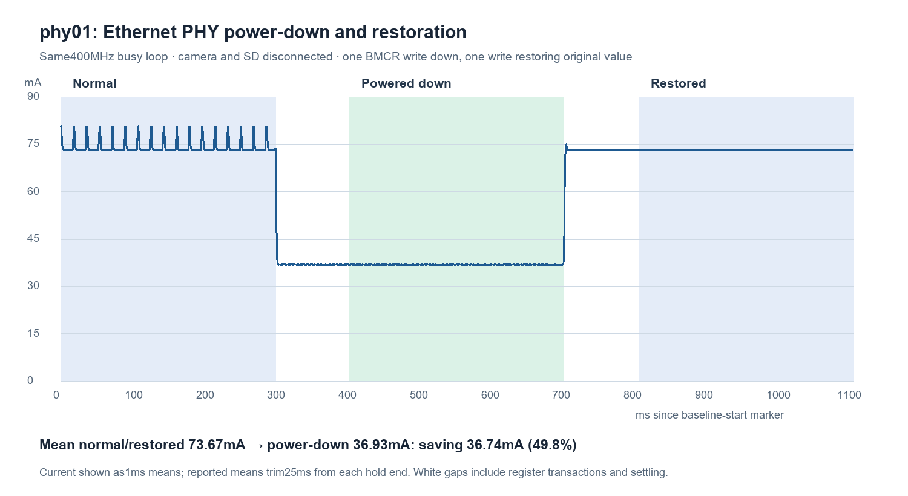

# Isolated Nucleo power measurements — October 28, 2026

**Largest measured opportunity: Ethernet PHY power-down saves about 36.76 mA
at the 5 V board input, or 182.85 mW.** It approximately halves this isolated
board's awake demand. CPU-only clock division is a much smaller lever in the
tested configuration. Instruction caching substantially improves useful work
per joule without a material current increase.

Camera and SD were physically disconnected by the user. All measurements are
at regulated bench 5 V → JS110 → CN5.5; common return is CN5.6. CN8 and the LTC
output are disconnected, all CN9 shunts absent, D2/R23 removed, CN10 separately
powers ST-LINK. U24 Ethernet remains fitted. The JS GPIOs are IN0←CN15.21/PD12,
IN1←CN15.33/PD0, GPIO ground←CN15.20. The supply read about 4.98–4.99 V.
These are **whole-board input measurements**, not MCU-die measurements or a
complete capture/save energy budget. Debug signal/sense paths remain attached.

## Measured states

| State / controlled change | Mean board current | Mean board power | Interpretation |
|---|---:|---:|---|
| 400 MHz integer/SRAM workload, two controls | 74.66–74.69 mA | 371.93–372.06 mW | Current project's CPU frequency; not the chip's maximum rated frequency |
| 400 MHz shallow WFI, 100 Hz timer wake | 70.50–70.58 mA | 351.24–351.62 mW | Same peripheral/rail configuration; finite wake verified |
| 200 MHz workload / shallow sleep | 73.33 / 69.63 mA | 365.27 / 346.90 mW | CPU divider only |
| 100 MHz workload / shallow sleep | 72.45 / 69.22 mA | 360.93 / 344.88 mW | CPU divider only |
| 50 MHz workload / shallow sleep | 72.00 / 69.07 mA | 358.69 / 344.11 mW | CPU divider only |
| Ethernet test, normal PHY | 74.08–74.18 mA | 369.03–369.48 mW | Separate fixed 400 MHz polling workload |
| Same test, PHY powered down | 36.933 mA | 184.22–184.23 mW | Two successful normal/down/restored trials |
| Same test, PHY restored | 73.25–73.26 mA | 364.87–364.94 mW | Control register/IDs restored; periodic bursts had not yet resumed |
| Unused SRAM1/2/3 RUN clocks gated | 0.317 mA reduction | 1.592 mW reduction | Mean surrounding same-binary controls; no demonstrated sleep saving |
| Deep shutdown after missing-camera error | 8.0766 mA | 40.3322 mW | Finite two-second plateau, then warm recovery and SBF=1/PDDS=1/STOPF=0 |

The exact windows, powers, energies and proofs are in
[the consolidated analysis](analysis/consolidated-analysis.txt). Power is averaged
from the native power stream, not calculated by multiplying independent mean
current and voltage values. The savings above are separate controls and must
not be added as if a combined configuration had been measured.

## Ethernet is the first firmware change to qualify in the camera

The LAN8742 at address 0 returned IDs `0007/C131`. Each of two trials changed
only BMCR `3000` → `3800` (power-down bit 11), measured the same 300 ms workload,
then restored `3000` and verified IDs/registers/pins/clocks. Relative to the mean
of surrounding controls, the reductions were 182.75 and 182.95 mW, averaging
182.85 mW. Approximately 18 ms-spaced current bursts disappeared during
power-down. This implicates Ethernet activity; no Ethernet line waveform was
captured, so the exact packet/pulse mechanism is not proved.

Restoration returned the DC level but not the original burst pattern within
the short post-restore window. Original-versus-down alone gives approximately
185 mW, whereas the surrounding-control average gives 183 mW. Retain this
distinction rather than claiming identical before/after waveforms.

The earlier MDIO reader sampled after the rising MDC edge and obtained the
next bit. Sampling before that edge returned the correct IDs. The experimental
`firmware/capture-raw/power_phy.inc` is now fixed, and an actual-clock regression
test deliberately reproduces the old failure. Thirteen relevant tests pass and
both RAM Ethernet profiles compile. **This is not installed in normal NOR**;
camera/SD must be reconnected for a complete capture/readback/energy comparison.
PHY power-down must be re-applied after reset.

Microchip documents BMCR power-down and MDIO timing in the
[LAN8742 datasheet](https://www.microchip.com/content/dam/mchp/documents/OTH/ProductDocuments/DataSheets/DS_LAN8742_00001989A.pdf).
The measured difference includes changes in upstream conversion losses and
possibly the MCU's response to the PHY clock; it is not a direct PHY-rail power
measurement.

## CPU speed, sleep and cache

All successful CPU probes independently verify the final instruction state,
timer wake, complete executable readback, stable result record, no CPU fault,
and restoration of the complete recorded RCC inventory. The deterministic
workload checksums were independently replayed for all eleven successful runs.
The CPU's frequency changes through IC1; PLL1, buses, peripheral clocks and
voltage settings remain unchanged. This is **not** a complete low-frequency
voltage/PLL/fabric optimization.

400 → 50 MHz reduced active current by only 2.68 mA (13.31 mW). For the same
workload, it cost **2.035 times as much board energy per completed update**:
the lower power did not compensate for the longer execution time. Shallow
sleep reduced the 400 MHz workload draw by 4.14 mA (20.57 mW), while other clocks,
rails and Ethernet remained active. It is useful while waiting, but is far from
the approximately 8.08 mA deep shutdown state.

I-cache was tested with the **same v6 binary** in off/on/off order. The two
controls each completed 349,440 updates in about 200 ms; cache-on completed
569,088, about 63% more. Current stayed approximately 74.3–74.5 mA. The resulting
energy per completed update fell **38.76%**, from 0.213608 to 0.130810 µJ.
D-cache stayed off, and I-cache was
disabled/invalidated before final verification. This is a synthetic RAM workload,
not a demonstrated 39% reduction in image-save energy. The normal runtime's
cache policy and actual bottlenecks must be checked before applying it.

Uncached code placement itself changes throughput: compare clock/cache choices
within a frozen binary, not across v4/v5/v6. SRAM gating saved only 1.6 mW under
load, with no demonstrated sleep saving. This gates clocks; it does not remove
SRAM retention power.

## What a Nucleo modification or custom PCB could additionally save

| Candidate | Evidence / scale | Recommendation |
|---|---|---|
| Omit/remove U24 Ethernet PHY | Software power-down already removes about 183 mW in this configuration. Physical removal may also remove residual power-down load and pre-firmware startup consumption; neither additional saving is measured. U24 is the PHY itself, not a regulator. | Qualify software power-down first; omit Ethernet on the custom camera. Do not add the catalog active-power number to the measured saving. |
| More efficient main 3.3 V and auxiliary 1.8 V generation | U33 dissipates roughly `1.7 V × main-rail current`; U26 roughly `1.5 V × auxiliary-1.8-V current`; U23 roughly `3.2 V × AON-rail current`. Actual branch currents are not yet measured. | Best next hardware attribution measurement. Required rails cannot simply be disabled while running. |
| Debug voltage-sense dividers | Resistor calculation: approximately 0.496 mA at board input, 2.48 mW, before leakage. | Small saving; loses voltage sensing. D2/R23 savings are already present. |
| ADC buffer amplifiers U7/U8/U9 | Six channels, about 0.30 mW at the chips / 0.55 mW upstream of their LDO, before buck losses. | Low priority; removal affects Arduino analog/slider paths. |
| Boot NOR deep power-down | BOM part's typical standby-to-deep difference is tens of microwatts at the chip. Actual silicon identity and wake behavior still need qualification. | Low priority once NOR is idle. Preserve boot/recovery. |
| Regulator quiescent current / unused regulator removal | U14 already disabled; U25 unpowered in this hookup. Core U17 is the low-IQ non-A TPS62088, not the forced-PWM A variant. | Avoid counting loads that are already absent. Load-dependent conversion losses matter more than catalog no-load bias. |
| Input capacitance / soft start | C14 is nominal 220 µF on target 5 V: ideal constant-C charge 1.10 mC and stored energy 2.75 mJ. Effective capacitance is voltage-dependent. | Relevant to startup peaks, not the sustained 70 mA floor. Prefer controlled soft-start experiments over removing bulk capacitance blindly. |

These component figures are estimates, distinct from the measured controls.
See [the sourced board-load audit](analysis/board-load-research.txt) and
[board controls](mdio/board-loads.md). Primary circuit sources are the
[ST C02 schematic](https://www.st.com/resource/en/schematic_pack/mb1940-n657x0q-c02-schematic.pdf),
[LD39020](https://www.st.com/resource/en/datasheet/ld39020.pdf),
[LD56100](https://www.st.com/resource/en/datasheet/ld56100.pdf),
[TPS62088](https://www.ti.com/lit/ds/symlink/tps62088.pdf), and
[TSZ122](https://www.st.com/resource/en/datasheet/tsz122.pdf) datasheets.

We cannot yet label the remaining approximately 37 mA with Ethernet down as
"intrinsic STM32 current": it still includes the MCU, board regulators, memory,
passive loads and peripherals. Rail-current measurements are needed to put a
credible number on the custom-board floor. Nor does this isolated-board result
show that four CR2032 cells can directly support a complete camera/SD cycle.

## Qualification, failed controls and recovery

- Raw analog/GPI channels use native sample IDs at 2 MSPS. Middle comparison
  windows discard 25 ms from each end; PHY windows additionally follow 100 ms
  settling. Retained initial 71 NaN current samples make whole-session validity
  false; the reported windows independently pass finite/contiguous checks.
- No debugger polling occurs during measured workload/sleep/PHY windows. Each
  sleep probe wakes on its own and returns to an awake verified park.
- An initial high-SRAM diagnostic load failed before execution. A known cold
  UART recovery and the existing SRAM bootstrap bridge restored operation.
  A subsequent host filename collision was repaired with recorded provenance.
- v1 refused a disabled pending TCM_ECC interrupt; its origin remains unresolved.
  v3 refused missing inherited sleep-clock permissions. v4 explicitly sets and
  restores the required SRAM/RIF/bus/BSEC permissions. These early refusals are
  not successful sleep measurements or proof of memory health.
- The cache-on firmware completed correctly, but the initial host validator
  used Cortex-M7 cache-bit positions. Cortex-M55 has I-cache at bit 17 and
  D-cache at bit 16. The host-only correction passed negative regression tests;
  a fresh live read verified completion/code/context. Original failure records
  remain, joined to the original preparation by nonce and exact proof equality.
- The previous report's explanation of UART recovery failure as a disabled
  firmware IRQ listener was unsupported. Existing recovery uses observed
  ST-LINK BREAK/reset behavior and the early polled C0 detector. See the separate
  [interpretation correction](../2026-10-28-aligned-ablation/CORRECTION.md).
- The final unchanged-flash missing-camera boot reached a low plateau after its
  error sequence. Warm UART recovery passed nine good/zero bad pulses, then the
  guarded reader observed SBF=1, PDDS=1, STOPF=0 without writing CPUCR or cycling
  power. Its generic `trial_entry_proven:false` is retained: no live pre-entry
  flag-clear trace was captured. The recorded cold-cycle history, frozen error
  path's CSSF write and later flag observation support the Standby interpretation.

## Final bench state and evidence

**At 19:15:18 UTC, JS output was intentionally disabled (`range/select=0`).**
Normal NOR firmware is unchanged, no SD or NOR writes occurred, camera/SD remain
disconnected, COM8 is closed/BREAK released, and no bench helper remains active.
Other JS settings were restored. The last proven target state before output-off
was the exact normal UART recovery park; output-disabled is not proof that all
target rails are zero through attached debugger signal paths.

The archive preserves frozen test source/binaries, register/readback proofs,
host operations, analysis and raw-recording hashes. Large native streams remain
under ignored `tmp/bringup/nucleo-isolated-20261028/`; no private images were
captured here. `manifest.json` binds compact file bytes; `.gitattributes`
prevents text normalization. `chunks.jsonl.gz` preserves exact chunk metadata.
Scripts retain their original workspace/toolchain/SDK assumptions; this is an
evidence archive, not a self-contained hardware-control distribution.

Recommendation: qualify Ethernet power-down in the complete camera first,
then compare caching/idle policies by total capture/save energy and verify
images. Measure the main 3.3 V and auxiliary 1.8 V branch currents before any
regulator or supply-tree rework.
