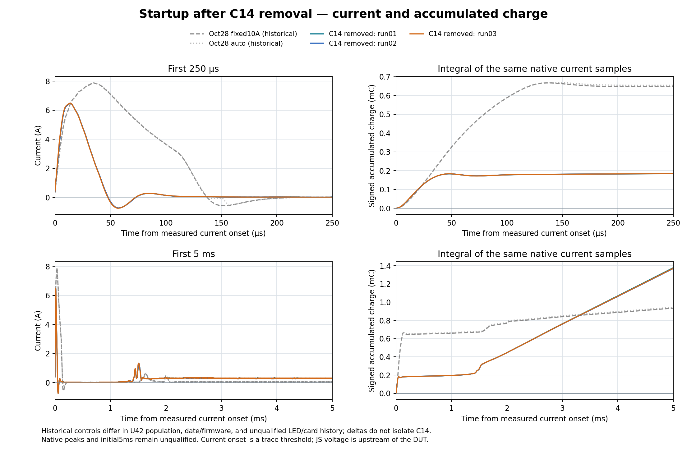
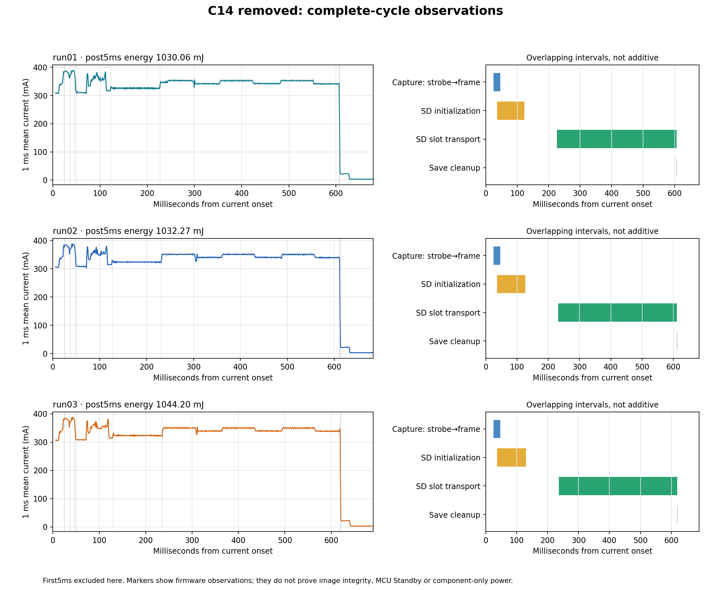

# C14 removal: three cold captures and startup current — November 5

The three measured cold starts reproduce a **6.48–6.49 A sampled peak**, versus
7.87 A in the October 28 fixed-range reference. The first 250 us draw about
**0.184 mC**, versus 0.648 mC: approximately **72% less charge**. This is chiefly
a shorter surge; a substantial instantaneous peak remains.

**An unresolved finding is higher sustained active current.** The new cycles
average about 331–332 mA after the first 5 ms and consume 1.03–1.04 J before the
low-current plateau. Do not describe C14 removal as a demonstrated whole-cycle
energy saving. The comparison is historical, not a matched one-component A/B.

## Setup and measurement boundary

User-confirmed C14 removal and CN10 reconnection; U42, D2/R23 and the SD carrier
LED were already removed. Direct regulated bench 5 V through JS110 to CN5.5,
return CN5.6; no LiPo/LTC source change was reported. Source measured 4.995 V at
the initial 3.203 mA plateau. CN8 remains disconnected and CN9 shunts absent
under the established hookup. Twisted SD CLK/GND remains CN3.3/8 and SD supply
CN3.5. No physical changes were made by the agent.

The JS GUI initially owned the instrument; the user closed it normally. Root
then used APIs exclusively. Each cold run began from freshly checked exact UART
recovery, had 15 s output-off with near-zero measured input current, and used
fixed 10 A range at 2 MS/s. Settings were restored and the device closed after
each run. Off current alone does not prove every target rail discharged.

The observed GPIO roles are **IN1 = PD12 phase protocol; IN0 = PD0 exposure IRQ
mirror**, reversed from the earlier documented connection. All three recordings
contain one unique valid eleven-phase train on IN1 and one bounded 10.9845 ms
exposure envelope on IN0. Separate remapped analyses preserve the original raw
stream identities and original failed-default-mapping analysis. No rewiring or
instrument setting substitution was made.

## Results

| Quantity | October 28 fixed-range reference | Run 1 | Run 2 | Run 3 |
|---|---:|---:|---:|---:|
| Sampled peak, A | 7.8726 | 6.4801 | 6.4817 | 6.4894 |
| Peak after current onset, us | 35.0 | 14.0 | 14.0 | 13.5 |
| Net charge, first 250 us, mC | 0.64764 | 0.18356 | 0.18385 | 0.18374 |
| Time above 5 A in first 5 ms, us | 69.5 | 18.0 | 18.0 | 18.5 |
| Net charge, first 5 ms, mC | 0.93442 | 1.37763 | 1.36896 | 1.37176 |
| First exposure IRQ after current onset, ms | 24.880 | 24.452 | 25.011 | 24.858 |
| Onset to low-current plateau, ms | 609.391 | 628.699 | 632.964 | 640.235 |
| Energy after first 5 ms to plateau, mJ | 364.410 | 1030.065 | 1032.273 | 1044.198 |

The newer curves show a separate load beginning around 1.5 ms, followed by
roughly 0.31–0.38 A during active operation. Consequently their accumulated
charge overtakes the old reference by about 3.3 ms despite the smaller initial
impulse. A preliminary warm capture also reported an optional Ethernet
power-down warning (error 7), not a successful PHY power-down. That warning is
evidence to investigate, not an explanation for the entire extra load.

The closer October 28 single-frame control has almost identical cycle duration
(628.292 ms) and 266.061 mJ post-5-ms energy, versus run 1's 628.699 ms and
1030.065 mJ. In the 5–10 ms window, old current was 48.912 mA versus
305.812–308.388 mA now: the difference already exists before the first receiver
phase marker. Full physical NOR readback later matched the selected normal
64 KiB image exactly, excluding a changed boot image in that region.
Final warm recovery measured 75.594 mA versus earlier 331.5/394.5 mA parks;
warm recovery power state is variable and is not an isolated MCU measurement.

Native startup extrema include ringing and negative samples; physical peak
accuracy and switch response have not been independently checked with a scope.
Voltage is measured upstream of the JS switch/shunt, not at the Nucleo rail.
Fixed range avoids autoranging transitions during these peaks but does not
remove those limits. The old recording differs in U42 population, date,
firmware and potentially supply/wire/card history. The percentage deltas are
descriptive and do not isolate C14 as the only changed variable.

## Image and shutdown verification

One separate, previously qualified warm RAM capture found first FREE slot 155
by scanning all 156 headers and saved 3,730 sectors. Its original camera RAM was
downloaded, but this preliminary older explicit-STOP path is not included in
the three cold timing/energy results. Fresh SCR and card identity were retained;
headers 156, 157 and 158 were independently confirmed FREE before the cold runs.

All three cold images, slots **156/157/158**, passed full **3,730-sector** reads
at 25 MHz (11,190 sectors in total), GXR2/GXRE marker validation and independent
RAW10-to-16-bit-PNG sample comparison. Root viewed all three PNGs: each contains
a recognizable monitor/bench scene without apparent transport corruption.
Samples span 63–1023 in each image; mean values are recorded in the individual
readback validations. Every bounded read returned successful idle/cleanup,
unchanged card identity and the exact qualified reader executable.

The cold captures enter Standby and lose their source RAM. These results prove
complete readable saved objects and correct host decoding, not original-camera-
RAM byte equality, cryptographic payload integrity or power-loss tolerance.

All three subsequent UART recoveries passed exact prefix/context verification.
After the third cycle, a guarded read found SBF=1, PDDS=1 and STOPF=0 without
clearing flags or changing power. The reader retains `trial_entry_proven:false`:
it did not independently prove a pre-entry flag clear for that particular run.

## Resistor precharge versus a controlled ramp

The user's proposed resistor in parallel with a high-side MOSFET bypass is a
valid precharge topology, downstream of a separate power-disconnect switch.
With nominal remaining direct-5-V capacitance of 54 uF, an unloaded 10 ohm
resistor limits initial current to 0.5 A and reaches 99% of 5 V in about 2.49 ms.
The resistor must support the short pulse; a larger resistor lowers the peak
but increases voltage drop once regulators and other loads start.

Do not wait for application firmware to bypass a resistor that can prevent the
MCU from booting. Abrupt bypass with substantial voltage still across the
resistor can create another surge. Source-powered timing/voltage sensing or a
controlled MOSFET transition is needed. The resistor path alone is not an OFF
switch.

An adjustable-ramp load switch is the preferred next prototype experiment.
For a roughly linear 0-to-5-V ramp over 2 ms, 54 uF alone draws about 135 mA;
operating loads and downstream converter charging add to that. This is an
estimate, not a measured limit. [TI's inrush guidance](https://www.ti.com/lit/an/slva670a/slva670a.pdf)
and the [TPS22918](https://www.ti.com/product/TPS22918) illustrate this approach.
The latter is an example for the 5 V bench path, not a selected production
part: its typical 0.5 uA shutdown current alone exceeds the earlier 0.1 uA
main-path target, and it provides slew control rather than a hard current limit.
Required STM32 rail sequencing and core-regulator rise time must still hold;
slowing the 5 V input is not permission to slow VDDCORE arbitrarily.
[ST AN6000](https://www.st.com/resource/en/application_note/an6000-how-to-build-the-discrete-power-supply-for-stm32n6-mcus-stmicroelectronics.pdf)

No resistor, MOSFET or load switch was installed or selected in this campaign.
Other required local regulator capacitors were retained. Actual biased
capacitance, rail droop, shutdown sequencing and reduced-input-voltage operation
remain unqualified by these tests.

## Evidence and final state

Working campaign: `tmp/bringup/inrush-20261105/c14-removed/`. Native streams and
private image bytes remain local; compact proofs, chart data, hashes and source
copies are archived here. No card erase/deletion or NOR programming occurred.
Final state at **2026-11-06 04:53:26 UTC (November 5 local)**: JS output is
intentionally **OFF**, input current reads zero, and source voltage is 4.996 V.
This does not prove every target rail is zero through the separately powered
debugger. All other changed instrument settings were restored; JS closed,
COM8 closed/BREAK released, and no bench helper remains active.

Immediately before OFF, exact normal UART recovery passed again. Physical NOR
sector 0 (64 KiB) matched SHA256
`79a379470927135bc03841098fe070912cad8275e91c5d5985cc066c294cf64e`;
prefix is `6378483a91b560ffc6b31d74a9dd1205996a14c8030447ffddf7deddc9d23874`.
The installed October 28 single-frame/Ethernet-down/SD25MHz/error-engine/UART
recovery build is unchanged and will run on the next normal power cycle. The
offline DMA-sleep candidate was not executed or installed. No NOR erase/program
or SD erase/deletion occurred. The final target is not left executing a reader.

See [final-state.json](final-state.json), [archive inventory](archive-manifest.json)
and SHA256SUMS. The inventory excludes private image and native waveform bytes
while retaining their hashes and local paths. Recheck ownership and actual
wiring before enabling output for subsequent work.
