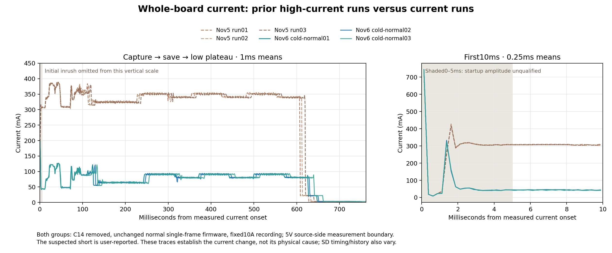

# Extra active current absent after suspected short correction — November 6

The additional approximately250mA is absent in three new cold cycles with the
**same installed firmware and C14 still removed**. During this campaign the
user reported that an inadvertent short may have been fixed. That is the leading
physical explanation, not a proven fault location or controlled repair A/B.
No firmware power optimization accounts for this reduction.

## Three normal cold cycles

All runs used direct regulated5V through JS110 to CN5.5, returnCN5.6, fixed10A
range and native2MS/s acquisition, with15s off/near-zero current before startup.
All eleven phase markers, one exposure envelope, successful commit, SD deinit
and pre-Standby WFI were observed each time. IN1 carries the phase protocol;
IN0 carries the exposure IRQ mirror. Raw stream names are preserved.

| Run | Onset to low plateau, ms | Mean current, mA | Energy, mJ | First exposure, ms |
|---|---:|---:|---:|---:|
| 1 | 647.822 | 80.033 | 256.557 | 24.751 |
| 2 | 651.425 | 79.654 | 256.772 | 25.111 |
| 3 | 661.443 | 79.693 | 260.894 | 25.158 |

Current and energy above cover **5ms after current onset through the low
plateau**, excluding the unqualified initial surge. Prior abnormal C14-removed
runs measured330.8–332.4mA and1030–1044mJ over analogous windows. SD timing and
slot scanning vary; this is a measured disappearance of the large offset,
not a matched per-component energy attribution. Current onset is not power-good.

## Controls and register observations

- Cold power-on directly into exact UART recovery, without camera/SD init,
  measured approximately75mA. A second native-recorded cold recovery remained
  approximately75mA on fixed10A range.
- At unchanged recovery execution, EXTIO0→3300→0 and auto→fixed10A→auto gave
  74.60–75.10mA. This did not reproduce an extra250mA; it does not calibrate
  the Joulescope against an independent meter.
- Guarded RCC/PWR snapshot: external VCORE selected (SDEN0), VOS1 ready,
  all measured IO-domain configuration bits3.3V, no debug sleep/stop/Standby
  retention enabled. These are register settings, not rail measurements.
- The frozen corrected read-only MDIO helper found LAN8742 IDs0007/C131 and
  BMCR3000 twice at PHY address0. GPIOs/clocks restored, code/terminal verified,
  CFSR/HFSR0. Earlier abnormal-state evidence had BMCR0000 twice; that difference
  does not prove the PHY caused the full extra current. This helper sent no
  PHY writes or storage commands. The SRAM bridge temporarily enabled extra
  memory banks; current after it was not used as an untouched control.
- Exact current-prefix UART recovery passed before recorded mutations and after
  the RAM diagnostic. No NOR programming or explicit SD erase occurred.

The proposed held-reset/CPU/PHY power-down ablations were **not run** after the
user's suspected-short update and these low-current confirmations. Prepared
offline tools are retained as such, not counted as experimental evidence.

## C79

C79 is Ethernet cable-side termination capacitance:1nF,2kV X7R, between the
common75-ohm termination node and shield ground. It is not a5V supply bulk
capacitor and offers no relevant DC/inrush saving. **Leave it fitted.** No C79
removal is reported. [ST C02 schematic, Ethernet sheet7](https://www.st.com/resource/en/schematic_pack/mb1940-n657x0q-c02-schematic.pdf).
Its fitted identity is YAGEO CC1206KKX7RDBB102 in the C02 manufacturing records.

## Final state and limits

Target remains powered after normal cold run3, at **3.311mA
and 4.99554V** in a final auto-range statistics read.
JS settings restored/range128 and device closed; COM8 closed/BREAK released,
no active helper. No further tests are running. The normal October28 single-frame
firmware remains installed; the offline SD-DMA-sleep candidate was not executed.
The fresh prefix matched6378483a...23874; full NOR was verified in the preceding
November5 campaign, not reread here.

These runs verify current and firmware phase signatures. **New saved photos
were not independently read back**, and no fresh Standby flag/PC proof was taken
after the final cycle. Earlier slots156–158 were fully verified in the previous
campaign. Do not reuse a historical helper/recovery proof as current state.

Initial native surge extrema and first5ms integrals remain unqualified; input
voltage is source-side, not target-rail voltage. The user reported a suspected
short, but its endpoints, resistance, exact repair timing and causal link were
not inspected. Retain the earlier high-current traces as fault-condition
evidence; do not treat them as the normal C14-removed design budget.

## Evidence

Compact logs, analyses, scripts and register snapshots are frozen under
[evidence](evidence/). Native current/voltage/GPIO/range streams remain at
`tmp/bringup/active-current-20261106/`, with exact SHA256 and sample-continuity
checks in each analysis. The comparison script also verifies original streams.
[Final state](evidence/final-state.json); [measurement comparison](evidence/report/comparison-three/comparison.json).
SHA256SUMS covers this compact archive. The source-path typo in one stats-only
save attempt is noted: it restored/closed JS but saved no result; the corrected
repeat is `after-normal01-park-stats.json`. It did not change target power.
