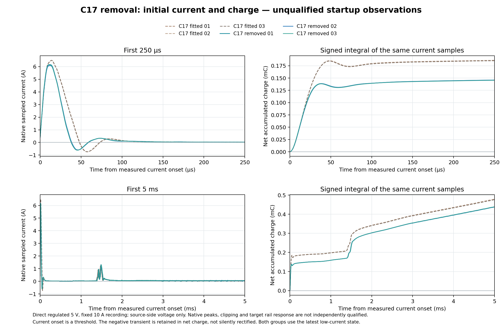
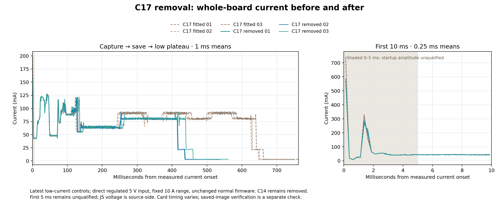

# C17 removal: three cold cycles, November 6, 2026

C17 removal reduced startup charge but left a multiampere surge. Three new
cold captures completed, and **all three saved photos passed full 25 MHz SD
readback, independent decoding and visual inspection**. Normal firmware is
unchanged. The target is intentionally powered off; see [final state](final-state.json).

## Startup comparison

Compare the latest three LOW-current C17-fitted runs with three C17-removed
runs. C14 and U42 were already removed in both groups. The preceding
suspected-short / approximately 331 mA runs are excluded.

| Median of three runs | C17 fitted | C17 removed | Change |
|---|---:|---:|---:|
| Sampled peak in first 250 µs | 6.497 A | 6.140 A | −5.5% |
| Net charge in first 250 µs | 0.18540 mC | 0.14588 mC | −21.3% |
| Net charge in first 1 ms | 0.19765 mC | 0.15895 mC | −19.6% |
| Net charge in first 5 ms | 0.47686 mC | 0.43825 mC | −8.1% |
| Cumulative time above 5 A, first 5 ms | 18.0 µs | 13.5 µs | −25% |
| Mean current, 5–10 ms | 43.40 mA | 43.61 mA | Essentially unchanged |

New peaks ranged 6.082–6.168 A; first-250-µs net charge ranged
0.14548–0.14590 mC. Charge integration retains the observed negative samples.
Positive and negative contributions are separately recorded in the JSON.

These are **JS110 instrument observations, not independently qualified physical
startup extrema**. Recordings used the fixed 10 A range at native 2 MS/s, with
15 seconds off before each cold cycle. The voltage channel measures upstream
of the JS/DUT connection; no downstream rail droop or rise-time qualification
follows. Current onset is a threshold, not a measured MCU power-good event.

## Cycle timing and energy

| Median of three runs | C17 fitted | C17 removed |
|---|---:|---:|
| First exposure mirror rise from current onset | 25.116 ms | 24.903 ms |
| Onset to low-current plateau | 651.43 ms | 437.72 ms |
| Energy from 5 ms to plateau | 256.77 mJ | 159.97 mJ |
| SD initialization | 102.944 ms | 102.995 ms |
| Slot scan/preparation | 106.688 ms | 111.639 ms |
| Slot transport | 383.680 ms | 164.859 ms |
| Energy during slot transport | 165.447 mJ | 66.009 mJ |

**Do not credit C17 with the cycle-energy reduction.** The approximately
99 mJ reduction during SD transport accounts for the approximately 97 mJ
reduction in total measured energy. These whole-board transport intervals
include bus transfers, card waits and host work; the trace does not establish
why card service time changed. Initialization stayed essentially unchanged.

All six traces passed hash/continuity checks. Each new trace contained all
eleven phase markers and one complete exposure mirror envelope. The separate
auto-range sleep observation was **3.310 mA at 4.995 V**, versus 3.311 mA before
removal. Fixed-10-A plateau estimates do not supersede this measurement.

## Saved-image and recovery checks

A fresh warm allocation capture selected slot 165 and established card/SCR
identity. That older RAM helper uses an explicit sensor STOP; its timing and
energy are excluded from the cold comparison. Before the measured boots,
slots 166–168 each passed a complete 512-byte erased first-sector check.

After the three boots, every one of the **3,730 sectors per image** was read
at four-bit 25 MHz, with consistent card identity and successful idle/deinit
proof after each chunk. All images have valid GXR2/GXRE bounds, all 1,909,600
RAW payload bytes, and agreement between independent RAW10 unpacking and
the decoded PNG samples. Root viewed all three recognizable desk/monitor
scenes; no obvious blank frame, torn rows or gross corruption appeared.

- [Complete three-image summary](images/summary.json)
- [Slot 166](images/slot-166/readback-validation.json),
  [slot 167](images/slot-167/readback-validation.json),
  [slot 168](images/slot-168/readback-validation.json)
- [Visual inspection and image hashes](visual-inspection.json)

Original cold camera RAM is lost in Standby. These checks establish complete
readable images and successful decoding, **not equality to the original sensor
RAM**. The stored format has no payload checksum; completion markers are not
power-loss atomicity or retention proof.

Exact UART recovery passed after each cold cycle and again after image
readback. A [guarded retained-flag read](standby-flags/result.json) found
SBF=1, PDDS=1, STOPF=0. Its `trial_entry_proven:false` limitation remains: no
fresh pre-entry flag-clear history is claimed for that individual trial.

## Hardware and firmware identity

- User reports C17 removed. C14, U42, D2, R23 and the SD carrier LED were
  already removed. C12/C28 remain unchanged; no C79 removal was reported.
- Source is direct regulated 5 V → JS110 → CN5.5, return CN5.6. CN8/LTC are
  disconnected, CN9 shunts absent; CN10 separately powers ST-LINK. No LiPo
  or battery/LTC efficiency qualification is included.
- Camera/SD remain connected. SD CLK/GND is twisted to CN3.3/8; VCC is CN3.5;
  no clock resistor or SD signal probes. BOOT jumpers remain normal.
- Observed JS roles: IN1 = PD12/CN15.21 phase protocol; IN0 = PD0/CN15.33
  exposure mirror; GPIO ground CN15.20. The roles are inferred from traces,
  opposite the older assumed mapping; raw stream names were preserved.
- Normal firmware remains October 28 single-frame auto-stop, Ethernet
  power-down, four-bit 25 MHz RAW slots, error engine, UART recovery and
  Standby. Offline DMA-sleep code was not installed.
- Exact prefix SHA-256, repeatedly read:
  `6378483a91b560ffc6b31d74a9dd1205996a14c8030447ffddf7deddc9d23874`.
  No NOR programming, new full NOR readback, or explicit SD erase/deletion
  occurred. The warm allocation capture and three measured boots wrote
  slots 165–168.

## Final handoff and evidence

After a fresh idle-reader check, UART recovery returned to the exact normal
park at `0x3418078C`. A further live park check preceded intentional JS
output-off. JS closed at **2026-11-06 05:53:43.156882 UTC**, with range 0
intentionally retained and other settings restored. Measured input current
was zero; this does not prove every target rail is 0 V through debug paths.
COM8 is closed, BREAK released, and no bench helper or ownership hold remains.
Normal firmware runs on the next normal power-up.

[Detailed comparison](report/summary.md), [numerical data](report/summary.json),
[SD timing explanation](report/sd-timing-context.md), and
[archive manifest](archive-manifest.json) retain provenance. Native streams,
photos, RAM and sector payloads remain local under
`tmp/bringup/c17-removed-20261106/`, with hashes only in this archive.
Compact logs, proofs, analyses and frozen helper code use byte-preserving
attributes. `SHA256SUMS` covers generated archive files; this README and
root-authored final-state record are outside that generated inventory.

Three successful cycles are limited prototype evidence, not all-condition
electrical qualification or a randomized isolated-component experiment.
