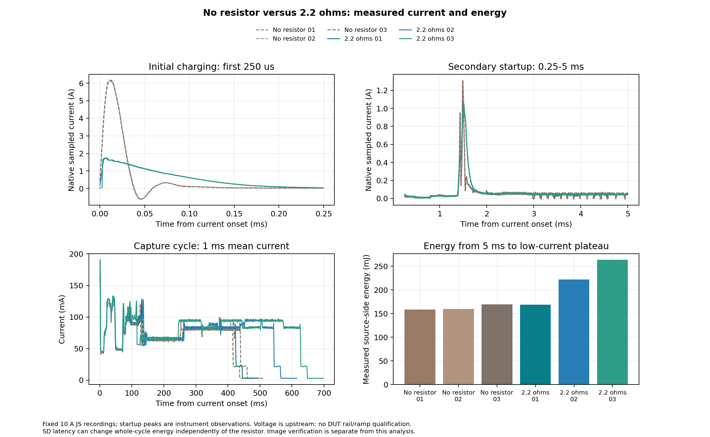

# 2.2-ohm input resistor: three cold cycles, November 6, 2026

The user's result is confirmed: the sampled startup peaks fell to about
**1.74 A and 1.05 A**, and **all three cold captures saved complete, recognizable
images**. The resistor remains installed and normal firmware is unchanged.
The target is intentionally powered off; see [final state](final-state.json).

## Current and timing

Comparison uses the three immediately preceding C17-removed, no-resistor
recordings. Both groups use direct regulated 5 V, the fixed 10 A JS110 range,
native 2 MS/s acquisition and 15 seconds off before each cold boot.

| Median of three runs | No resistor | 2.2 ohms | Change |
|---|---:|---:|---:|
| Initial sampled peak, first 250 us | 6.140 A | 1.743 A | -71.6% |
| Secondary sampled peak, 250 us to 5 ms | 1.311 A | 1.051 A | -19.8% |
| Secondary peak time after current onset | 1.4905 ms | 1.5065 ms | +16 us |
| First exposure mirror | 24.898 ms | 25.122 ms | +0.225 ms |
| Cycle to low-current plateau | 437.717 ms | 564.577 ms | +126.860 ms |
| Energy from 5 ms to plateau | 159.974 mJ | 222.186 mJ | +62.212 mJ |

The new initial peaks ranged **1.738-1.744 A**, and secondary peaks
**1.049-1.052 A**. All eleven phase markers and one complete exposure mirror
appeared in each cycle. Separate auto-range sleep current was **3.309 mA at
4.995 V**, essentially unchanged from 3.310 mA.

These are instrument observations. Voltage is measured upstream; no board-input
or downstream core/main/AON rail waveform was measured. This does not qualify
the rail-rise requirements discussed in the [power notes](../../NOTES.md).
Current onset is a measured threshold, not a direct reset/power-good event.

## Energy interpretation

| New run | Expected/saved slot | Exposure | Cycle | Energy after 5 ms | Energy including startup* |
|---|---:|---:|---:|---:|---:|
| 1 | 174 | 24.584 ms | 445.501 ms | 168.425 mJ | 170.847 mJ |
| 2 | 175 | 25.122 ms | 564.577 ms | 222.186 mJ | 224.615 mJ |
| 3 | 176 | 25.268 ms | 647.580 ms | 263.382 mJ | 265.796 mJ |

*The first 5 ms remain an unqualified startup measurement window.

Do not assign the median 39% energy increase entirely to resistor dissipation.
For the actual median-energy runs, slot transport lengthened from 164.859 to
280.441 ms and accounts for 54.709 mJ of the 62.212 mJ increase. Across the
three disjoint SD phases, holding baseline mean power fixed attributes about
81% of the difference arithmetically to extra duration. This is accounting,
not proof of what caused the card's changed timing.

The closest-duration transport comparison, resistor run 1 versus baseline
run 2, is 164.745 versus 164.859 ms, with 3.60% more transport energy. Its
whole post-5-ms cycle uses 5.28% more energy and lasts 7.784 ms longer.
This suggests a modest operating penalty, but is not a randomized resistor
removal/reinstallation comparison. Nominal I-squared-R heat is separately
calculated and is not the same as extra source energy: converter behavior
changes and some dissipation can move from onboard LDOs into the resistor.

[Numerical results](comparison-report/summary.json) and
[timing accounting](comparison-report/timing-context.md) preserve all phases,
source identities and limitations. Phase windows can overlap; do not sum them.

## Image verification and recovery

A preliminary warm RAM capture saved slot 173 and established fresh card/SCR
identity and the allocation position. Its older explicit-STOP helper is
excluded from the cold-cycle comparison. Slots 174-176 each had an entirely
erased first sector before the measured boots. Earlier manual images were
preserved; no card erase or deletion occurred.

Every one of the **3,730 sectors per cold image** was read at four-bit 25 MHz,
with successful idle/deinitialization checks between chunks. All three
objects have valid GXR2/GXRE bounds and complete 1,909,600-byte RAW payloads.
Independent RAW10 unpacking agrees with decoded 16-bit PNG samples. Root
viewed every preview: each contains a recognizable monitor/desk scene, with
no obvious blank frame, torn rows or gross corruption.

Original cold camera RAM is lost in Standby. Readability, completion markers,
decoding and visual review do not prove equality to that original capture;
the stored format has no payload checksum. See [image proofs](images/summary.json)
and [visual review](visual-inspection.json). Native traces and photographs stay
local, with hashes in the [archive manifest](archive-manifest.json).

UART recovery worked throughout; the exact normal prefix was repeatedly
verified. No NOR programming or new full-NOR readback occurred. Final normal
prefix SHA256 is `6378483a91b560ffc6b31d74a9dd1205996a14c8030447ffddf7deddc9d23874`.
The October 28 single-frame/Ethernet-down/25 MHz/error-engine/UART-recovery
firmware remains installed; the offline DMA-sleep candidate was not installed.

## Final bench state

After image verification, UART recovery returned to the exact normal park
at `0x3418078C`. A fresh park check preceded intentional JS output-off.
JS closed at **2026-11-06 17:03:19.096403 UTC**, retaining range 0 and restoring
other settings. Input current was zero; this is not proof every downstream
rail is zero through debug paths. COM8 is closed, BREAK released, and no
bench helper remains active. No fresh SBF read was performed in this campaign.

User-installed 2.2 ohms is understood to be between JS OUT+ and CN5.5; exact
physical placement was not independently inspected. Main return stays CN5.6,
CN8/LTC disconnected, no CN9 shunts, CN10 separately powered, JP1/JP2 normal.
C14/C17/U42/D2/R23 and SD carrier LED remain removed; C12/C28 unchanged;
no C79 removal reported. Camera/SD remain connected, with twisted CLK/GND
at CN3.3/8, SD VCC CN3.5, no SD clock resistor or signal probes. Observed JS
roles remain IN1=PD12/CN15.21 phases and IN0=PD0/CN15.33 exposure, GPIO GND20.

Three passes establish this prototype result, not battery/LiPo operation,
all-condition reliability, or downstream rail/ramp compliance.
