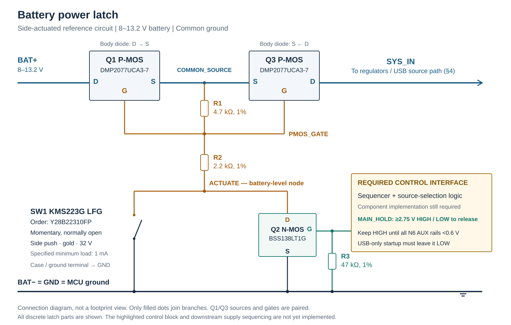

> Historical proposal, superseded as the working baseline on September 7, 2026. See [current power design](../../power.md). Stock and assumptions below retain their original dates.

# Global X Camera power design

**Status:** proposed design for review and bench qualification. **Updated:** September 5, 2026, EDT.

The proposed battery switch uses **two Diodes DMP2077UCA3-7 P-MOSFETs, one onsemi BSS138LT1G N-MOSFET, three resistors, and a momentary shutter switch**. All specified latch parts have at least 1,000 pieces available at a checked distributor. The reference version below retains side actuation and uses a C&K gold-contact switch.

At a provisional 0.55 A system-input load, the two power MOSFETs lose about **110 mV and 61 mW**, using their room-temperature resistance specification. A first-order OFF-current calculation for the discrete latch gives about **0.213 µA at 13.2 V and 25°C**, before PCB contamination, the RTC and the required control circuitry. These are engineering estimates, not guaranteed assembled-board limits.

**The latch core is specified here; the complete STM32N6 power sequencer is not yet implemented.** Its main supplies must remain valid until all auxiliary supplies have fallen below 0.6 V. The highlighted interface in the diagram records that requirement. Directly connecting an arbitrary GPIO, or the automatic `PWR_ON` output, does not by itself satisfy both shutdown sequencing and USB source selection. See §3.

## 1. Operating assumptions and power architecture

| Item | Working assumption / requirement |
| --- | --- |
| Battery | Four series CR2032 cells; 8–13.2 V operating assumption. Exact cell manufacturer and pulse capability remain unqualified. |
| Ground | BAT−, processor ground, regulator grounds and interface ground remain connected. |
| Main converter | Existing TPS62132 produces 3.3 V from SYS_IN. The reviewed downstream 1.8 V architecture must be split into the required main/auxiliary supply groups. |
| Power demand used for sizing | Provisional 1.2 A at 3.3 V = 3.96 W. An assumed 90% conversion efficiency gives 4.4 W required at SYS_IN. This is not a measured workload. |
| Shutter | A momentary press starts the battery supply immediately; control must take over before the button is released. |
| Capture | Target remains 50 ms from shutter press to acquisition. Saving may finish later. |
| Shutdown | Finish and verify the nonvolatile write, shut down peripherals, discharge auxiliary supplies, then disconnect the battery from the main regulators. |
| USB | USB can power downloads independently. USB-only startup must not automatically engage the battery path. |
| Shelf current | Minimize total OFF current. The previously discussed ≤100 nA whole-latch target has **not** been established by these parts. |

The [power review](../../docs/review/power-review.md) contains the existing regulator, reservoir, cell-current and magnetics findings. Four cells in series provide more voltage, but every cell still carries the complete pack current. The MOSFET calculations below do not qualify CR2032 pulse performance.

## 2. Power ON/OFF: proposed discrete latch

### 2.1 Connection diagram



[PNG version](../../docs/power/power-latch.png). The blocks name electrical terminals; they are not package-orientation drawings. Reference designators Q1/Q2/Q3 retain the roles used in the recovered design.

| Connection | Required wiring |
| --- | --- |
| Q1, battery-side PMOS | Drain to BAT+; source to COMMON_SOURCE; gate to PMOS_GATE. |
| Q3, system-side PMOS | Source to COMMON_SOURCE; drain to SYS_IN; gate to PMOS_GATE. |
| R1 | 4.7 kΩ from COMMON_SOURCE to PMOS_GATE. |
| R2 | 2.2 kΩ from PMOS_GATE to ACTUATE. Both the button and Q2 act through this resistor. |
| Q2, control NMOS | Drain to ACTUATE; source to GND; gate to MAIN_HOLD. |
| R3 | 47 kΩ from Q2 gate to GND, defining OFF when the controller is unpowered or high-impedance. |
| SW1 | Normally-open contact from ACTUATE to GND. Connect its specified case/ground termination to GND. |
| MAIN_HOLD | A ground-referenced control output meeting §3; nominal 3.3 V, at least 2.75 V while holding. |

Both PMOS body diodes point **from drain to source**. Joining the sources makes the diodes oppose one another between BAT+ and SYS_IN. With battery power present and the latch OFF, Q1's body diode supplies the common-source node while Q3 blocks the system path. Under reverse bias from SYS_IN, their roles swap. Their ON channels conduct in either direction; back-to-back placement does not provide reverse-current protection while enabled.

**ACTUATE is a battery-level node while OFF.** Do not connect it, PMOS_GATE or COMMON_SOURCE directly to an MCU input. The old D3-to-PC13 shutter-sense connection is excluded from this proposal. Once Q2 holds ACTUATE low, that node also cannot distinguish a pressed button from a released one. Independent shutter sensing would require a separate safe interface.

### 2.2 Exact parts and electrical specifications

| Ref. / quantity | Manufacturer part | Specifications used in this design |
| --- | --- | --- |
| Q1, Q3 / 2 | **Diodes DMP2077UCA3-7** | P-channel; −20 V VDS; ±12 V VGS. RDS(on) maximum 100 mΩ at VGS=−4.5 V, ID=−0.5 A, 25°C; 78 mΩ at −8 V. IDSS maximum 100 nA at VDS=−16 V, VGS=0, 25°C. X4-DSN1006-3, approximately 1.0 × 0.6 × 0.2 mm. |
| Q2 / 1 | **onsemi BSS138LT1G** | N-channel; 50 V VDS; ±20 V VGS. RDS(on) maximum 10 Ω at VGS=2.75 V, ID<200 mA, −40…85°C. IDSS maximum 100 nA at VDS=25 V, VGS=0, 25°C. SOT-23; pins 1=G, 2=S, 3=D. |
| R1 / 1 | **Yageo RC0603FR-074K7L** | 4.7 kΩ, 1%, 0603, 100 mW standard power rating, 75 V maximum working-voltage limit. |
| R2 / 1 | **Yageo RC0603FR-072K2L** | 2.2 kΩ; same tolerance, package, power and voltage class. |
| R3 / 1 | **Yageo RC0603FR-0747KL** | 47 kΩ; same tolerance, package, power and voltage class. |
| SW1 / 1 | **C&K KMS223G LFG**, current order code **Y28B22310FP** | Side-actuated SPST normally open; gold contacts; 32 VDC maximum, 1 mA minimum, 10 mA maximum; insulation resistance ≥1 GΩ; 2 N force. New footprint/actuator fit must be checked. |

Manufacturer sources: [Diodes pp1–2,6](https://www.diodes.com/datasheet/download/DMP2077UCA3.pdf), [onsemi pp1–2](https://www.onsemi.com/download/data-sheet/pdf/bss138lt1-d.pdf), [Yageo pp2,5](https://www.yageogroup.com/content/datasheet/asset/file/PYU-RC_GROUP_51_ROHS_L), [C&K KMS pp1–3](https://www.littelfuse.com/assetdocs/littelfuse-c-k-tactile-kms-series-datasheet?assetguid=e4669181-bbf2-4513-a0e8-e0ceb1657663).

Use the exact vendor and suffix. A generic `BSS138` or `AO3401A` substitution can have different leakage and gate-drive guarantees. The previously suggested Toshiba SSM3K79FU was not found in either distributor's current search, so it is not the procurable baseline.

The PMOS source PDF has an `Advanced Information` label in its text layer, although the manufacturer lists the ordering code as Active. Obtain a controlled production specification before release. Its tiny package also needs an exact land-pattern and assembly review; the original SOT-23 footprint does not apply. [Manufacturer status, Master CofC p175](https://www.diodes.com/assets/Quality-Reliability-Docs/Master_CofC.pdf#page=175)

### 2.3 Distributor stock, checked directly

These are live distributor-page observations from **September 5, 2026, 21:17–21:26 EDT** (September 6, 01:17–01:26 UTC), not cached search-result quantities. Stock can change. Quantities are individual parts; each board needs two PMOS devices.

| Part | Distributor / cut-tape SKU | Available | Displayed factory lead time | Checked EDT |
| --- | --- | ---: | --- | --- |
| DMP2077UCA3-7 | [DigiKey 31-DMP2077UCA3-7CT-ND](https://www.digikey.com/en/products/detail/diodes-incorporated/DMP2077UCA3-7/10295302) | **5,885** | 40 weeks | 21:17–21:18 |
| DMP2077UCA3-7 | [Mouser 621-DMP2077UCA3-7](https://www.mouser.com/en/ProductDetail/Diodes-Incorporated/DMP2077UCA3-7?qs=gZXFycFWdANmX5Zz3ft%252Bjg%3D%3D) | 140 | 40 weeks | 21:17–21:18 |
| BSS138LT1G | [DigiKey BSS138LT1GOSCT-ND](https://www.digikey.com/en/products/detail/onsemi/BSS138LT1G/918376) | **441,979** | 53 weeks | 21:18 |
| BSS138LT1G | [Mouser 863-BSS138LT1G](https://www.mouser.com/en/ProductDetail/onsemi/BSS138LT1G?qs=vNc2DXHODiKPZ2y3rQhTYQ%3D%3D) | **11,154** | 53 weeks | 21:18 |
| Y28B22310FP | [DigiKey CKN10953CT-ND](https://www.digikey.com/en/products/detail/c-k/Y28B22310FP/2043220) | **2,788** | 15 weeks | 21:26 |
| RC0603FR-074K7L | [DigiKey 311-4.70KHRCT-ND](https://www.digikey.com/en/products/detail/yageo/RC0603FR-074K7L/727212) | **1,476,290** | 17 weeks | 21:26 |
| RC0603FR-072K2L | [DigiKey 311-2.20KHRCT-ND](https://www.digikey.com/en/products/detail/yageo/RC0603FR-072K2L/729963) | **556,141** | 17 weeks | 21:26 |
| RC0603FR-0747KL | [DigiKey 311-47.0KHRCT-ND](https://www.digikey.com/en/products/detail/yageo/RC0603FR-0747KL/730200) | **2,043,746** | 17 weeks | 21:22 |

The stock is useful for prototypes and an initial build, but the long factory lead times are a supply-planning risk. Mouser's displayed BSS138LT1G order maximum was 3,000. DigiKey warns that manufacturer packaging/lead time applies after the switch stock is depleted. No parts were ordered.

Use the **manufacturer's 32 V switch rating**; DigiKey's 50 V attribute conflicts with the current manufacturer PDF.

### 2.4 Why these resistor values changed

The earlier 100 kΩ/47 kΩ divider supplies only about 54–90 µA. That is below the selected side-actuated switch's specified 1 mA minimum contact load. Changing R1/R2 to **4.7 kΩ/2.2 kΩ** preserves nearly the same divider ratio while providing approximately 1.15–1.91 mA during button-only activation. Once Q2 also conducts, current divides between the parallel contact and Q2; the minimum-load comparison describes the initial button-controlled start, not a guaranteed contact current during HOLD overlap.

This costs roughly 9–25 mW during ON operation. It does not create another permanent OFF path: with SW1 and Q2 open, the lower end of the divider floats and the PMOS gate returns to its source. A press/release while Q2 is already conducting is a low-load contact event; its contact reliability remains a qualification item and is not established by the initial-start current calculation. The former Omron B3U-3000P's 12 V rating is also insufficient for an ACTUATE node that can reach 13.2 V. [Omron datasheet p1](https://omronfs.omron.com/en_US/ecb/products/pdf/en-b3u.pdf)

### 2.5 Operating states

| State | Circuit behavior |
| --- | --- |
| OFF, no USB | MAIN_HOLD LOW; SW1 open; Q2 off. R1 returns the PMOS gates to their sources. Only leakage paths remain. |
| Button pressed | SW1 pulls ACTUATE low through its contact. R1/R2 establish negative PMOS VGS and the regulators start. The button carries gate-network current, not camera load current. |
| Startup takeover | The required controller asserts MAIN_HOLD while SW1 still provides power. Q2 then maintains the gate pull-down. The acceptable minimum press duration must exceed measured rail-start plus takeover time. |
| Running | Q2 holds the PMOS pair on after button release. No mechanical debounce delay is imposed by this core. Contact bounce and the complete 50 ms startup budget still need measurement. |
| Shutdown requested | Firmware completes storage work and requests shutdown. Hardware performs the supply sequence in §3 while MAIN_HOLD remains HIGH. |
| Final release | Once the sequencer permits it, MAIN_HOLD falls. R3 discharges Q2's gate; R1 turns the PMOS pair off. No deliberate timing capacitor is included in this core. |
| Button still held | SW1 continues forcing ON regardless of MAIN_HOLD. Main power cannot disconnect until release; the processor should enter the appropriate low-power state after completing its work. |
| Reset / crash | The behavior depends on the sequencer's retained state and fault policy. This three-transistor core supplies no watchdog or guaranteed forced-off timeout. |

## 3. Required STM32N6 control and sequencing interface

The control block in the diagram is a **required subsequent circuit design**, not an already selected IC or a firmware routine hidden inside a label. Its OFF current and any extra battery sensing paths must be added to the budget in §6.

ST requires the main supplies to rise together, followed by the auxiliary supplies rising together after `PWR_ON` permits them. On shutdown, all auxiliary supplies must fall below 0.6 V before any main supply falls below its minimum operating voltage. `PWR_ON` asserts automatically after main power is present and falls for Standby. Removing the main supply immediately when this output falls does not establish the required discharge ordering. Ordinary GPIO execution/control is also unavailable after the core loses power. [ST AN5967 §3.5, pp8–9](https://www.st.com/resource/en/application_note/an5967-getting-started-with-hardware-development-for-stm32n6-mcus-stmicroelectronics.pdf#page=8)

The interface must provide:

1. **A defined initial state:** MAIN_HOLD LOW while unpowered, and no automatic battery engagement from USB-only startup.
2. **Early battery takeover:** retain a valid battery-start request before button release; assert MAIN_HOLD without waiting for the main application to load.
3. **Ordered shutdown:** disable/discharge auxiliaries after the appropriate N6 shutdown transition, retain MAIN_HOLD through loss of CPU execution, and release it only after all auxiliaries meet ST's discharge requirement. A fixed delay would need worst-case discharge qualification, not a nominal RC guess.
4. **Electrical drive:** guarantee MAIN_HOLD ≥2.75 V at Q2's gate throughout HOLD, and approximately 0 V throughout OFF. Qualify the controller's OFF output voltage and leakage: a digital logic LOW alone does not establish Q2's VGS=0 leakage test condition. Record the actual gate voltage in OFF-current measurements. R3 draws about 70 µA at 3.3 V. Any retained state must survive the applicable reset/brownout sequence.

For context, ST's ordinary VDD-GPIO VOH guarantee is VDD−0.4 V, which would require VDD≥3.15 V before interface drops. TPS62132's initial PSM tolerance gives 3.2241 V minimum, leaving only about 74 mV after that GPIO allowance; line/load effects, ripple and transients need their own allowance. A selected sequencer must meet its own output guarantee. [ST Table65 p171](https://www.st.com/resource/en/datasheet/stm32n657x0.pdf#page=171), [TI TPS62132 §7.5 p5](https://www.ti.com/lit/gpn/TPS62132)

Do not assign PC13 as the final hold output at this stage: it uses the VDD_VSW domain and its GPIO function is lost in Standby. Firmware should expose a shutdown request to the eventual hardware controller; its exact pin remains to be assigned with that circuit. [RM0486 §15.3.14 p791](https://www.st.com/resource/en/reference_manual/rm0486-stm32n647657xx-armbased-32bit-mcus-stmicroelectronics.pdf#page=791)

## 4. USB and other power paths

The existing USB path feeds SYS_IN through D2. That diode blocks SYS_IN from feeding USB VBUS; it does not select USB over the battery. The PMOS pair blocks a reverse body-diode path while OFF, but permits bidirectional channel current while ON.

The controller must leave MAIN_HOLD LOW on USB-only startup. Raw `PWR_ON` is therefore not an acceptable unqualified battery-hold signal. Define plug/unplug behavior explicitly, including whether an ongoing battery capture finishes on battery or transfers supply.

The physical SW1 path in this drawing can still engage the battery while the button is held, even if USB is connected. If the product must prohibit that as well, the manual start path needs a hardware inhibit; the present circuit does not claim strict USB priority in that state.

The RTC's lowest-cell backup tap remains separate from the switched system input. Its backup current and interface leakage affect the lowest cell in addition to the pack-wide leakage. The existing camera analog-first shutdown requirement and N6 main/auxiliary corrections remain part of the downstream sequencer design; see the [MCU review](../../docs/review/mcu-review.md) and [camera/memory review](../../docs/review/camera-memory-review.md).

## 5. ON-state calculations

### 5.1 Gate-voltage margin

With SW1 or Q2 conducting, and initially ignoring Q2's small voltage drop:

```text
|VGS(PMOS)| = VCOMMON_SOURCE × R1 / (R1 + R2)
            = VCOMMON_SOURCE × 4.7 / 6.9
            ≈ 0.68116 × VCOMMON_SOURCE
```

The 1% resistor extremes give a ratio of approximately 0.6768–0.6855. At 13.2 V with negligible load, the maximum is **9.048 V**, below the ±12 V gate absolute maximum. At 8 V, 0.55 A system load and the 10 Ω NMOS resistance allowance, the nominal magnitude is **5.404 V**, above the −4.5 V resistance test point. This calculation assumes the stated battery range; a sagging pack below 8 V needs separate treatment.

The divider is not a transient clamp. Measure battery insertion, wiring-inductance and switching transients. The 20 V drain and 12 V gate ratings are absolute limits, not recommended operating targets.

### 5.2 Camera-current path

Use **0.100 Ω per PMOS** throughout the battery range rather than applying the −8 V gate-drive specification at the low battery endpoint:

```text
Rpair ≈ 0.100 + 0.100 = 0.200 Ω
Vdrop ≈ ILOAD × Rpair
Ploss ≈ ILOAD² × Rpair

At 0.55 A: Vdrop ≈ 0.110 V; Ploss ≈ 0.0605 W
```

Q1 also supplies the gate-network current. Including that small extra branch gives:

| Battery | System load | Divider current, Q2 holding | PMOS gate magnitude | Pair voltage drop | Q1+Q3 loss | Gate-network loss |
| ---: | ---: | ---: | ---: | ---: | ---: | ---: |
| 8.0 V | 0.550 A | 1.150 mA | 5.404 V | 110.115 mV | 60.627 mW | 9.135 mW |
| 12.0 V | 0.550 A | 1.729 mA | 8.125 V | 110.173 mV | 60.690 mW | 20.648 mW |
| 13.2 V | 0.550 A | 1.902 mA | 8.941 V | 110.190 mV | 60.710 mW | 25.005 mW |

These estimates use the PMOS's 25°C limit measured at 0.5 A; the illustrative 0.55 A point is a small extrapolation, not a new guaranteed specification. Hot RDS(on), inrush and safe operating area must be qualified. A sensitivity calculation that doubles both resistances gives about 220 mV and 121 mW at 0.55 A, before the gate branch; the factor of two is an assumed sensitivity case, not a guaranteed temperature multiplier.

For the provisional constant-power load, include the extra current required to make up the MOSFET drop. Taking P(SYS_IN)=3.96/0.90=4.4 W yields:

| Battery | Current into SYS_IN load | SYS_IN voltage | PMOS pair loss |
| ---: | ---: | ---: | ---: |
| 8.0 V | 0.557786 A | 7.888328 V | 62.353 mW |
| 12.0 V | 0.368941 A | 11.926039 V | 27.351 mW |
| 13.2 V | 0.335039 A | 13.132802 V | 22.578 mW |

Battery terminal current additionally includes the approximately 1.15–1.91 mA gate branch. Cell/contact resistance and converter-efficiency changes are not included. The derivation and numerical model are in [power-calculations.json](../../docs/power/power-calculations.json) and [the reproducible builder](../../tools/build_power_document_assets.py).

### 5.3 Control and resistor losses

At the high end, Q2's 10 Ω allowance produces only about **19 mV** at ACTUATE. R1 dissipates about **17 mW**, R2 about **8 mW**, and Q2 about **36 µW**. Each resistor is comfortably below its 100 mW nominal rating; apply the manufacturer's temperature derating for the final enclosure.

R3 draws `3.3 V / 47 kΩ = 70.2 µA`, or **0.232 mW from the 3.3 V supply**, while MAIN_HOLD is HIGH. That is additional to the battery-side divider figures. It contributes no intentional steady battery drain when MAIN_HOLD and the switched supplies are OFF.

## 6. OFF-state leakage calculations

### 6.1 Count physical current paths

For battery-only OFF, SW1 open, MAIN_HOLD LOW and SYS_IN discharged, use this screening model:

| Path | Calculation / basis | 13.2 V screening allocation |
| --- | --- | ---: |
| Battery → Q1 body diode → Q3 → SYS_IN/load | One blocking PMOS IDSS allowance: 100 nA at the manufacturer's −16 V, VGS=0, 25°C test point. | 100 nA |
| Battery → Q1 body diode → R1/R2 → Q2 → GND | Q2 IDSS allowance: 100 nA at 25 V, VGS=0, 25°C. | 100 nA |
| ACTUATE → open SW1 → GND | Approximate the specified ≥1 GΩ insulation as a single equivalent resistance: 13.2 V / 1 GΩ. | 13.2 nA |
| **Discrete-core subtotal** | Sum of the three modeled branches. | **213.2 nA = 0.2132 µA** |

Do **not** add two full PMOS IDSS limits as though the devices were parallel leakage paths. Nor should both ±12 V PMOS gate-leakage limits simply be added: their actual OFF VGS values are near zero, and internal gate currents redistribute through the already identified branches. The separate PMOS IGSS limit is 50 nA at ±12 V; Q2's is 100 nA at ±20 V. Those tests describe different bias conditions.

Using the same screening allowances at 8 V and 12 V gives about **208 nA** and **212 nA**. With the gate-network branch carrying roughly 113.2 nA at 13.2 V, its drop across R1 is only about `113.2 nA × 4.7 kΩ = 0.532 mV`. Thus the power MOSFET has a small negative VGS rather than exactly the datasheet's zero-bias test condition.

### 6.2 What the subtotal does and does not establish

**0.2132 µA is a screening estimate assembled from datasheet limits at other test biases, not a guaranteed worst-case bound or a typical measured current.** The PMOS has no specified elevated-temperature IDSS maximum. Q2 permits 5 µA at 50 V and 150°C; that does not tell us its exact leakage at 13.2 V and the intended storage temperature. The switch insulation figure likewise is not a demonstrated ten-year, humid, assembled-PCB leakage limit.

The complete budget must also include:

- The yet-to-be-selected sequencer, supply monitor and any always-connected divider or start-sense circuit.
- PCB surface leakage and any additional terminal-to-case paths. A separate unintended 100 MΩ path from 13.2 V costs **132 nA** by itself.
- The RTC's backup current and any backfeed through interfaces. A tap-powered load drains only the tapped cell; pack leakage drains every series cell.
- USB-connected OFF behavior, external debug connections and other independently powered interfaces, assessed separately from battery-only OFF.

Downstream regulator shutdown current is not automatically an additional battery branch: its supply is behind the blocking MOSFET. Additional connections can, however, bypass that isolation. Measure the assembled system with its real interfaces rather than summing unrelated catalog quiescent currents.

Consequently the proposed parts **do not prove the earlier ≤100 nA whole-latch target**. A 300 nA room-temperature budget would leave only about 87 nA beyond this core estimate, and would still require component and assembly qualification. Do not assume that budget is achieved or that it applies when hot.

### 6.3 Ten-year charge cost

For constant pack current, using ten 365-day years:

```text
Charge (mAh) = current (µA) × 87.6
```

| Continuous current | Charge drawn from each series cell in ten years |
| ---: | ---: |
| 0.100 µA | 8.76 mAh |
| 0.200 µA | 17.52 mAh |
| 0.2132 µA | 18.68 mAh |
| 0.300 µA | 26.28 mAh |
| 1.000 µA | 87.60 mAh |

These are charge calculations, not battery-life predictions. Capture energy, self-discharge, temperature, aging and the RTC's additional lowest-cell load remain separate.

## 7. Alternative: lower active gate current with a top-actuated button

If the mechanical design can accommodate top actuation, **C&K KMR232NG ULC LFS / Y78B23224FP** permits the original **R1=100 kΩ, R2=47 kΩ** network. Preserve `ULC`: the standard version's minimum contact load is different. The manufacturer specifies 32 V maximum, a ULC minimum of 1 µA at 1.8 V, and ≥1 GΩ insulation. [KMR2 datasheet pp1,4](https://www.ck-components.com/media/1479/kmr2.pdf)

Live stock at 21:22 EDT was **31,226** at [DigiKey CKN11021CT-ND](https://www.digikey.com/en/products/detail/c-k/KMR232NG-ULC-LFS/2176545), and **20,727** at [Mouser 611-KMR232NGULCLFS](https://www.mouser.com/en/ProductDetail/CK/KMR232NG-ULC-LFS?qs=sGAEpiMZZMtFyPk3yBMYYJs5pV9KTQMgt8Np%2FpAqkuI%3D). Its actuator is 1.9 mm high with 3 N force. Yageo **RC0603FR-07100KL** had **2,220,767** available at [DigiKey](https://www.digikey.com/en/products/detail/yageo/RC0603FR-07100KL/729836); the 47 kΩ part is listed above.

This alternative cuts the gate-network current to approximately 54–89 µA and its power to **0.43–1.18 mW** at 0.55 A system load. The nominal OFF path count remains the same, but the larger R1 produces about 11.3 mV of leakage-induced PMOS gate bias rather than 0.53 mV. Measure its OFF current separately. Do not use these high resistor values with the standard KMS switch without qualifying operation below its specified contact load.

## 8. Layout and prototype validation

Keep the BAT+–Q1–Q3–SYS_IN path short and wide, with suitable copper around the tiny PMOS drain/source lands. Place R1 at the paired gates/sources and R3 at Q2. Route ACTUATE away from low-voltage inputs and keep it free of contamination. Use the exact PMOS top-view drawing and suggested pad geometry; check switch contacts and case termination against its manufacturer drawing. None of the changed packages is a presumed footprint-compatible replacement.

The first prototype should expose BAT+, COMMON_SOURCE, PMOS_GATE, ACTUATE, SYS_IN, MAIN_HOLD, GND and the relevant main/AUX rails. Use a current-limited bench source before qualifying actual cells.

1. Measure OFF current at 8 V, 12 V and 13.2 V, then at the selected storage-temperature limits. Disconnect programmer and USB for the battery-only test; repeat the separately defined USB-powered cases. Record instrument burden and fixture leakage.
2. Measure startup with the shortest intended button press and contact bounce. Confirm MAIN_HOLD takeover, PMOS gate margin, regulator ramps and shutter-to-acquisition time.
3. Measure transistor drop and temperature at representative capture/save load and inrush. Check VDS/VGS transients and switching safe operating area, not just steady I²R heating.
4. Verify ordered shutdown at the actual MCU supply pins: every auxiliary rail below 0.6 V before any main supply falls below its minimum operating voltage. Repeat with button held, reset, a stalled CPU, USB insertion/removal and weak-source brownout.
5. Measure complete capture-and-save energy on selected fresh, cold and aged cells. Demonstrate that interrupted writes recover correctly.

These checks close remaining engineering questions; the calculations and distributor stock do not replace them.

## 9. Evidence and reproducibility

- [Archived PMOS datasheet](../../datasheets/candidates/power-latch/Diodes_DMP2077UCA3.pdf), [onsemi NMOS datasheet](../../datasheets/candidates/power-latch/onsemi_BSS138L.pdf), and [Yageo resistor datasheet](../../datasheets/candidates/power-latch/Yageo_RC_resistors.pdf) have adjacent provenance records and SHA-256 hashes.
- The current C&K switch PDFs were readable through manufacturer/distributor research links. Direct HTTPS archive requests returned HTTP 403; use the manufacturer links above. No local switch PDF is claimed.
- [Diagram and calculation builder](../../tools/build_power_document_assets.py) regenerates the SVG, PNG and [numerical results](../../docs/power/power-calculations.json). The model includes Q1's additional gate-network current and checks the constant-power equation.
- [Datasheet catalog](../../datasheets/README.md) records the local document collection. [Earlier transistor research](../../docs/power-latch-transistor-candidates.md) and [latch-IC comparison](../../docs/power-latch-options.md) preserve the alternatives.
- The reconstructed KiCad design has not yet been updated to this proposal. Implementation must include the required sequencing/source-control circuit before this becomes a complete camera power design.
