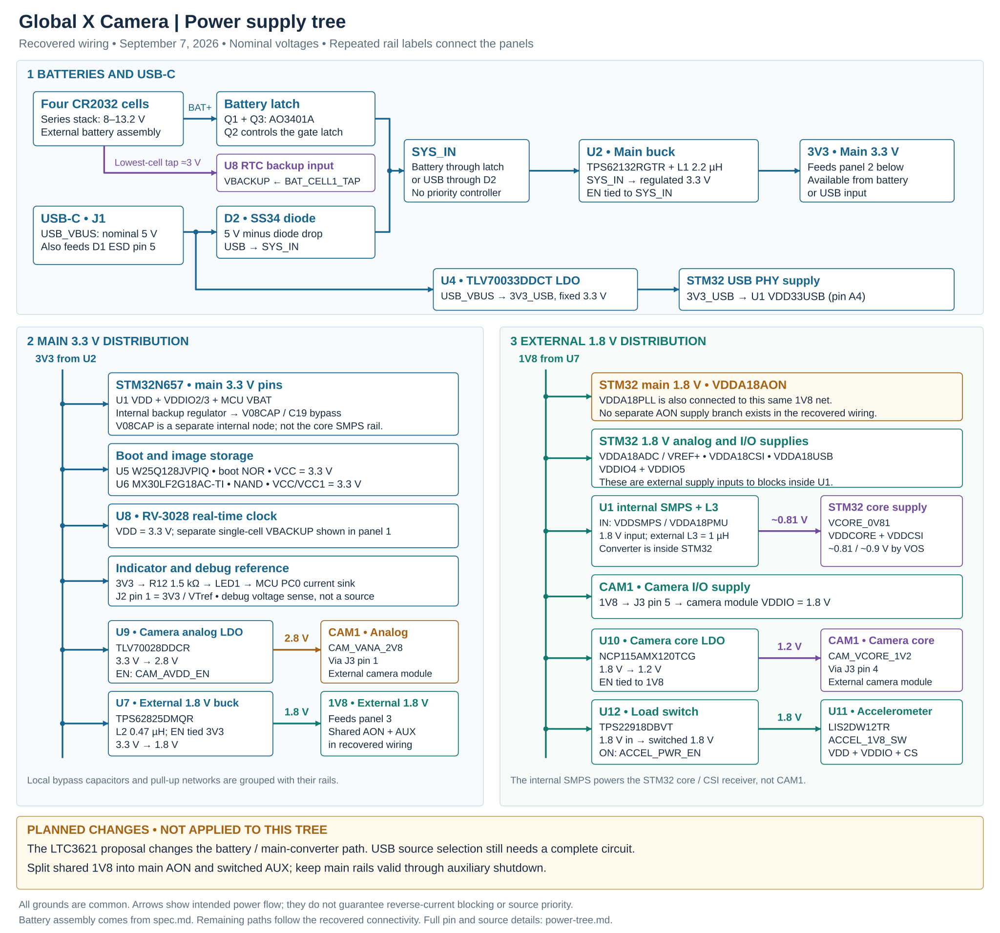

# Recovered power tree

This document describes the **current recovered wiring**, including its existing rail sharing and control connections. It accompanies [the vector diagram](power-tree.svg) and [the PNG diagram](power-tree.png). LTC3621 and CAM-6G3-073CLR/VD56G3 are now selected for the prototype, but those changes and the required STM32N6 supply regrouping have **not** been applied to this connectivity snapshot. The diagram is evidence of existing CAD, not the selected future power implementation; see [current decisions](../../spec.md) and [power implementation](../../power.md).

**October 14 review:** see the [selected-camera/Nucleo rail requirements and proposed power tree](2026-10-14-power-tree-review.md) for the current discussion. It proposes 5.0 V for the Nucleo bench and keeps custom-board output voltage open. CAM-6G3-073CLR needs 2.8 V, 1.8 V and 1.15 V. Neither this proposal nor the selected components have been applied to the recovered diagram below.

The electrical source is [schematic-connectivity.json](../../hardware/reconstruction/schematic-connectivity.json), reconstructed from the recovered Flux project. [The native inventory](../../imports/flux/2026-09-05/native-inventory.json) supplies component identities and passive values. The four-cell arrangement comes from [spec.md §2.5](../../spec.md); individual cells and production battery holders are not netlisted PCB components.

All rails share **GND**, including battery negative, USB ground, MCU ground, regulator grounds, the camera connector and RTC return. Bypass capacitors, reservoir capacitors, rail pull-ups and test points are aggregated in the diagram rather than drawn individually. The tables below distinguish a supply input from a feedback connection, logic strap or control output.

## Sources and rail derivation

| Rail / node | Source and conversion path in the recovered circuit | Meaning |
| --- | --- | --- |
| `BAT_PLUS` | Conceptual four-series-CR2032 pack, approximately 8–13.2 V | External battery input; this voltage range is a specification assumption. |
| `BAT_CELL1_TAP` | Positive terminal of the lowest cell, referenced to common GND | Separate RTC backup feed; it is not the full pack voltage. |
| `USB_VBUS` | J1 USB4105-GF-A VBUS contacts A4/B9 and B4/A9 | Nominal 5 V USB input. |
| `SYS_IN` | Battery: `BAT_PLUS` → Q1 AO3401A → shared sources → Q3 AO3401A → `SYS_IN`. USB: `USB_VBUS` → D2 SS34 → `SYS_IN`. | Common input to the main buck. Q1/Q3 form a common-source, back-to-back PMOS switch; D2 is a diode feed, not an active source-priority controller. |
| `3V3` | `SYS_IN` → U2 TPS62132RGTR → `BUCK3V3_SW` → L1, 2.2 µH → `3V3` | Main fixed 3.3 V rail. U2 AVIN/PVIN and EN are connected to `SYS_IN`. |
| `1V8` | `3V3` → U7 TPS62825DMQR → `BUCK1V8_SW` → L2, 0.47 µH → `1V8` | Shared adjustable buck output configured for 1.8 V. U7 VIN and EN are both connected to `3V3`. |
| `VCORE_0V81` | `1V8` → U1 VDDSMPS/VDDA18PMU → internal SMPS → `MCU_SMPS_SW` → L3, 1 µH → `VCORE_0V81` | MCU core supply and CSI digital supply. The net name records the original approximately 0.81 V target; the internal SMPS voltage depends on the configured voltage-scaling mode. |
| `3V3_USB` | `USB_VBUS` → U4 TLV70033DDCT → `3V3_USB` | Dedicated 3.3 V USB PHY supply. U4 IN and EN are tied to VBUS; this rail has no battery feed in the recovered circuit. |
| `CAM_VANA_2V8` | `3V3` → U9 TLV70028DDCR → `CAM_VANA_2V8` | Camera analog 2.8 V rail; U9 EN is controlled by `CAM_AVDD_EN`. |
| `CAM_VCORE_1V2` | `1V8` → U10 NCP115AMX120TCG → `CAM_VCORE_1V2` | Camera core 1.2 V rail. U10 IN and EN are tied to `1V8`, so it has no independent enable in this snapshot. |
| `ACCEL_1V8_SW` | `1V8` → U12 TPS22918DBVT load switch → `ACCEL_1V8_SW` | Switched accelerometer supply. U12 ON is controlled by `ACCEL_PWR_EN`; this stage switches 1.8 V without regulating a new voltage. |
| `V08CAP` | U1 internal backup regulator → U1 F1 → C19, 4.7 µF / 4 V → GND | Local capacitor node derived internally from VSW, not an externally generated distribution rail. |

The PMOS pair joins **Q1 source pin 2 and Q3 source pin 2** on `BAT_FET_COMMON_SOURCE`; Q1 drain pin 3 is `BAT_PLUS`, and Q3 drain pin 3 is `SYS_IN`. Their gate pins share `PMOS_GATE`. While enabled, their channels conduct in either direction. The opposed body diodes provide isolation when the pair is off; the circuit does not establish strict USB priority while the battery switch is on.

## Rail consumers

| Rail | Connected loads and rail-fed interfaces |
| --- | --- |
| `USB_VBUS` | D2 anode pin 2; U4 IN pin 1 and EN pin 3; **D1 USBLC6-2SC6 VBUS pin 5**, which is the USB ESD protection reference. D1 is not the GPIO hold diode proposed in the separate LTC3621 circuit. |
| `SYS_IN` | U2 AVIN pin 10, PVIN pins 11/12 and EN pin 13, plus input bypass/reservoir components. |
| `3V3` | U1 VDD, VBAT, VDDIO2 and VDDIO3; **U5 W25Q128JVPIQ NOR VCC pin 8**; **U6 MX30LF2G18AC-TI NAND VCC pins 12/34/37/39**; **U8 RV-3028-C8 RTC VDD pin 7**; U7 VIN pin 6 and EN pin 1; U9 IN pin 1; **R12, 1.5 kΩ → `STATUS_LED_A` → LED1 anode pad 2**; **J2 Tag-Connect target-voltage reference pin 1**; associated pull-ups and decoupling. |
| `1V8` | U1 AON, PMU/SMPS, PLL, ADC/reference, CSI analog, USB analog and IO4/IO5 connections detailed below; **J3/CAM1 camera VDDIO contact 5**; U10 IN pin 4 and EN pin 3; U12 VIN pin 1; associated pull-ups and decoupling. U1 PDR_ON is also strapped to this rail, as a control input. |
| `VCORE_0V81` | U1 VDDCORE pins and VDDCSI; core output capacitors. U1 VFBSMPS also senses this node. |
| `3V3_USB` | U1 VDD33USB, A4; C14 bypass. |
| `CAM_VANA_2V8` | **J3 contact 1 → CAM1 contact 1**, VANA; camera analog bypass. |
| `CAM_VCORE_1V2` | **J3 contact 4 → CAM1 contact 4**, camera core; output bypass. The recovered CAM1 symbol calls the contact `VCORE_1V15`, but the connected net and selected U10 are the existing 1.2 V implementation. |
| `ACCEL_1V8_SW` | **U11 LIS2DW12TR VDD pin 9 and VDDIO pin 10**; **CS pin 2** strapped high to select its interface mode; accelerometer bypass/pull-ups. U12 QOD pin 5 also connects here as the output-discharge path. |
| `BAT_CELL1_TAP` | **U8 RTC VBACKUP pin 6** and local backup bypass. This is independent of the switched main supply. |
| `V08CAP` | C19 only, apart from U1's own F1 connection. Do not join this node to `VCORE_0V81` or another external rail. |

**J3 and CAM1 are two representations of the same physical camera-module interface**, not two camera loads to add together. J3 is the host-board connector; CAM1 is the external CAM-5G0-079CLR module. Likewise, J2 pin 1 is a target-voltage reference for the debug probe, not a separately established source of board power. LED1's cathode pad 1 returns through `STATUS_LED_K` to the MCU-controlled sink.

Y1 CX3225SA40000D0PTWCC is a **passive 40 MHz crystal** between `HSE_IN` and `HSE_OUT`, with grounded case pads. It does not have a supply input and must not be depicted as a separately powered oscillator. The MCU's HSE circuitry is associated with VDDA18AON. Camera MCLK is a signal generated by the MCU, not a power rail.

## Feedback, controls and internal regulation

| Connection | Recovered wiring | Role in the tree |
| --- | --- | --- |
| U2 output sensing | VOS pin 14 → `3V3`; FB pin 5 → GND for the fixed-output device | Feedback/sense, not additional power conversion. |
| U7 feedback | FB pin 3 → `BUCK1V8_FB`, with the recorded 200 kΩ / 100 kΩ divider | Sets the shared 1.8 V output. |
| U1 switching node | VLXSMPS J1–J6 → `MCU_SMPS_SW` → L3 pin 1; L3 pin 2 → `VCORE_0V81` | Internal SMPS switching output followed by its external inductor. The attached C59 damping branch is not a separate rail. |
| U1 feedback | VFBSMPS G2 → `VCORE_0V81` | Core-SMPS voltage sense. |
| U1 PWR_ON | E2 → `PWR_HOLD` → Q2 BSS138 gate pin 1 | Automatic MCU power-state control output used by the recovered battery latch; it is not a power feed or an ordinary GPIO. Q2 pulls down `LATCH_PULLDOWN`. |
| U1 PDR_ON | A1 → `1V8` | Reset-control strap, not a supply input. |
| Power-good outputs | U2 PG pin 4 → `PG_3V3`; U7 PG pin 2 → `PG_1V8` | Status signals; they do not supply downstream devices. |
| Camera analog enable | U9 EN pin 3 → `CAM_AVDD_EN` | Control signal. |
| Accelerometer enable | U12 ON pin 3 → `ACCEL_PWR_EN` | Control signal. U12 VOUT pin 6 and QOD pin 5 connect to `ACCEL_1V8_SW`. |

The internal SMPS already handles MCU core regulation and switches off in Standby, when PWR_ON goes low. Its optional output pull-down is controlled by `PWR_CR1.MODE_PDN` and is disabled by default. These internal functions do not independently switch every external auxiliary supply. [RM0486 §13.4.2, p356 and PWR_CR1, p386](https://www.st.com/resource/en/reference_manual/rm0486-stm32n647657xx-armbased-32bit-mcus-stmicroelectronics.pdf#page=356).

V08CAP belongs to a different internal regulator. Its source is **VSW**, which is supplied by VDD when present and by VBAT otherwise. In this recovered circuit **U1 VBAT is connected to `3V3`**, so the MCU backup input has no independent cell-tap connection. The external RTC U8, however, does have the separate lowest-cell backup feed. [DS14791 Table103 note 2, p211](https://www.st.com/resource/en/datasheet/stm32n657x0.pdf#page=211).

## MCU physical-pin appendix

U1 is **STM32N657X0H3Q**, VFBGA264. Supply names are normalized for readability; the source spellings for the analog rails are shown where they differ. Ground pins are excluded.

| Actual net | MCU connection | Physical pins |
| --- | --- | --- |
| `3V3` | VDD ×6 | G13, H12, H13, J12, J13, K13 |
| `3V3` | VBAT | E1 |
| `3V3` | VDDIO2 ×4 | L13, L14, M14, M15 |
| `3V3` | VDDIO3 ×2 | N13, P13 |
| `1V8` | VDDA18AON (`VDDA18A_ON`) | F6 |
| `1V8` | VDDSMPS ×6 | K1, K2, K3, K4, K5, K6 |
| `1V8` | VDDA18PMU (`VDDA18P_MU`) | G1 |
| `1V8` | VDDA18PLL (`VDDA18P_LL`) | M5 |
| `1V8` | VDDA18ADC (`VDDA18A_DC`) | N6 |
| `1V8` | VREF+ — ADC reference input | U2 |
| `1V8` | VDDA18CSI (`VDDA18C_SI`) | R5 |
| `1V8` | VDDA18USB (`VDDA18U_SB`) | C5 |
| `1V8` | VDDIO4 ×2 | E8, F8 |
| `1V8` | VDDIO5 ×2 | E9, F9 |
| `VCORE_0V81` | VDDCORE ×9 | L6, L12, M7, M9, M11, N8, N10, N12, P11 |
| `VCORE_0V81` | VDDCSI | R4 |
| `3V3_USB` | VDD33USB (`VDD33US_B`) | A4 |

This lists **13** supply connections on `3V3`, **17** on `1V8` including the ADC reference, **10** on `VCORE_0V81`, and **1** on `3V3_USB`. It excludes VFBSMPS feedback G2, the VLXSMPS switching outputs J1–J6, V08CAP F1, PDR_ON A1 and PWR_ON E2, whose roles are recorded above. The BGA has no exposed-pad supply entry; all its ground connections are common GND.

## Changes discussed but not implemented

The [LTC3621 implementation study in power.md](../../power.md) describes the selected main-regulator direction and button/RUN/GPIO-HOLD control. **U2 remains TPS62132 and Q1/Q3 remain AO3401A in this recovered tree.** Accepted direction is not evidence that these replacements are already in the schematic.

The recovered `1V8` rail combines **VDDA18AON and external auxiliary loads on one net**. VDDA18PLL M5 is on this same net; there is no separate AON/PLL feed in the snapshot. A revised tree must assign the permitted main/auxiliary groupings and separate the required paths. ST allows the PLL supply to be grouped with AON when connected as specified; that choice must be explicit in the revised design. IO2/IO3 are presently tied to main 3.3 V, while IO4/IO5 are on the shared 1.8 V rail. [AN5967 Tables4–5 and §3.5, pp7–9](https://www.st.com/resource/en/application_note/an5967-getting-started-with-hardware-development-for-stm32n6-mcus-stmicroelectronics.pdf#page=7).

The MCU's built-in SMPS and PWR_ON control are part of the sequencing solution. The board must still keep main supplies within operating limits until **all auxiliary rails**, including the internally generated core supply, have discharged below 0.6 V. This may use appropriate control and qualified discharge/hold-up circuitry; the power-tree diagram does not claim that arrangement has been implemented. The accepted USB policy is USB-powered photo-drive mode with the shutter inactive and the battery regulator disabled. Detection, RUN inhibition, reverse-current isolation, plug/unplug transitions and the dedicated USB supply's sequencing remain implementation work. Existing detailed findings are in the [MCU review](../review/mcu-review.md), [power review](../review/power-review.md) and [camera/memory review](../review/camera-memory-review.md).

## Snapshot provenance

Recorded September 7, 2026. No schematic, netlist or BOM changes were made to produce this companion.

| Source | SHA-256 |
| --- | --- |
| `hardware/reconstruction/schematic-connectivity.json` | `51e7cc050d23652d4eaf891e7384f519d6f3fd94c0c72f2dd945cbf626a62e98` |
| Recovered `bigjosh-global-x-camera.flx`, as recorded by the native inventory | `6da7be0451f25cee64d67e8072e4fb0b201687bf9c56cfb6292dd439a3d16aac` |

These hashes identify the source snapshot; they are not a claim that its circuit has passed design or hardware qualification.
