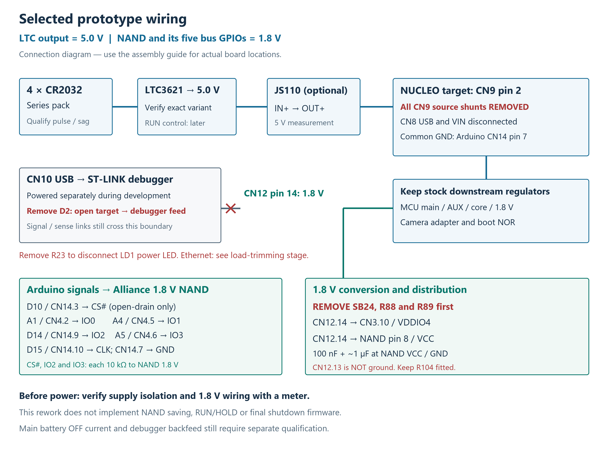
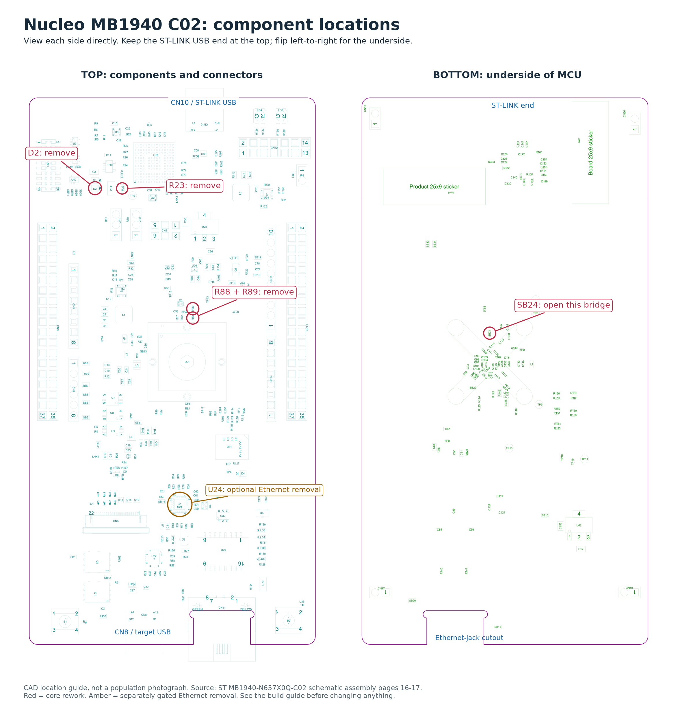
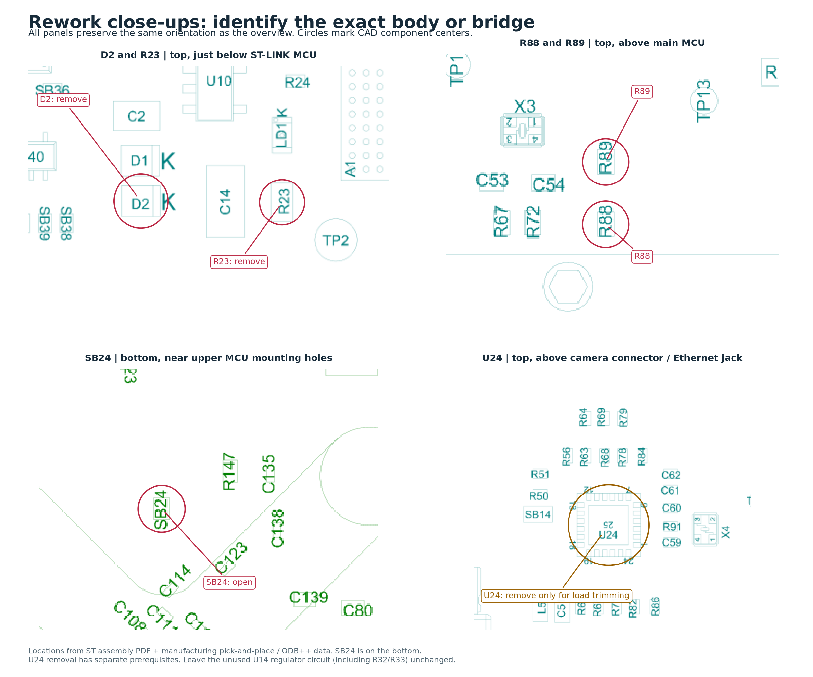
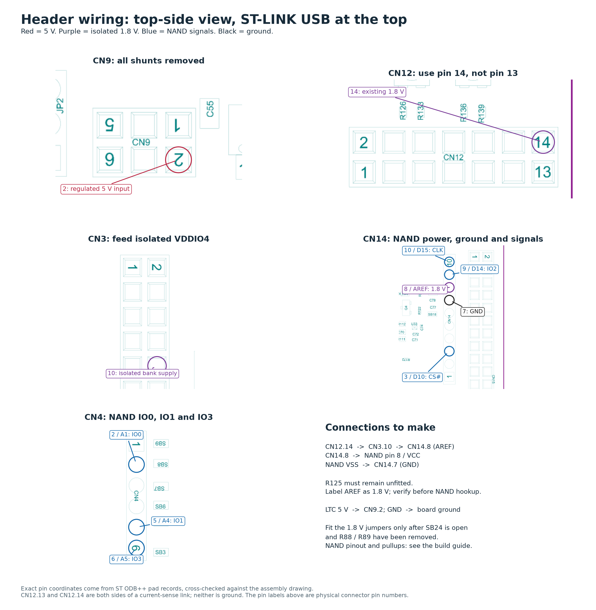

# Nucleo prototype: consolidated modification and wiring guide

**Selected October 18, 2026:** existing **AS5F14G04SND-10LIN NAND**, Arduino-header **bit-banged quad data**, and **LTC3621 at 5.0 V** feeding the Nucleo's existing downstream regulators. This is the current assembly path; earlier CN3/VDDIO5, translated hardware-XSPI and direct-3.3 V proposals are alternatives, not additional steps.

The plan is electrically sensible. The two costs are slower software-driven transfers and the remaining overhead of an evaluation board. Remove the large unnecessary loads as described below, retain convenient debugging during bring-up, then qualify complete-cycle energy. Four CR2032 cells' ability to supply startup and save pulses is still unmeasured.

**Scope:** MB1940 **N657X0Q-C02**. Locations come from ST's assembly, pick-and-place and connectivity files, not estimated positions on a photograph. Match the board revision and reference designators before rework. **User-reported progress, October 18: R23 and D2 removed.** No other removal or NAND wiring is yet reported, and this changed configuration has not been bench-qualified. V44 is programmed with complete 64 KiB readback verified, and the user reports the LEDs working. V41 remains the last instrument-qualified RAM-capture/recovery image; v44 capture, sleep and recovery checks remain pending. NAND saving and final power-off still need implementation. The user is now continuing physical modifications; recheck the actual wiring before bench work resumes.

## At the bench

**October 19 clarification:** the user confirms the GPIO banks are still at 3.3 V and will try the existing SD breakout without socket rework. The [current one-bit SDMMC2 experiment](sd-breakout-benchmark.md) uses CN3 for CLK/CMD/DAT0 and unused-DAT3 pull-up, plus CN5.4 for 3.3 V. It replaces the briefly proposed four-bit/socket-wire and Arduino SPI5 partial direct-plug experiments; no Nucleo voltage conversion is needed. This does not yet change the selected NAND assembly plan, and no SD result has been measured.

Follow these stages in order:

1. Remove the debugger's target-supply path and the target power LED.
2. Convert VDDIO4 to 1.8 V; verify its voltage before attaching NAND.
3. Feed Arduino AREF/CN14.8 from CN3.10, then wire the NAND entirely on the Arduino headers.
4. Feed the target from the meter-verified 5 V LTC output.
5. Remove the unused Ethernet PHY, then repeat the camera test.
6. Implement and test NAND storage and the final RUN/HOLD/shutdown cycle.

Keep the existing camera connection, boot jumpers, boot NOR, PE1 recovery circuit and timing probes. **Before soldering, disconnect CN8, CN10, LTC power and the JS110 OUT0 recovery lead; verify the rails have discharged.** Reconnect the recovery lead after rework. Its diode remains PE1 anode → OUT0 cathode, with OUT0 HIGH for normal boot and LOW for recovery.

Have a compatible NAND carrier, three 10 kΩ resistors, one 100 nF capacitor, approximately 1 µF of local bypass capacitance, and short hookup wires ready. No level translator is needed for this pin mapping.

## 1. Remove the debugger supply path and power LED

| Part | Action | Purpose |
|---|---|---|
| **D2**, BAT20JFILM, top | Remove, or lift one end and secure it clear of its pad. Leave an **open circuit**. | Stops target 5 V feeding U10 and ST-LINK. D1 still lets CN10 power the debugger independently. |
| **R23**, 820 Ω, top | Remove. | Disconnects LD1, the always-on target-power LED. The camera's status LEDs are separate. |

Keep **all CN9 shunts absent**. Leave **CN8 unplugged** during LTC/battery capture operation. CN10 can remain connected to the PC for separately powered debugging after D2 is open. Do not change JP3 or remove SWD/reset links in this first stage: we need the working recovery/programming path.

**D2 is supply separation, not full electrical isolation.** Debugger data, reset and sense connections remain. A powered debugger or recovery lead may contribute current across that boundary. Do not interpret a later Joulescope reading as qualified battery energy or 100 nA OFF current until those paths are isolated or measured. The [debugger audit](../power/nucleo-debug-isolation.md) retains that separate qualification task.

**Temporary USB-only functional operation:** after D2/R23 removal, CN8 can still power the target with CN10 unplugged. Disconnect LTC/external target power. Use either the existing CN9.3 → JS110 → CN9.2 route with all CN9 shunts absent, or, without that JS path, the normal CN9 **3–4** source-selection shunt. Do not fit the shunt across the JS measurement path. D2 removes the main debugger supply feed, but the unpowered debugger remains connected through signals and sense dividers. Its FT inputs lack the ordinary upper protection diode; that does not establish a powered-off leakage limit or qualify power transitions. **Keep CN10 independently powered for development; CN10-unplugged use remains an unqualified test configuration.** Qualification requires interface-current/loading checks as well as debugger rail voltage, target reset release and autonomous capture. See the [specific audit](../power/nucleo-debug-isolation.md#d2-and-r23-removed-cn8-only-functional-operation--october-18). LD1 is intentionally dark after R23 removal. This USB configuration is distinct from step 4's LTC-powered setup.

### MCU-controlled LEDs retained after rework

The three dedicated user LEDs remain available to the STM32N657 after D2/R23 removal:

| Board LED | Color | MCU GPIO | Drive |
|---|---|---|---|
| LD5 | Red | PG10 | LOW on, HIGH off |
| LD6 | Green | PG0 | LOW on, HIGH off |
| LD7 | Blue | PG8 | LOW on, HIGH off |

These pins do not overlap the selected Arduino NAND connections or the converted VDDIO4 bank. They are target-controlled and do not require debugger firmware. R23 removal affects only the separate LD1 power indicator. There is also a green Arduino LED, LD3, connected through SB18/Q4 to **D13/PE15** on C02. UM3417 §7.8 calls that pin PB15, but its own Table18 and the C02 schematic sheet10 identify D13 as PE15; use the schematic mapping. The dedicated LD5/LD6/LD7 group is selected for the prototype phase indication below. Verified against [UM3417 Rev4 §7.8 and Table18](https://www.st.com/resource/en/user_manual/um3417-stm32n6-nucleo144-board-mb1940-stmicroelectronics.pdf), [C02 schematic sheets10/12](https://www.st.com/resource/en/schematic_pack/mb1940-n657x0q-c02-schematic.pdf), and the local ST BSP definitions on October18; no hardware test was performed.

**D-48 phase indication, requested October 18:** red from the earliest custom-boot code to first exposure; blue from the first sensor STROBE rising edge through the complete frame arriving in RAM; green only during actual future NAND writing; all three off at sleep/shutdown. The preceding ROM interval cannot be indicated by custom firmware. There is no green in the RAM-only build, and no 250 ms success pulse. This replaces the older yellow/green normal sequence for the current prototype; product fault blink counts remain unchanged.

V44 implements an all-off shallow WFI completion path, with RAM/debug retention intended but instrumented checks still pending. It does not release RUN/HOLD or turn the regulator off. The user confirms the LEDs working and is continuing board modifications. The latest confirmed supply is CN8 directly through a CN9 shunt, bypassing JS110; restore and verify inline JS power, shared ground, recovery diode and probes before cold/recovery tests. See the [current checkpoint](../../firmware/capture-timing/README.md#october-18-checkpoint--v44-installed-leds-confirmed-by-user).

## 2. Convert the NAND GPIO bank to 1.8 V

| Part | Action | Purpose |
|---|---|---|
| **SB24**, 0 Ω, **bottom** | Remove/open. | Disconnects VDDIO4 from the board's main 3.3 V supply. |
| **R88**, 1.5 kΩ, top | Remove. | Removes PH9/SCL's pull-up to 3.3 V. |
| **R89**, 1.5 kΩ, top | Remove. | Removes PC1/SDA's pull-up to 3.3 V. |

Only after all three are open, wire **CN12 pin 14 → CN3 pin 10 (VDDIO4)**. Retain **R104**, the existing 1.8 V current-path link. **CN12 pin 13 is not ground**; pins 13/14 are a supply measurement pair.

Keep **SB23** in its original state. The old VDDIO5 plan is not part of this build. If that earlier rework was already made, reconcile it before continuing; never close a 3.3 V bridge onto an attached 1.8 V feed.

Preserve **SB8, SB3 and SB5**; keep **SB2 and SB4 open**, the default Arduino routing. This makes A1 = PC10, A4 = PC12 and A5 = PH2. A4 must not be tied to D14; A5 must not be tied to D15.

Before connecting NAND:

- With power off, check that VDDIO4/CN3.10 is no longer directly shorted to main VDDIO/CN3.5. Semiconductor paths can remain; an infinite resistance is not required.
- Temporarily power the board using the meter-verified **5 V hookup in step 4**, without reinstalling CN9 shunts. Measure **1.71–1.89 V at CN3.10** and approximately **3.3 V at CN3.5**. Then switch everything off again before connecting NAND.
- This changes the **entire bank**: PC1, PC6–PC12, PH2 and PH9. Do not connect a 3.3 V Arduino shield to those pins afterward.

The selected five bus pins belong to this bank. PA3/CS remains in the main 3.3 V bank and is handled by open-drain drive below. Camera I²C, camera reset, boot NOR, PE1 recovery and PD0/PE0 timing markers are not converted.

## 3. Connect the NAND

The Alliance chip is a bare **8 × 6 mm LGA-8**, not an Arduino module. Use a correctly matched carrier or a secure breakout assembly. A generic SOIC-8 adapter does not match its footprint. Check pin 1 against the package drawing; bottom-pad views are mirrored relative to the top-view pinout.

| NAND pin | Signal | Nucleo connection | Extra component |
|---:|---|---|---|
| 1 | CS# | **D10 / CN14.3 / PA3** | 10 kΩ to NAND 1.8 V; GPIO **open-drain only** |
| 2 | IO1 | **A4 / CN4.5 / PC12** | — |
| 3 | IO2 / WP# | **D14 / SDA / CN14.9 / PC1** | 10 kΩ to NAND 1.8 V |
| 4 | GND | **CN14.7**, Arduino GND | Common ground with LTC and board |
| 5 | IO0 | **A1 / CN4.2 / PC10** | — |
| 6 | SCLK | **D15 / SCL / CN14.10 / PH9** | — |
| 7 | IO3 / HOLD# | **A5 / CN4.6 / PH2** | 10 kΩ to NAND 1.8 V |
| 8 | VCC | **AREF / CN14.8**, repurposed as 1.8 V | Feed from CN3.10; 100 nF + approximately 1 µF to pin 4, close to chip |

All eight NAND connections now use Arduino headers, including VCC through the repurposed AREF contact. The board's stock Arduino headers have no 1.8 V power output; the two supply jumpers below provide it. Keep connections short, with a close ground return. Do not tie IO2/IO3 directly high; they become data lines in quad transfers.

**Canonical NAND power route, selected October 18:** retain **CN12.14 → CN3.10 (VDDIO4)**, add **CN3.10 → CN14.8 (AREF)**, and connect **NAND pin 8/VCC → CN14.8**. On C02, **R125 is not fitted**, isolating AREF from VREFP; confirm it remains absent and keep it absent. Install the AREF jumper with power disconnected after completing step 2. NAND ground stays **CN14.7** and local decoupling stays at the chip. This extends the regulator rail; it does not power the NAND from a GPIO. Check CN14.8 measures **1.71–1.89 V** before attaching NAND, and label the repurposed AREF contact **1.8 V**. Do not attach an external analog reference there.

This selected route supersedes the direct CN12.14-to-NAND wire; physical completion has not yet been reported. **CN5.1 is not a free NC contact on C02**: fitted R1 (1 kΩ) connects it to 5V_VIN. CN5.2/IOREF and CN5.4 remain 3.3 V after the bank4 conversion. These connections and R125's unfitted status were checked against C02 schematic sheet 10 and the C02 BOM; see the [ST schematic](https://www.st.com/resource/en/schematic_pack/mb1940-n657x0q-c02-schematic.pdf#page=10) and [BOM](https://www.st.com/resource/en/bill_of_materials/mb1940-bom.zip). No bench operation or physical modification was performed to update this plan.

**CS must never drive 3.3 V into NAND.** Firmware preloads PA3's released state, disables internal pulls and enables open-drain output. The external 1.8 V resistor provides HIGH. Do not use PA3 input readback as a guaranteed high indication: its input thresholds still belong to the 3.3 V domain.

The analog companions of A1/A4/A5 are high-value dividers feeding separate ADC buffers, not 3.3 V output drivers. Their small load can remain. The 1.8 V regulator is configured for a 0.5 A rating, but this is **not** 0.5 A of spare capacity. Verify rail droop with the NAND active; its specified active current can reach 30 mA.

## 4. Connect LTC power

Use **regulated 5.0 V at CN9 pin 2**, not the VIN pin. Retain the Nucleo's main, auxiliary, core and 1.8 V converters and the camera adapter's regulators.

| Connection | Wiring |
|---|---|
| With JS110 | LTC 5 V output → **JS110 IN+**; **OUT+ → CN9.2** |
| Without JS110 | LTC 5 V output → **CN9.2** |
| Ground | LTC ground → board GND, for example **CN14.7**; retain the JS110's common-ground/voltage-sense arrangement |
| Old source | Remove JS110 IN+'s old connection to **CN9.3** and unplug **CN8** |
| CN9 selection | **No shunts fitted** across any source pair |
| Debugger | CN10 may independently power ST-LINK after D2 is open |

CN9 pins 2/4/6 are the common target 5 V bus. Pins 1/3/5 are different upstream sources; do not bridge them together. CN8 must stay unplugged in this configuration because its USB paths bypass the measurement boundary, and simultaneous USB/battery source selection is not yet implemented. The LTC's shutdown function is not a qualified reverse-blocking power mux.

**Regulator confirmed by the user, October 18: DC1863A.** Its adjustable LTC3621 supports the selected 5 V directly. With power off:

- Fit the output-selection shunt at **JP7 / 5 V**; leave the other output-voltage selections open.
- Select **JP2 / BM** for Burst Mode.
- Initially select **JP1 / ON** to hold RUN enabled during bench bring-up.

Verify 5.0 V with a meter before connecting the Nucleo. The specified 5 V operating row requires at least 5.2 V input. Later, external button/GPIO RUN control requires removing JP1's forced ON/OFF connection and verifying the RUN node before attaching that circuit. The old fixed-3.3 V chip study does not describe this adjustable evaluation board.

Initially validate through the LTC from a current-limited bench source, then the four-cell pack. Regulator current capability does not establish coin-cell pulse capability. Measure rail sag and complete capture/save duration before treating the battery configuration as qualified. Measuring after LTC captures target-side energy; battery energy and main-path OFF leakage must be measured upstream of LTC.

## 5. Trim the remaining unused circuitry

Do this as a second rework stage so each change can be checked against the working camera baseline.

**Ethernet: remove U24, LAN8742A, if eliminating its load is the objective.** It is a 24-pin QFN with an exposed pad, so this is a hot-air/rework operation, more involved than removing the small links. Leave the surrounding parts in place, the Ethernet cable disconnected, and the MCU's unused RMII pins as inputs without pulls. The camera has its own clock; it does not depend on the Ethernet PHY.

Do **not** merely remove L5. L5 supplies the analog PHY branch, while U24's VDDIO and several pulls have other 3.3 V connections. Removing only L5 does not cleanly remove the PHY's power. If U24 removal is deferred, explicitly budget Ethernet overhead: firmware power-down can reduce it, but does not eliminate it. Holding the chip in reset is not its lowest-current state.

**Leave U14 and its R32/R33 supply links alone.** U14 is the unused internal-SMPS input converter, but C02 leaves its enable link R22 absent. The ST1S31's internal enable pull-down therefore already disables it. Its standby current is small; it is not an active converter wasting its running current. Removing R32/R33 would also leave capacitive input coupling through C26, so that is not a clean cutoff or worthwhile first-stage modification. The official C02 BOM confirms R10/R20/R22 not fitted. Leave the working external core supply and its selection links unchanged. Grounding the unused MCU PMU supply node is a separate ST startup recommendation requiring its own validation; this guide does not add that wire.

Some small board overhead remains deliberately: ADC buffers may serve exposure/battery measurements, and the USB controller will serve retrieval. Firmware must hold USB power-provider control disabled, keep unused LEDs off, disable unused peripherals, and stop camera/CSI activity after acquisition. This is a reduced-overhead development board, not a claim that every non-capture microamp has been removed. Debugger sense dividers alone load the powered target by about 165 µA from 3.3 V and 331 µA from 5 V; signal injection and OFF-state behavior still require separate checks.

## Component locations

The USB/debugger end is at the top of each overview. The bottom view is viewed directly from the underside, so left/right is reversed relative to the top. Follow the labels on the drawings rather than flipping coordinates mentally.

See the [diagram provenance and original coordinates](nucleo-assembly/README.md) for source files and verification. D2, R23, R88, R89 and U24 are top-side parts; SB24 is underneath.

## Bring-up acceptance checks

1. Inspect each removed component for an open connection and solder bridges. Confirm R125 remains absent, the two 1.8 V jumpers follow CN12.14 → CN3.10 → CN14.8, and the NAND VCC wire ends at CN14.8. Check 5 V/1.8 V to ground before power; confirm all CN9 shunts remain out. Verify 1.71–1.89 V at CN14.8 before attaching NAND.
2. Verify rail startup and a camera RAM capture using the existing guarded image, preserving the PE1 recovery guard. Repeat after each optional load trim. Successful meter readings alone do not qualify capture or cold boot.
3. In new firmware, enable the VDDIO4 monitor, wait for valid supply and release its isolation before bus use. Start with **VDDIO4VRSEL = 0** conservative 1.8 V operation; no HSLV OTP programming is needed for this first test.
4. Wait for the NAND's specified power-on interval and check OIP/ready before operations. Read identity/features/status at a slow software clock, keeping IO3/HOLD# high during single-bit commands. Preserve factory bad markers. Only then use a designated scratch block for erase/program/readback/ECC checks and characterize quad transfers. Keep ECC enabled; handle IO direction turnaround and CS rise time explicitly.
5. Integrate the accepted photo object/journal, commit verification, error reporting and optional payload readback. Measure actual Arduino bit-bang throughput; earlier 5 MHz examples were scenarios, not a result for these scattered pins.
6. Add RUN/HOLD, low-battery handling, product fault indications and ordered Standby/shutdown. HOLD needs a suitable main-3.3 V GPIO, not a converted 1.8 V bank4 pin. The qualified v41 baseline ends in an awake loop; installed v44 intends to use shallow WFI sleep, with instrumented confirmation pending. **Neither turns the regulator off.**

RTC, exposure potentiometer, product fault indications and USB source arbitration retain their separate implementation tasks. The existing Nucleo LEDs supply the selected prototype phase-indicator hardware. These modifications provide the processor/camera/NAND power and wiring base; they do not by themselves complete the standalone camera.

## References

- [ST MB1940 C02 schematic](https://www.st.com/resource/en/schematic_pack/mb1940-n657x0q-c02-schematic.pdf), sheets 3/4/7/9/10/13; [manufacturing archive](https://www.st.com/resource/en/board_manufacturing_specification/mb1940-manufacturing.zip).
- [UM3417 board manual](https://www.st.com/resource/en/user_manual/um3417-stm32n6-nucleo144-board-mb1940-stmicroelectronics.pdf), power and connector tables.
- [STM32N657 datasheet](https://www.st.com/resource/en/datasheet/stm32n657x0.pdf), GPIO banks and reduced-performance 1.8 V operation; RM0486 independent-supply control.
- [Alliance serial NAND family datasheet](https://www.alliancememory.com/wp-content/uploads/AllianceMemory_AS5F_QSPI_NAND_Flash_3V-1Gb-8Gb_1p8V-2Gb-4Gb-8Gb_Ver3.2_Jan2026-revised.pdf), exact non-C AS5F14G04SND device.
- [DC1863A manual](https://www.analog.com/media/en/technical-documentation/user-guides/dc1863af.pdf) and [LTC3621 datasheet](https://www.analog.com/media/en/technical-documentation/data-sheets/ltc3621-3621-2.pdf).
- [LAN8742A datasheet](https://www.microchip.com/content/dam/mchp/documents/OTH/ProductDocuments/DataSheets/DS_LAN8742_00001989A.pdf), supplies, reset straps and power-down behavior.
- [ST1S31 datasheet](https://www.st.com/resource/en/datasheet/st1s31.pdf), §4.5: the internal EN pull-down disables the converter when EN floats.
