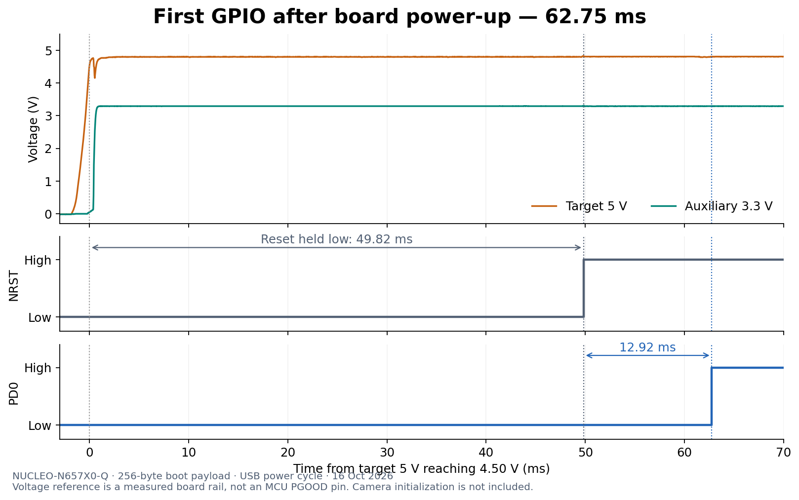

# First GPIO autonomous boot measurements — October 16, 2026

The NUCLEO-N657X0-Q successfully loaded the small first-GPIO image from its onboard external NOR on two recorded power-up events. The first PD0 marker occurred **62.911 ms** and **62.748 ms** after the target 5 V rail crossed 4.50 V. Approximately 49.5–49.8 ms of each interval elapsed with NRST still low; execution reached PD0 approximately 12.9–13.4 ms after NRST rose.

This proves autonomous execution of this payload on this board. It **does not qualify the 50 ms button-to-exposure requirement**, measure sensor exposure, or establish a 63 ms minimum for an optimized custom STM32N6 design. The source of the approximately 50 ms reset hold remains unresolved. Only the named external rails were observed; complete discharge of every MCU and camera power domain was not measured.

The bench date is October 16 in America/New_York; some raw logs are timestamped October 17 UTC.

## Configuration and measurement references

- Board: NUCLEO-N657X0-Q, with the previously mounted CAM-6G3-073CLR camera. The first-GPIO payload does not initialize or capture from the camera.
- Power/debug connection: ST-LINK USB at CN10. The JS110 was inserted into the selected target supply path in place of the CN9 STLK jumper, as described in the [power-boundary study](../../docs/power/nucleo-debug-isolation.md#reversible-js110-insertion--october-16). The earlier unexplained reading at the intended CN15 pin 8 source probe remains unresolved; no new wiring conclusion is inferred from it.
- Autonomous boot setting: **JP1 (BOOT0) and JP2 (BOOT1), both on pins 1–2**. This supersedes the JP2 2–3 development-mode setting used for RAM bring-up. [ST Nucleo standalone template](https://github.com/STMicroelectronics/STM32CubeN6/blob/main/Projects/NUCLEO-N657X0-Q/Templates/Template/README.md)
- Instrument: Saleae Logic Pro 8, Logic 2.4.46, 6.25 MS/s digital and 31.25 kS/s analog. Digital sample spacing is **0.16 µs**; analog spacing is **32 µs**. The shared digital threshold uses the 3.3 V logic-family setting, nominally 1.65 V; this is distinct from the explicit analog voltage crossings below. [Saleae threshold specification](https://www.saleae.com/support/specifications-hardware/electrical-characteristics/supported-voltages)
- The timing captures recorded manual power transitions; the capture program did not download, start or halt the target during those transitions.

| Channel | Physical connection | Meaning |
|---|---|---|
| CH0 | CN3 pin 14 | Target NRST |
| CH1 | CN15 pin 33 | PD0, first payload marker |
| CH2 | CN15 pin 29 | PE0, second payload marker |
| CH3 | CN3 pin 16 | Auxiliary `VDD3V3`, not main MCU VDDIO |
| CH4 | CN3 pin 18 | Target `5V`; primary power-on reference |
| CH5 | CN3 pin 6 | Second probe on the same target `5V` net |
| GND | CN15 pin 20 | Common instrument/board ground |

Connector assignments follow [UM3417](https://www.st.com/resource/en/user_manual/um3417-stm32n6-nucleo144-board-mb1940-stmicroelectronics.pdf) and the [MB1940 C02 schematic](https://www.st.com/resource/en/schematic_pack/mb1940-n657x0q-c02-schematic.pdf). CH4 and CH5 are duplicate target-rail observations, not source/output measurements around the JS110. There is **no MCU PGOOD, main VDDIO, VDDA1V8_AON, core-supply or individual camera-rail probe** in this setup.

The primary reference is the first sampled rising crossing of **4.50 V on CH4**, not the USB plug event, PC command timestamp, or CH4's digital logic transition. The auxiliary reference is CH3 crossing **2.97 V**. These are reproducible bench thresholds, not proof that every MCU supply is valid at that instant. The second trace includes a brief dip after the first 4.50 V crossing; this table deliberately uses the first crossing, not a settled-rail criterion.

## Payload, preservation and programming

The [assembly payload](first_gpio.S) is 256 bytes, linked at `0x34180400`, with initial stack `0x34181000` and reset vector `0x34180441`. It enables the GPIO clocks, configures PD0 and PE0, raises them in order, then remains in ordinary Sleep with both outputs high. It contains no HAL/RTOS startup, camera operation, OTP/security-state writes or external-memory writes. The [header wrapper](add_boot_header.py) produced a **1,280-byte unsigned STM32 v2.3 boot image**; its independently checked format is documented in [header-evidence.md](header-evidence.md).

Before programming, the complete **64 MiB NOR** was read and preserved. A separate re-read of the first **64 KiB erase sector** matched the corresponding bytes in the full backup. The first sector was then programmed with the boot image at `0x70000000` and verified. This replaced the original contents of that sector; it was not a whole-device erase. No OTP or lifecycle change was made.

The durable local recovery copy is in the Git-ignored directory:

```text
hardware/local-backups/nor-before-first-gpio-20261016/
    full-64MiB.bin
    first-sector-check.bin
    backup-manifest.json
```

These binaries are local, **not included in the public Git repository or its remote backup**. The original working copy remains under `tmp/bringup/nor-backup-20261016/`. The actual manifest filename is `backup-manifest.json`.

| Artifact | Bytes | SHA-256 |
|---|---:|---|
| Original complete NOR, `full-64MiB.bin` | 67,108,864 | `63e5f8f04e3aee52d5647cad0dc2036b39256e9f61d92c644b9418657d8622f1` |
| Original sector re-read, `first-sector-check.bin` | 65,536 | `e71ffe257e1f3b7825d58b707b8c7d68db297739efe0b1987310eceb2b7070aa` |
| Raw payload, `build/first_gpio.bin` | 256 | `14d4c8ff2fc72c9df04dafa4a1a910a5f9fec39f09cc9e2d3e10e91105e34c44` |
| Boot image, `build/first_gpio_boot.bin` | 1,280 | `1c1aeff1a482f5edd6509cbcdef52da976cc5cc07e4b92bcfedebd0d08820cca` |

The saved manifest reports `first_sector_read_twice_matches: true`; the full backup contains 117,404 bytes different from `0xff`. Hashes of the durable copies and build files were rechecked while preparing this record.

Before changing NOR, a debugger-loaded RAM run reached `boot_idle` and confirmed PD0/PE0 mode and output-register values. The accompanying `first-gpio-ram-trace-01` capture measured **2.24 µs** from PD0 to PE0. This validated the payload and probe wiring; the debugger-loaded execution and its GPIO spacing are **not autonomous boot-time measurements**. The RAM log includes a debugger breakpoint-removal warning despite the observed marker/register pass; the later standalone flash boots provide the independent execution evidence.

## Successful autonomous captures

| Measurement | `first-gpio-cold-01` | `first-gpio-cold-03` |
|---|---:|---:|
| Target 5 V crosses 4.50 V, capture time | 55.552610162 s | 44.374626162 s |
| Auxiliary 3.3 V crosses 2.97 V, capture time | 55.552226162 s | 44.375266162 s |
| NRST rises, capture time | 55.602095840 s | 44.424450240 s |
| PD0 rises, capture time | 55.615521120 s | 44.437373760 s |
| **Target 5 V → PD0** | **62.910958 ms** | **62.747598 ms** |
| Target 5 V → NRST | 49.485678 ms | 49.824078 ms |
| NRST → PD0 | 13.425280 ms | 12.923520 ms |
| Auxiliary 3.3 V → PD0 | 63.294958 ms | 62.107598 ms |
| PD0 → PE0 | 0.48 µs | 0.48 µs |
| Preceding uninterrupted sampled interval below 0.1 V: target 5 V | 0.461856 s | 44.372896 s |
| Preceding uninterrupted sampled interval below 0.1 V: auxiliary 3.3 V | 1.428288 s | 44.374784 s |

The extra decimal places preserve the exported calculations, **not nanosecond accuracy for analog references**. Any interval involving a rail crossing inherits the 32 µs analog sampling granularity, plus voltage accuracy, threshold selection, and ramp-shape effects. Digital-only intervals use 0.16 µs sample spacing; the 0.48 µs marker separation is three digital sample periods. Two successful events are not a distribution or a worst-case timing bound.

In `first-gpio-cold-03`, target 5 V briefly dips to approximately **4.154 V** after its first 4.50 V crossing. Its final upward 4.50 V crossing is **44.375298162 s**, 0.672 ms later than the primary reference; using this alternative gives **62.075598 ms to PD0**. `first-gpio-cold-01` has no additional crossing of this threshold during startup. Neither reference brings the observed power-to-marker interval below 50 ms.

The measured NRST 10–90% analog rise takes approximately **0.54–0.58 ms**. Its digital threshold edge is an external observation, not the exact instant of internal CPU reset release. Accordingly, the NRST-to-PD0 intervals above must not be interpreted as isolated ROM execution times.

The first capture's power-low interval between digital transitions was about **2.44 seconds**, although a 15-second wait had been requested. Use the observed waveform rather than the requested dwell. As a direct check, during capture time 55.4–55.5 s, CH4/CH5 were near zero, NRST was near zero, and CH3 was **0.064–0.074 V**. The second capture independently started with the observed rails low and retained approximately **44.37 seconds** of sampled off-state before power returned.

Both captures therefore show substantial discharge of the observed target 5 V and auxiliary 3.3 V rails and subsequent standalone marker execution. Neither proves that unprobed VDDIO, AON, core or camera rails reached zero. They are qualified as **autonomous starts after observed rail discharge**, not complete characterization of every cold-start condition.



## Approximately 50 ms reset hold: established facts and open cause

The first capture's analog NRST trace remains near zero while target 5 V and auxiliary 3.3 V are already stable, then rises. For example, at 55.58–55.59 s the medians are NRST approximately −0.016 V, auxiliary 3.3 V approximately 3.293 V, and target 5 V approximately 4.791 V. This is consistent with an active reset hold followed by release, rather than a 50 ms passive rise of the reset capacitor.

The board's reset block contains **C80 = 10 nF**, U35 ESD protection and button B2; it does not show a timed reset supervisor. ST-LINK `T_NRST/PA6` also connects through **R75 = 0 Ω** to target NRST. [Schematic, sheets 12 and 13](https://www.st.com/resource/en/schematic_pack/mb1940-n657x0q-c02-schematic.pdf)

DS14791 specifies a **30–50 kΩ** NRST pull-up. With 10 nF, the simple RC time constant is approximately **0.3–0.5 ms**. Its reset/power-control table specifies a **200 µs minimum** POR reset temporization, without a typical/maximum value; it does not establish a fixed 50 ms startup delay. [DS14791, tables 26 and 71](https://www.st.com/resource/en/datasheet/stm32n657x0.pdf)

`RCC_RDCR.EADLY` is the ROM's wait before accessing an external device, with a reset default of **5 ms**. Its optional 50 ms value is not a specification for holding NRST low. The separate `MRD` field defaults to zero, bypassing the optional approximately 1–31 ms pulse-duration extension. Hardware initialization also includes option-byte loading before internal system reset releases. These mechanisms must not be conflated with the measured external NRST interval. [RM0486 §§14.5.7, 14.5.9 and 14.10.106](https://www.st.com/resource/en/reference_manual/rm0486-stm32n647657xx-armbased-32bit-mcus-stmicroelectronics.pdf)

**Unresolved:** whether ST-LINK control, internal MCU power/reset conditions, or another board interaction causes the approximately 50 ms hold. No measurement here identifies the device driving NRST. The 5 ms ROM external-access wait may contribute to the subsequent 12.9–13.4 ms interval, but that contribution has not been isolated. No timing-related register or hardware change was made to remove the hold.

After the completed second capture, a read-only CubeProgrammer HOTPLUG attempt to inspect reset registers reported target voltage 3.27 V but failed with “Unable to get core ID.” No `RCC_RSR` or `RCC_RDCR` values were obtained. No explicit reset or OTP operation was requested, and no further debug-access attempt was made for this check. The local log is `first-gpio-cold-03/reset-registers.log`; the failed inspection does not invalidate the already recorded autonomous marker edges.

## JS110 switching and unsuccessful power restoration

The JS110 is a measurement device with a controllable current path; it does not generate the target's supply. Its standard voltage measurement is **IN+ relative to IN−**, upstream of its output disconnect. The helper uses one persistent `Driver` session opened in `restore` mode and JS110 topic `s/i/range/select`: `off` is range 0, `auto` is range 128. Native statistics arrive around 2 Hz and can precede a command, so each record includes their age. [JS110 user guide, §§9.3 and 10.2](https://download.joulescope.com/docs/JoulescopeUsersGuide/JoulescopeUsersGuide_v1_3.pdf), [helper](js110_session.py)

`power-path-01` was an initial GUI-operated diagnostic. Selecting off brought the target rails down. The 5 V tail was long: CH4 first went below 0.1 V at 23.429410 s after crossing downward through 4.5 V at 15.618210 s. A later small pulse peaked at 0.369 V on CH4 and 0.365 V on CH5 at 27.946786 s; neither auxiliary 3.3 V nor NRST returned high. Both 5 V channels stayed below 0.1 V after approximately 27.970 s through the 40.064 s capture end. Final 39–40 s medians were CH0 −0.021 V, CH3 −0.013 V, CH4 −0.017 V and CH5 −0.024 V, consistent with instrument zero offsets. The generic smoke-test checker reports failure because this capture intentionally lacks its GPIO/reset pulse pattern; that result is not a failed boot-image test.

`first-gpio-cycle-02` provides stronger evidence about the restoration problem:

| Event | Recorded evidence |
|---|---|
| Select `off` | API confirmed range 0. The immediate statistics still included the preceding powered measurement and cannot characterize the off state. |
| Query after approximately 15.10 s off | Range 0; JS110 input average **4.916069 V**, current **0 A**. The source remained present with the current path open. |
| Select `auto` | API confirmed range 128. Its immediate voltage statistic was the preceding off-state sample, not evidence of successful reconnection. |
| Query approximately 2.12 s later | Range 128; input average **−0.000908 V**, current approximately **−1.53 µA**. Input supply had collapsed to approximately zero. |
| Target capture | No successful rail-to-GPIO startup event; the target remained down. |
| Recovery | Replugging ST-LINK USB restored target power; the later `first-gpio-cold-03` trace again reached both markers. |

Thus this observed source collapse occurs **on reconnection**, rather than being an ordinary no-load timeout during the 15-second off interval. It is not evidence that the JS110 failed to accept the range command. The ordinary no-load explanation is superseded by this trace.

The board's U6 eFuse is enabled by ST-LINK `T_PWR_EN` after USB enumeration. Its current limit is managed by ST-LINK. The schematic's TPS259535 option is **auto-retry**, so an eFuse hardware latch-off is not an established explanation. Reconnection inrush, protection response, ST-LINK control or the physical power boundary remain candidates. USB replug recovery resets multiple parts of that system and does not isolate the cause. [UM3417 §7.4.1](https://www.st.com/resource/en/user_manual/um3417-stm32n6-nucleo144-board-mb1940-stmicroelectronics.pdf), [schematic sheet 13](https://www.st.com/resource/en/schematic_pack/mb1940-n657x0q-c02-schematic.pdf), [TPS2595 device comparison and protection behavior](https://www.ti.com/lit/ds/symlink/tps2595.pdf)

Until the source behavior is resolved, use observed manual USB power cycles for these boot comparisons. A future automated cycle must verify both actual rail discharge and successful rail restoration; a range setting alone proves neither. No power-path modification is prescribed by this result.

## Evidence locations and next questions

Large raw recordings remain local under ignored `tmp/bringup/`. The numeric findings, hashes, interpretation and plot above are the durable repository record. The [evidence directory](evidence/) also preserves both successful runs' digital transitions, capture configurations and calculated summaries, plus SHA-256 hashes of their original `.sal` and CSV files. The tracked [NOR manifest](nor-backup-manifest.json) duplicates the local backup's verification metadata without publishing its binary contents.

| Local evidence directory | Contents / purpose |
|---|---|
| `first-gpio-ram-01` | RAM debugger/register validation log |
| `first-gpio-ram-trace-01` | RAM GPIO wiring/operation capture; `.sal`, CSV and stimulus logs |
| `power-path-01` | Initial GUI power-path diagnostic, rail-decay trace |
| `first-gpio-cold-01` | First successful autonomous boot; `boot.sal`, CSV, capture configuration and `boot-summary.json` |
| `first-gpio-cycle-02` | Failed API reconnection; capture and `cycle-log.jsonl` |
| `first-gpio-cold-03` | Second successful autonomous boot after prolonged observed off-state; capture and summary |

Offline timing summaries can be regenerated with `python firmware/boot-timing/analyze_capture.py <capture-directory>`. The analyzer does not access the board. Inspect off-state intervals and waveform shape alongside the summary; its threshold detector can arm on a single low sample.

Resolve the remaining questions in this order:

1. Identify the source of the active reset hold, distinguishing board/debugger behavior from MCU behavior before changing it.
2. Resolve the source collapse on JS110 reconnection before relying on automated power cycling or synchronized energy measurements.
3. Qualify actual MCU/AON/core and camera supply timing and discharge, then add sensor-initialization and exposure markers or an optical exposure test.

At this checkpoint the board is in normal flash boot with the first-GPIO image installed. The original NOR contents remain recoverable from the local backup. The camera capture program remains a separate RAM bring-up program and is not the installed autonomous image. After stopping the persistent JS110 helper, the GUI connection was restored with current range `auto`; the last input-supply reading before closing the helper was approximately **4.8406 V**.
