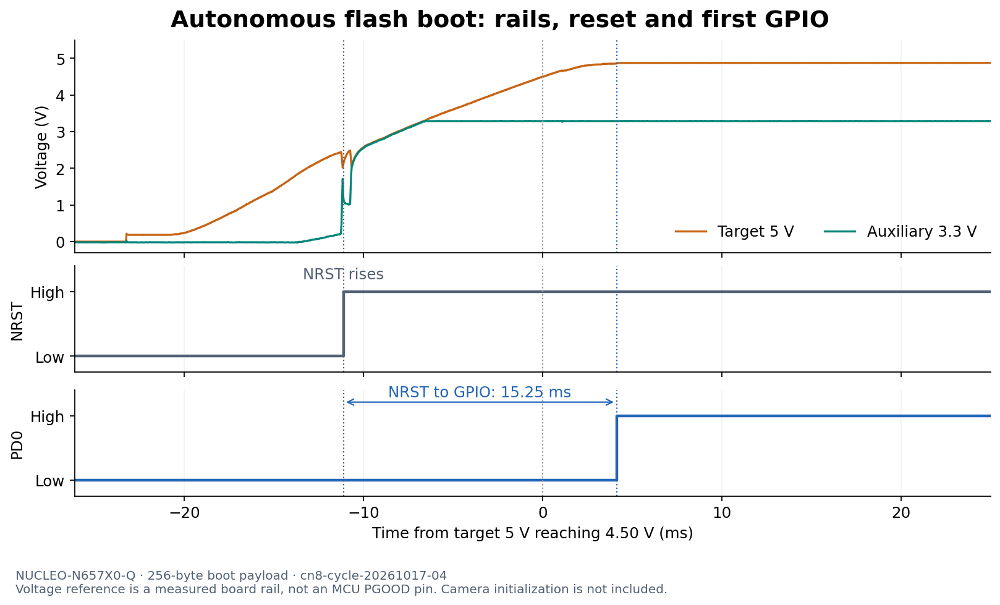

# CN8-powered autonomous boot and API cycling — October 17, 2026

**The bench can now power-cycle the target through the JS110 API and boot the installed NOR image without a debugger command during each cycle.** Three fully recorded repeat cycles passed after an initial stuck reset was released. They reached PD0 **15.20–15.43 ms after NRST rose**, or **22.67–22.90 ms after the target supply crossed 0.5 V**. Both monitored rails were continuously below 0.1 V together for **12.97–13.08 seconds** before each restart.

This validates the current supply route and first-GPIO experiment. It does not measure sensor startup or exposure, prove complete discharge of unprobed rails, or qualify the 50 ms button-to-exposure requirement. Three repeats are not a worst-case bound. The installed image and firmware hashes are unchanged from the [October 16 experiment](bench-results-2026-10-16.md); no NOR, OTP or security setting was changed today.

## Supply, instruments and probes

The user confirmed this wiring before the test:

```text
Second USB supply → CN8 → CN9 pin 3 → JS110 IN+
JS110 OUT+ → CN9 pin 2 → target board 5 V
All CN9 shunts absent; VIN unused
Original ST-LINK USB stays connected to CN10
JS110 IN− and OUT− share board ground (CN5 pins 6 and 7)
```

The new route avoids the ST-LINK-controlled CN9.1 source that shut down during prior reconnection attempts. It does not disconnect the debugger's D2 supply-sharing branch or signal interfaces. The [power-path study](../../docs/power/nucleo-debug-isolation.md) retains the schematic rationale, protection qualifications and external-SMPS inrush warning. No PCB rework or increased current limit was used. These low-rate statistics do not characterize inrush or establish that the previously documented board supply issue is resolved.

NUCLEO-N657X0-Q / MB1940 C02 retains the mounted CAM-6G3-073CLR. JP1 BOOT0 and JP2 BOOT1 remain on pins 1–2 for normal flash boot. The 256-byte first-GPIO payload raises PD0 then PE0 and sleeps; it does not initialize the camera.

| LP8 channel | Connection | Meaning |
|---|---|---|
| CH0 | CN3 pin 14 | NRST |
| CH1 | CN15 pin 33 | PD0, first marker |
| CH2 | CN15 pin 29 | PE0, second marker |
| CH3 | CN3 pin 16 | Auxiliary 3.3 V, **not main MCU VDDIO** |
| CH4 | CN3 pin 18 | Target 5 V |
| CH5 | CN3 pin 6 | Duplicate target 5 V |
| GND | CN15 pin 20 | Common reference |

All instrument control was through APIs. Logic 2.4.46 remained running on port 10430, controlling LP8 `6753424D9C96677D`. Capture rates were 6.25 MS/s digital and 31.25 kS/s analog: **0.16 µs digital** and **32 µs analog** sample spacing. The selected digital family was 3.3 V, not a 3.3 V logic trip threshold.

The user closed the Joulescope GUI to release exclusive access. `pyjoulescope_driver` 2.5.4 opened JS110 `u/js110/000163` in restore mode, starting at current range 128 (`auto`) and voltage range 0 (15 V). The persistent helper commanded `off` (range 0), waited about 20 seconds, then restored `auto`. JS110 voltage is measured at **IN+ relative to IN−**, upstream of its disconnect. Native approximately 2 Hz statistics support source-presence checks, not waveform timing or peak-inrush claims.

## Initial reset problem and recovery

The passive preflight found target 5 V about 4.894 V and auxiliary 3.3 V about 3.309 V, but NRST and both markers low. In `cn8-cycle-20261017-01`, switching off and back on restored both rails; the input source stayed about 4.985 V while off and about 4.925 V after restoration. Both observed rails had been below 0.1 V together for 13.029 seconds. Nevertheless, NRST remained physically near zero throughout and the firmware did not reach either marker. Source restoration alone was therefore not a boot pass.

We recorded one diagnostic CubeProgrammer connection using the documented hardware-reset-pulse mode:

```text
STM32_Programmer_CLI -c port=SWD sn=002100203335511035383531 mode=HWRSTPULSE freq=1000
```

The log reported 3.28 V, device ID `0x486`, revision Z and STM32N6xx; connection succeeded. In `cn8-reset-release-20261017-02`, NRST rose at 18.034786560 s, PD0 at 18.047666880 s and PE0 at 18.047667360 s: **12.880320 ms NRST→PD0**, then **0.480 µs PD0→PE0**. The rails were already powered. This was a debugger-assisted reset diagnostic, not a cold-power timing result. [ST's command-line reference](https://dev.st.com/stm32cube-docs/prog/2.23.0/en/docs/markup/CubeProg_Command_Lines.html) describes `HWRSTPULSE` as pulsing reset before attempting connection.

No further debugger command was issued during the subsequent power-cycle experiments. The reset hold did not recur. This implicates reset-control state as something to investigate, but does not establish which device originally held NRST, why it happened, or that the old roughly 50 ms hold had the same cause. Target MCU POR and the ST-LINK reset output both remain relevant; auxiliary 3.3 V alone does not establish the MCU's main/AON rail state.

One additional API cycle was issued after capture `-03` had already timed out. Its source statistics showed restoration, but its trace contains no power transition; it is excluded from all timing and repeatability counts. Start and complete each future cycle within a fresh, confirmed-active capture window.

## Three recorded autonomous repeats

Each repeat used a fresh capture, about 20 seconds commanded off, restoration, and a stable final interval. There were no debugger reset/connect operations between these runs. Times below come from measured waveforms, not host command timestamps.

| Measurement | `-04` | `-05` | `-06` |
|---|---:|---:|---:|
| Both measured rails continuously <0.1 V | 13.000320 s | 12.969536 s | 13.080896 s |
| Target 5 V first crosses 0.5 V → PD0 | 22.712398 ms | 22.667438 ms | 22.896718 ms |
| Target 5 V first crosses 4.50 V → PD0 | 4.120398 ms | 4.043438 ms | 4.272718 ms |
| Final sustained 4.50 V crossing → PD0 | 4.056398 ms | 3.979438 ms | 4.208718 ms |
| Auxiliary 3.3 V first crosses 2.97 V → PD0 | 12.248398 ms | 12.171438 ms | 12.400718 ms |
| **NRST rising → PD0** | **15.248320 ms** | **15.196480 ms** | **15.431040 ms** |
| PD0 → PE0 | 0.480 µs | 0.320 µs | 0.320 µs |

The full directory names are `cn8-cycle-20261017-04` through `-06`. Each has exactly one NRST/PD0/PE0 rising sequence, no later falling marker/reset edge, and stable final rails and markers. The source was about **4.985 V while off** and **4.905–4.906 V under the restored load**. Settled current through the measured path was about **95.5 mA**, not optimized product sleep current or isolated MCU current.

**The 4 ms number is not complete startup time.** NRST rises during the slow supply ramp, before either selected 90% voltage reference. The 5 V rise from 0.5 to 4.5 V takes approximately 18.6 ms. Each trace has a brief threshold recrossing; the final 4.5 V crossing is 64 µs later than the first. The 0.5 V reference captures more of the ramp but is still a chosen threshold, not the instant of button press or source application.



The displayed decimal places preserve calculations, not equivalent measurement accuracy. Analog-based intervals have 32 µs sampling granularity plus threshold, voltage and ramp uncertainties. NRST's digital edge is an external threshold observation, not the exact instant of internal reset release or isolated ROM execution. The different source, ramp and reset-control history prevent attributing the improvement over October 16 to a single cause or claiming a firmware optimization.

The generic analyzer reported a zero-duration auxiliary off interval for `-04` and `-06` because of a final noisy sample near 0.1 V. Independent scanning found the long continuous low plateaus reported above. The new [offline inspector](inspect_cycle.py) checks continuous off dwell, marker order, all rail crossings and stable final levels, and fails a trace without the required boot sequence. Its JSON findings are preserved with the evidence. It validates observed waveforms; physical boot mode and absence of debugger commands are established by the procedure separately.

## Final state and evidence

At 04:17:22 UTC, the helper restored its starting range 128 and closed normally, releasing JS110 ownership. `cn8-session-close-20261017-07` recorded all six digital channels high throughout about 45 seconds spanning that close. Final analog samples were about 4.868 V target supply and 3.288 V auxiliary supply, with NRST and both markers high. **The board was left powered in normal flash boot; the Joulescope GUI remains closed, and no helper remains running.** Logic 2 remains available for the next API capture.

Raw `.sal` and analog CSV files remain local under ignored `tmp/bringup/`. The tracked [October 17 evidence directory](evidence/cn8-20261017/) contains compact digital transitions, configurations, summaries, independent reviews, command logs and a hash manifest for the raw files. The first failed cycle and reset recovery are retained along with the successes. No captured scene photos are published.

For another trial, start `js110_session.py` in restore mode with fresh mailbox paths, verify its ready state, start `capture_manual.py` with sufficient remaining time, then run `cycle_once.py --off-seconds 20` against those mailboxes. Stop the capture only after restoration and a stable final interval; run `inspect_cycle.py` offline. End the helper with `stop`, and verify physical rails after ownership release. A command response alone never establishes power restoration.

The next useful refinement is to measure **main VDDIO** in place of the duplicate 5 V probe (CN3 pin 5 is the documented VDDIO point), then add sensor-initialization/exposure timing to an autonomous image. Main/AON/core/camera rail discharge, startup energy, battery operation, full-resolution capture and the 50 ms exposure requirement remain open. The minimal first-GPIO image does not provide these functions.
