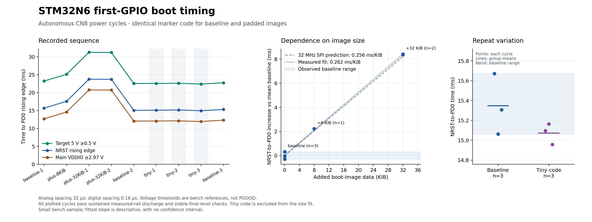
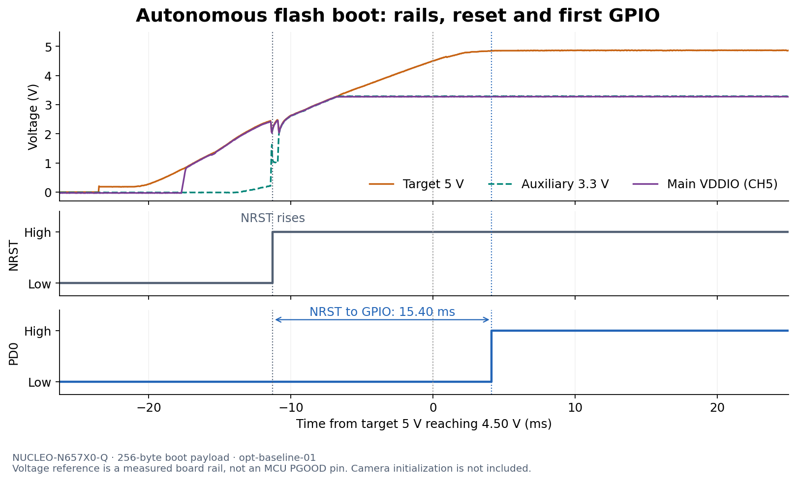

# Boot startup optimization experiments — October 17, 2026

The original first-GPIO test already uses a **256-byte bare-metal payload**, packaged as a **1,280-byte ROM boot image**. It loads neither the camera application nor HAL/RTOS. The completed comparison below finds a substantial cost for additional ROM-loaded firmware, but no demonstrated millisecond-scale benefit from further shortening this already-small marker path. It does not establish an absolute minimum or qualify the 50 ms button-to-exposure requirement.

## Completed comparison and present bench state — 05:40 UTC

**Nine autonomous cold boots passed, without another cable or jumper action.** The sequence was baseline, +8 KiB, +32 KiB twice, baseline, tiny three times, and baseline. Each used the same CN8 supply route, 20-second commanded off dwell, automatic JS110 range, and normal flash boot. Independent analysis checks sustained discharge below 0.1 V on target 5 V, auxiliary 3.3 V **and main VDDIO**, ordered markers, continuous exports and stable final rails. There were no debugger commands during measured starts. No OTP, fuse or lifecycle settings changed.

| Image | Packaged bytes | Repeats | NRST→PD0, ms | Target 5 V crossing 0.5 V→PD0, ms |
|---|---:|---:|---:|---:|
| Awake debug baseline | 1,472 | 3 | 15.063–15.672 | 22.563–23.228 |
| Identical code +8 KiB inert data | 9,664 | 1 | 17.583 | 25.129 |
| Identical code +32 KiB inert data | 34,240 | 2 | 23.715–23.756 | 31.217–31.266 |
| Shorter marker + same debug hook | 1,408 | 3 | 14.957–15.165 | 22.399–22.624 |

The descriptive size fit is **0.262 ms/KiB**, close to **0.256 ms/KiB** for the documented 32 MHz, single-bit serial-NOR load. This is a six-point fit including the three baselines; it has no confidence interval, and baseline NRST timing spans **0.608 ms**. ROM loads the complete selected initial image before handing over. Keeping only the earliest required work in that image can avoid roughly 8 ms per 32 KiB of later code. This supports the accepted staged-loading policy; it does not select a final bootstrap size.

The tiny image removes 60 executable bytes and 64 packaged bytes, retaining the same 176-byte post-marker debug hook. Its mean NRST timing is 15.073 ms versus 15.348 ms for the baseline, but the 0.275 ms difference lies within baseline variation. It does **not** establish that the code change caused that overall saving. The shorter PD0→PE0 interval is observable (0.16 µs versus 0.32–0.48 µs), while the initial-load reduction alone predicts only 16 µs. Do not present the fastest single run as a guaranteed startup limit.

The [matrix evidence](evidence/boot-matrix-20261017/) retains compact captures, complete analysis, ROM buffers/decodes, programming proofs and source/chart provenance. Large analog CSV/Saleae files and complete NOR content remain local with recorded hashes. Analog spacing is 32 µs and digital spacing 0.16 µs. These voltage thresholds are bench references, **not PGOOD**; unprobed AON/core/flash supplies remain unqualified.

ROM traces confirm the different image lengths and first-location boot. Some apparent load-phase spans cross secure/nonsecure trace buffers and therefore assume a shared timebase; they are not independently established phase durations. The external size comparison does not depend on that assumption. The older same-buffer 5,020-tick interval remains compatible with the documented five-millisecond EADLY setting, but its event names and external time alignment are unresolved.

The remaining [documented optimization limits](experiments/optimization-limits.md) cover fixed ROM serial-NOR protocol, required alignment, cache behavior and power-on reset defaults. There is no further documented reversible setting identified that would remove milliseconds before this same cold boot's handoff. Faster rail startup and sensor/application sequencing remain worthwhile investigations. This conclusion is specific to the board, ROM and tested supply setup; it is not an absolute silicon floor. Button-to-rail delay and actual sensor integration start still require measurement for the 50 ms target.

### Reliable programming and final state

The guarded WinUSB recovery resolved the observed debugger transport failure. The replacement [RAM NOR programmer](experiments/rom-nor-programmer/README.md) preserves the ROM's working XSPI1/port-2 route and clocks. Hardware tests established the expected JEDEC ID, two exact pre-write 64 KiB reads, a no-change operation with zero write enables, refusal of a deliberately incorrect current CRC before write enable, and successful changed-sector writes with full host readback. The following 4 KiB guard region matched before and after the experiments. [Programmer evidence](evidence/nor-programmer-20261017/) records the preliminary tests; matrix evidence records subsequent programs. The standard external loader's initialization problem remains unresolved and is avoided in this normal-boot workflow.

The final first 64 KiB is the **awake revision-2 baseline**, SHA-256 `4f22cc11e9819dd499489abb1f3c6a884098c70fcf0e16960b30705c098fa758`, with the 1,472-byte boot image and preserved original tail. The exact original non-debug sector remains backed up locally; it was deliberately **not** restored, so subsequent work can use AP1 without routine BOOT1 changes. Final normal boot passed, and a nonhalting/nonresetting AP1 read verified the debug marker record afterward. JP1/JP2 remain on pins 1–2, all CN9 jumpers absent, and both USB supplies/probes unchanged.

The JS110 helper released ownership cleanly at **05:40:25.303 UTC**, restoring automatic range. A separate subsequent capture verified target 5 V at **4.848 V mean** and main VDDIO at **3.278 V mean**, with reset and both markers high. No helper/programmer/capture process remains active. Logic 2 stays running as the API backend. This image deliberately stays awake for debug access; its idle power is not a camera shutdown-power result. All 27 offline control/recovery/evidence tests passed; hardware results, rather than those tests alone, establish this workflow's observed success.

## Earlier investigation record

## Supply and range comparison

The user moved Saleae **CH5 to CN3 pin 5, main MCU VDDIO**. CH3 remains auxiliary 3.3 V at CN3 pin 16, CH4 target 5 V at CN3 pin 18, CH0 NRST, CH1 PD0 and CH2 PE0. The CN8 → CN9.3 → JS110 → CN9.2 power path is unchanged. All instrument access uses APIs.

The original image repeated successfully in `opt-baseline-01`: **15.397 ms NRST→PD0** and **22.976 ms from target 5 V crossing 0.5 V to PD0**. At reset, main VDDIO was approximately 2.16 V. Reset releases during the supply ramp, so its edge does not isolate ROM execution time.

The matched range comparison uses the same revision-1 debug image in both runs. It preserves the original instructions through both GPIO markers and adds a debug-access attempt afterward: 368-byte executable payload, padded to 384 bytes, with a 1,408-byte packaged image. Neither cycle included a debugger command.

| Measurement | Auto range | Fixed 2 A measurement range |
|---|---:|---:|
| Capture | `opt-debug-auto-01` | `opt-debug-fixed-01` |
| Target 5 V, 0.5→4.5 V | 18.848 ms | 18.784 ms |
| Target 5 V, 0.5 V→PD0 | 23.089 ms | 23.019 ms |
| NRST→PD0 | 15.529 ms | 15.492 ms |
| Main VDDIO, 2.97 V→PD0 | 12.561 ms | 12.555 ms |
| PD0→PE0 | 0.480 µs | 0.480 µs |

**Fixed range did not demonstrate a useful startup improvement.** This is one matched pair, not a statistical bound. Analog samples are 32 µs apart and digital samples 0.16 µs apart. At NRST, bracketing main-VDDIO samples span about 2.15–2.21 V; VDDIO reaches 2.97 V almost 3 ms later. At PD0 it is approximately 3.27 V. The late 4.5 V crossing excludes most of startup.

The optional JS110 stream retains summaries of samples delivered at 2 MHz, including extrema positions, rather than raw current waveforms. Auto range reported a 4.789 A maximum; fixed range reported 2.211 A, consistent with clipping. The smaller fixed-range reading is **not evidence of lower inrush**. Both reported an upstream voltage minimum near −0.61 V; independent corroboration is needed before interpreting this as a physical negative rail. No source voltage or protection limit changed. The selected startup windows contain no sample gaps or nonfinite values. See the [compact evidence](evidence/optimization-20261017/); full captures remain in ignored `tmp/bringup/`.

## ROM findings and remaining hypotheses

- `RCC_RDCR` read **`0x06000000`**, the documented default **5 ms external-access delay**. The register resets on power-on. A later write cannot remove it from that cold start. [RM0486, RCC_RDCR](https://www.st.com/resource/en/reference_manual/rm0486-stm32n647657xx-armbased-32bit-mcus-stmicroelectronics.pdf).
- ROM loads the complete selected FSBL before handing over. Its serial-NOR path uses a single data line and fixed clock configuration. Matched images with **8 KiB and 32 KiB of inert padding** are prepared to measure size-dependent cost, contained within the saved first 64 KiB sector. [UM3234](https://www.st.com/resource/en/user_manual/um3234-how-to-proceed-with-boot-rom-on-stm32n6-mcus-stmicroelectronics.pdf).
- ROM event traces at **`0x341037F0`** and **`0x241077F0`** can identify logged boot phases. A later TIM2 counter read alone cannot reconstruct startup duration: its retained state and counting continuity must be established. [ST trace analyzer](https://wiki.st.com/stm32mcu/wiki/Security:STM32N6_ROM_trace_analyzer).
- Development-mode access identifies **STM32N657 Rev B**, with ROM words `00008604 00000200 00000001 00000501`. Earlier partial connections reported generic Rev Z; that is retained as a programmer observation, not a reliable silicon identification.
- Retain the documented **1 KiB payload/vector alignment**. The STM32N6 signing tool requires payload offset `0x400`; moving vectors to `0x280` or `0x300` is not a supported drop-in reduction. [UM2543](https://www.st.com/resource/en/user_manual/um2543-stm32-signing-tool-software-description-stmicroelectronics.pdf), [ST startup template](https://github.com/STMicroelectronics/cmsis-device-n6/blob/main/Source/Templates/system_stm32n6xx_fsbl.c).

## Successful GPIO trace export

The [PD0 diagnostic payload](experiments/pd0-dump/README.md) booted normally in two captures and exported both ROM trace buffers without needing debugger access during acquisition. It preserves the original code through the marker edges, then waits about 310 ms before sending data on PD0 while PE0 stays high. Its packaged image is **2,240 bytes**, so these are diagnostic-image measurements, not a demonstrated improvement over the smaller baseline.

| Measurement | `opt-gpio-trace-01` | `opt-gpio-trace-02` |
|---|---:|---:|
| NRST→first PD0 edge | 15.336 ms | 15.813 ms |
| Target 5 V, 0.5 V→first PD0 edge | 22.912 ms | 23.393 ms |
| PD0→PE0 | 0.320 µs | 0.320 µs |
| Continuous preceding target/auxiliary rails below 0.1 V | 12.966 s | 12.949 s |
| First PD0 edge→first serial packet | 309.741 ms | 309.694 ms |
| Serial stream duration | 4.963 s | 4.955 s |
| CRC-valid packets | 153 of 153 | 153 of 153 |
| Recovered trace bytes, secure + nonsecure | 2,048 + 2,048 | 2,048 + 2,048 |

The off intervals cover the measured target 5 V and auxiliary 3.3 V rails, not every MCU supply. Digital timing resolution remains 0.16 µs and analog spacing 32 µs. The old latched-marker inspector predictably rejects the subsequent PD0 data pulses; its failed verdict is preserved in `cycle-outcome.json`. The applicable serial decoder passes both runs, including packet order, CRC, complete traces, the final checkpoint and PE0 staying high. See [capture 01 evidence](evidence/optimization-20261017/opt-gpio-trace-01/) and [capture 02 evidence](evidence/optimization-20261017/opt-gpio-trace-02/).

Both runs read HDPLSR as **`0x51`**, CPU CONTROL as **`0`**, and BSEC_DBGCR/AP_UNLOCK as zero before the unlock writes and **`0xB451B400` / `0xB4` afterward**. RCC_RDCR remained **`0x06000000`**. DBGMCU_CR read back **zero** despite attempted debug-clock/Sleep-bit writes; RCC_MISCENR and RCC_MISCLPENR read `0x41` and `1`. The observed successful access therefore does not prove that the DBGMCU bits took effect.

The immediate post-marker TIM2 snapshots were **CNT = 0, PSC = 299**, with the RCC timer-enable bit set. CNT is not a measured boot duration, and this snapshot does not establish that the timer remained running or retained its earlier count. CPU CONTROL describes privilege/stack selection; it does not encode the secure/nonsecure execution state.

Later captures [opt-gpio-trace-03](evidence/optimization-20261017/opt-gpio-trace-03/) and [opt-gpio-trace-04](evidence/optimization-20261017/opt-gpio-trace-04/) each again recovered **all 153 CRC-valid packets and both 2,048-byte buffers**, with the completion checkpoint and PE0-high check passing. These are recovery checks during the external-loader investigation, not new optimization measurements. Their compact packet/ROM decodes, raw buffers, capture configuration, cycle outcomes and logs are retained; the old latched-marker inspector's expected failure remains visible. [GPIO provenance](evidence/optimization-20261017/gpio-source-provenance.json) identifies the exact retained data and source versions by verified SHA-256 hashes.

## ROM phase observations

Each exported pair decodes to **60 secure records and 5 nonsecure records**, with no malformed candidates. The pinned ST mapping recognizes 28 of the 65 records; **37 remain UNKNOWN**. The recognized records include a power-on reset, secure-boot action, SNOR/OSPI1 selection, a single-mode attempt, discovery of the default-location magic, a padding header, image length `0x680` (1,664 bytes including alignment), entry point `0x34180441`, and the decision to jump to the image. These are logged events, not independent measurements of each phase's duration. Decoder and reference provenance are retained in [the ROM trace tools](experiments/rom-trace/README.md).

The most conspicuous repeated interval is between two adjacent records in the **secure** trace:

| Secure trace event | Capture 01 raw timestamp | Capture 02 raw timestamp |
|---|---:|---:|
| Unknown code `0x00002900` | 5,225 | 5,710 |
| Unknown code `0x00000152`, argument `0x1388` = 5,000 | 10,245 | 10,730 |
| Difference | **5,020 ticks** | **5,020 ticks** |

The repeated interval and argument are **compatible with the documented default 5 ms external-access delay**, but the pinned parser does not identify either event code. They must not be labeled as delay start/completion facts. The documented nominal ROM timer setup supports a microsecond-scale interpretation; continuity and alignment to external NRST/power-on have not been established for these records. Raw trace timestamps must not be added to or substituted for the externally measured intervals. No removal of this cold-start delay has been demonstrated.

Compact evidence includes both raw 2 KiB buffers, decoded packets/events, capture configuration, cycle logs/outcomes, timing summaries, and the source/build identity. Large analog and serial CSV exports and Saleae captures remain in ignored local storage; their hashes are recorded in the [evidence manifest](evidence/optimization-20261017/manifest.json). The ST vendor parser is not copied into the repository.

## Firmware and recovery state

### External-loader investigation

**Recovery follow-up, 05:14 UTC:** the CN10 reconnect did not clear `DEV_USB_COMM_ERR`. A targeted WinUSB abort/reset of this ST-LINK's three bulk pipes did, immediately followed by successful HOTPLUG AP1 register reads. The [guarded recovery helper and evidence](stlink-recovery.md) are now saved for unattended use. A read-only 16-byte RAM helper subsequently returned the expected `STM2` NOR header while preserving the ROM's clocks and XSPI1/physical-port-2 configuration. This is the replacement access path under test; no new flash write has been performed in this follow-up.

HOTPLUG AP1 can read the running GPIO diagnostic, but the installed Nucleo external-NOR loader did not initialize successfully in that runtime state. This is a programmer-workflow problem; it does not establish a boot-performance limitation. All attempts in this investigation requested reads only.

The CPU had instruction cache enabled and data cache disabled (`CCR=0x00020201`). A [148-byte RAM helper](experiments/cache-prep/README.md) tests stale instruction cache as a possible contributor when the loader overwrites previously executed addresses. An initial launch mistakenly used CubeProgrammer `-g` without an address; it selected `0x08000000` despite the preceding PC write and entered HardFault. This attempt is not valid evidence of clean loader recovery.

After a fresh cold boot, revision 2 of the helper ran with `-run` and ended in its awake loop at `0x34190074`, in thread mode (`xPSR=0x41000000`). It recorded success `0x43414348`, cleared MSPLIM from `0x34180C00` to zero, and changed CCR from `0x20201` to `0x201`. The external loader still stalled in initialization. Clearing I-cache therefore did not by itself resolve the loader problem. The exact remaining cause is open.

The stuck read-only programmer process was stopped. Subsequent programmer calls reported `DEV_USB_COMM_ERR`, including ST-LINK enumeration. Another target cold cycle still produced a complete 153-packet GPIO dump (`opt-gpio-trace-04`), demonstrating that the target diagnostic continued to boot. A reconnect of **only CN10's ST-LINK USB cable** was requested to recover debugger communication; CN8 target power, probes and boot jumpers were to remain unchanged. At that checkpoint, NOR still contained the GPIO diagnostic; the completed comparison and final image selection above supersede that state. [Cache-preparation logs and manifest](evidence/optimization-20261017/cache-prep/manifest.json) preserve both the failed and clean attempts.

While awaiting that reconnect, the JS110 API session was released cleanly at **05:08:54 UTC**, restoring auto range. A separate Saleae capture afterward confirmed target 5 V at **4.850 V mean**, main VDDIO at **3.282 V mean**, reset high and both GPIO markers high. No helper retains ownership of the Joulescope. [Released-state evidence](evidence/optimization-20261017/released-state/powered-state.json) records the measured ranges. JP1/JP2 remain in normal boot, pins 1–2.

The automation now preserves capture metadata before export, keeps command and waveform failures distinct, and allows an interrupted cycle helper to finish its power-restoration path. Full-rate stream summaries separately report logging completion and sample coverage. **17 offline helper tests passed**, including a simulated child interrupted while power was off; the GPIO decoder also passed complete, corrupted, truncated and partial-trace tests. These checks do not replace physical rail verification. Hashed evidence retains its original bytes in Git rather than undergoing line-ending conversion.

Two independent reads of the original first 64 KiB NOR sector are byte-identical, SHA-256 **`9fde1c8206eb450b06b74a56cb6e36b220ed2e0d1188fb6a55031171eae3409a`**, under ignored `hardware/local-backups/nor-before-optimization-20261017/`. Each experimental sector buffer preserves every original byte after its image. Exact restoration and build manifests are documented in [experiments/README.md](experiments/README.md). No OTP or lifecycle configuration is changed.

Revision 1 booted and produced both markers, but HOTPLUG access failed afterward. Revision 2 attempts debug-clock configuration and stays awake after the markers. Its first attempted capture, `opt-awake-baseline-01`, produced no markers: the ROM trace explicitly reports **development boot**, so this is not a revision-2 performance result. After the user checked and reseated JP2, `opt-awake-baseline-02` booted successfully: **15.262 ms NRST→PD0**, then 0.320 µs to PE0. Default HOTPLUG and explicit AP0/AP2 attempts did not establish access.

After the successful GPIO diagnostic runs, **explicit HOTPLUG `ap=1` worked**; capture 01 retains the successful memory-read log. An explicit AP1 attempt had not been made after revision 2 normal boot, so the earlier failures do not establish a defect in that stub or prove a Sleep-related cause. Correct AP selection and post-marker firmware behavior remain separate considerations.

The smaller marker path with an identical revision-2 awake hook is prepared: 372 raw bytes and a 1,408-byte packaged image. It preserves the original 196-byte tiny marker path except for its post-marker branch, then appends the byte-identical 176-byte hook. At this earlier checkpoint, size comparisons, smaller-path timing and programming recovery remained pending. The completed comparison above supersedes that task status: it uses the bounded RAM programmer and deliberately retains the verified awake baseline for future debug access, rather than restoring the original non-debug image.
