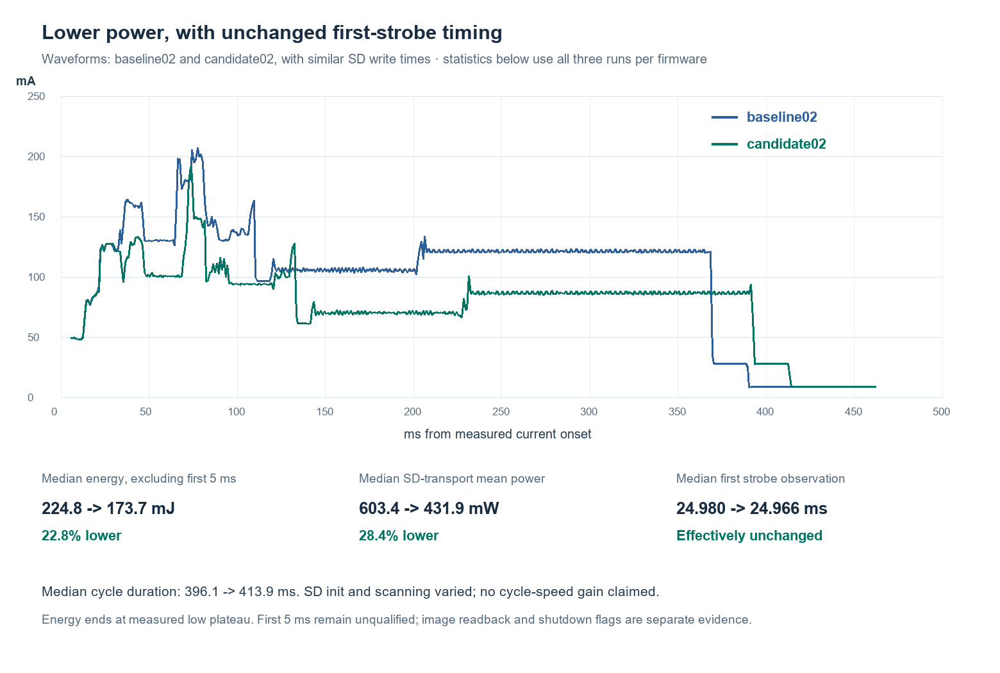

# Normal capture with unused Ethernet powered down — October 28, 2026

The normal flash firmware now powers down the Nucleo's unused LAN8742 PHY
after arming the camera receiver. Three cold cycles reduced median measured
energy **22.8%**, from **224.824 to 173.653 mJ**. Median cycle time increased
**17.760 ms**, from **396.120 to 413.880 ms**; this is a power improvement,
not a speed improvement. First-strobe observation was effectively unchanged.

## Measurement boundary and results

Regulated bench 5 V feeds JS110 IN+, with OUT+ to CN5.5 and common return
CN5.6. CN8/LTC are disconnected; CN9 shunts absent. CN10 separately powers
ST-LINK, D2/R23 are removed, and U24 remains fitted. Camera and the existing
64 GB-class card are connected. The selected twisted CLK/GND wiring, main
3.3 V card supply, no series resistor and no SD signal probes are retained.
JS IN0 observes PD12/CN15.21 phase markers, IN1 PD0/CN15.33, ground CN15.20.
No ST-LINK access occurs inside the measured cold-cycle window.

Energy is the integral of native JS power from **5 ms after current onset
through the low-current plateau**. It excludes the unqualified initial
transient, LTC losses and battery behavior. It is not a qualified full cold
cycle energy number. Duration includes onset through the plateau. All runs
retain initial nonfinite samples outside the measured windows. The plateau
endpoint has 1 ms resolution; nominal GPIO timestamps have a 0.5 us grid.

| Firmware/run | Energy, mJ | Cycle, ms | SD initialization, ms | Slot transport, ms | Transport mean power, mW |
|---|---:|---:|---:|---:|---:|
| Baseline 1 | 351.127 | 591.044 | 87.293 | 370.980 | 625.023 |
| Baseline 2 | 221.684 | 389.727 | 90.541 | 166.641 | 603.393 |
| Baseline 3 | 224.824 | 396.120 | 96.584 | 164.454 | 602.228 |
| Ethernet off 1 | 172.016 | 409.871 | 103.291 | 164.598 | 431.933 |
| Ethernet off 2 | 173.653 | 413.880 | 106.757 | 164.339 | 430.564 |
| Ethernet off 3 | 186.764 | 443.547 | 113.184 | 187.042 | 432.470 |

Median transport mean power fell **603.393→431.933 mW (28.4%)**.
The mean across all three energy runs fell 265.878→177.478 mJ (33.2%),
but baseline 1 had a long card write; the median is the more useful headline.
The unchanged shutdown plateau is approximately **8.66 mA**.
First-strobe marker medians were **24.980→24.966 ms from current onset**;
these firmware observations are not independently probed exposure edges.

The new runs had longer SD initialization (median 90.541→106.757 ms)
and SCR/slot-scan/write-preparation intervals (81.806→85.154 ms). Slot
occupancy increased during testing. Three runs per group establish observed
behavior, not statistical significance or a pure attribution of every timing
change to Ethernet. The first-5-ms inrush is not fixed or qualified here.

## Implementation and qualification

`--ethernet-powerdown` adds a one-shot bounded MDIO transaction using PF4 and
PG11, PHY address 0. It verifies IDs 0007/C131 and stable BMCR, writes
3000→3800, and verifies power-down twice. The actual successful RAM trial
took **5.319825 ms** by DWT. GPIO fields and owned clock enables are restored;
the PHY is intentionally left down until shutdown/reset. No Ethernet MAC
stack is enabled. READ helpers do not change PHY state.

Unexpected PHY identity, missing acknowledgement or verification failure
records a warning and lets the camera save continue. A potentially accepted
but unverified write remains explicitly uncertain. This failure behavior is
host-model tested; no physically missing-PHY cold test was performed.

The helper and all its callees are in checked late-loaded code. Early receiver
load remains **15,804 bytes**. The normal prefix differs only in the two
receiver CRC words; all 20 recovery literals and the relocated 1,536-byte
error engine remain identical. The helper executes after camera arm, before
SD initialization. Its larger late payload and additional BSS still require
measured timing rather than an assumption of zero startup cost.

Installed receiver SHA256:
`69c5a5c0cc434eb7496371d9e5b9c007db346b8bb7b9a1a650c90f0eade79d28`

Installed 64 KiB NOR sector:
`a10e4894d79cd3fe182b95b48eb56a308280f3201736d295860ecfe725a62645`

ROM-loaded prefix:
`2b9724bc4b60af52b1c4ab45e1b232578e9640efc3a30a57772a810d99c3f344`

Independent physical NOR readback matches; the following 4 KiB is unchanged.
The feature-disabled build is byte-identical to the prior installed firmware.
223 capture tests, 14 reader/recovery tests and the independent layout audit
passed. UART recovery reached the exact early park after every measured cold
cycle (nine good pulses, zero bad). After candidate 3, guarded observation
found SBF=1, PDDS=1, STOPF=0. The generic reader retains
`trial_entry_proven:false`; cold history and markers are separate evidence,
not a pre-entry flag-clear measurement.

The initial RAM run completed successfully, but its first host observation
rejected CONTROL=0xC. CMSIS identifies those bits as FPCA/SFPA: privileged MSP
floating-point context. The host validator now allows those bits while still
rejecting nPRIV, SPSEL and reserved bits. The original failure is retained;
fresh re-observation validated the same capture without repeating it.

## Images and final bench state

Baseline RAM slot 122 and candidate RAM slot 126 each passed all 3,730 sectors
at 25 MHz against their original 1,909,600-byte sensor buffers. Independent
RAW10-to-PNG sample decoding passed; both previews show recognizable scene
detail. Image bytes remain local.

Cold-image verification and final bench state are recorded in the completion
addendum below. No card erase, image deletion or power-loss qualification is
part of this change.

## Evidence map

- `candidate-offline-audit.json`: independent binary, recovery and late-code audit.
- `disabled-identity.json`: unchanged feature-disabled firmware.
- `install/complete.json`: independent NOR readback and following-sector check.
- `candidate-reobserved/verified.json`: successful PHY proof and original image identity.
- `baseline-readback/` and `candidate-readback/`: complete original-RAM equality.
- `baseline01..03/`, `candidate01..03/`: cold traces, exact recovery and park results.
- `analysis/comparison.json`, `comparison-report.txt`: all runs and phase statistics.
- `analysis/awake-comparison.json`: separate completed-awake comparison, not cold energy.
- `candidate-standby-flags/result.json`: guarded retained hardware flags.
- `cold-images-readback/`: complete post-Standby images, without original RAM equality.
- `final-state.json`: final restoration and instrument cleanup.
- `local-payloads.json`: hashes of native JS data and private image payloads retained in ignored `tmp`.
- `manifest.json`: exact compact archive hashes; per-directory attributes prevent newline rewriting.

Frozen builds and scripts retain their original workspace/SDK dependencies.
The archive is not a redistributable complete SDK/toolchain package.

## Completion addendum

All six measured cold images passed complete 3,730-sector readback at 25 MHz,
start/end markers and independent PNG sample decoding. These post-Standby
images cannot be compared with original RAM, which was lost in Standby.
The separate awake trials above provide that exact source equality.

| Slot | Firmware | Sample range | RAW SHA256 |
|---|---|---|---|
| 123 | baseline | 68–1023 | `f39f87f00bafc0834b734ec2d3611534a20bbfb5cd307740eaa44a2fa8607bc3` |
| 124 | baseline | 69–1023 | `c3e90e8900e65fde7ed9d9effdca485de20da637132410f5f516c9f51bac4660` |
| 125 | baseline | 69–1023 | `76d171b25036894c453bbc889ff2963b22a16c4d04207d33bf7ac5e5310070a5` |
| 127 | Ethernet off | 70–1023 | `6a8815b2b2ffc3a6060dc15abd65d10c7a2f1a2ff608674ea9891d17342bbe4b` |
| 128 | Ethernet off | 70–1023 | `06ca1f44b124b0b762193d9efef2dabcc3e84c3587cbec3b618b18abda4fa1c3` |
| 129 | Ethernet off | 70–1023 | `980d7c82486477b267023168d3bb2a8deac5bd1753f8cbeb3ceb2ad6a3fab723` |

The board was returned to a normal cold boot of the new installed firmware.
All ten phase markers appeared; the final low plateau was **8.564 mA**.
JS closed cleanly at **2026-10-28T19:58:55.492447+00:00**, restored its starting settings
and left output enabled. COM8 is closed/BREAK released; no helper remains
active after the finalization script exits. Expected extra slot 130 was proven
FREE before this final boot but was not reread afterward. This final state is
a phase/current observation, not a fresh SBF or final-photo proof. The three
measured candidate photos and prior retained Standby flags provide the
complete qualification above. No firmware changes followed the verified NOR
installation.
