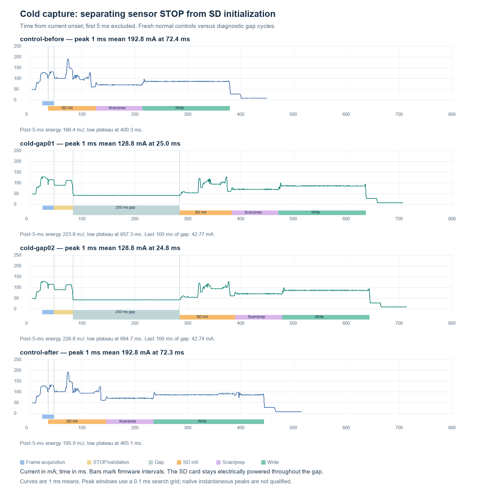

# Camera STOP to SD initialization gap — October 28, 2026

The requested separation experiment is complete. Two cold captures used a
nominal 200 ms wait after validated FRAME and acknowledged sensor STOP, before
the first SD command. Matched normal controls bracketed the experiment.
The normal Ethernet-power-down firmware is restored with independent full
physical NOR verification; the diagnostic gap is not enabled in normal use.

## Result

The mean of the two measured 1 ms peak currents fell from **192.8 mA**
in the bracketing normal controls to **128.8 mA** in the separated runs
(**33.2% lower**). All values are at the target 5 V input.
The camera and SD initialization now produce distinct peaks instead of the
approximately 73 ms combined peak. The powered board draws about 42.7 mA in
the quiet gap. This is strong evidence that scheduling affects peak demand.

| Run | Highest 1 ms mean, mA | Energy after first 5 ms, mJ | Power onset to low plateau, ms |
|---|---:|---:|---:|
| control-before | 192.76 | 166.444 | 400.319 |
| cold-gap01 | 128.78 | 223.830 | 657.320 |
| cold-gap02 | 128.80 | 226.790 | 664.748 |
| control-after | 192.79 | 195.915 | 465.124 |

The diagnostic wait itself consumes **42.94–42.99 mJ**. Remaining
time/energy differences also include lost overlap, card initialization history,
and per-run card latency. Subtracting 200 ms from these cycles does not predict
the performance of a STOP-to-immediate-SD implementation.

## Phase budget with the gap

Ranges below span the two cold gap runs. They are **whole-board input current
during each phase**, not isolated sensor/card rail measurements.

| Phase | Duration, ms | Mean current, mA | Highest 1 ms mean, mA |
|---|---:|---:|---:|
| Camera strobe through validated STOP | 57.78–57.78 | 103.73–103.76 | 128.17–128.19 |
| Quiet final 100 ms of gap | 100.00–100.00 | 42.74–42.77 | 42.89–42.91 |
| SD initialization | 98.84–105.40 | 79.82–80.04 | 127.95–128.40 |
| SCR/slot scan and preparation | 88.43–88.97 | 70.24–70.25 | 79.53–79.59 |
| Image write transport | 164.34–164.56 | 85.94–86.01 | 100.00–100.10 |

The quiet-gap reference includes an awake MCU, stopped sensor and receiver
supplies, powered but uninitialized SD card, and remaining Nucleo circuitry.
Subtracting it from another phase estimates incremental system activity only;
CPU and peripheral work changes too. It is not an SD-only idle-current baseline.
The warm RAM trial separately measured about 42.9 mA in its final 100 ms gap;
warm and cold traces are not pooled.

## What this establishes and what remains open

- Delaying SD commands until after the camera stops reliably lowers the peak
  in this experiment; normal/gap/normal controls preserve the reversal.
- The gap also gives the powered SD card another 200 ms before initialization.
  The experiment does not isolate overlap reduction from that changed startup
  history. A future STOP-to-immediate-SD test would separate those effects.
- The GPIO gap is about 201.4–201.5 ms. Firmware records 80 million DWT cycles
  at the nominal 400 MHz clock. External GPIO timing is authoritative for the
  recorded waveform; the boundaries include the marker/check overhead.
- Capture through STOP includes validation and STOP acknowledgment, not just
  the optical exposure. Normal cold traces do not contain an exact STOP marker.
- All current/energy is downstream of a regulated 5 V supply, excluding the
  LTC and coin cells. First 5 ms, native instantaneous peaks and physical
  inrush are unqualified. Reported peaks are 1 ms means on a 0.1 ms search grid.
- Initial stream NaNs remain in the native recordings; all reported windows
  are finite and contiguous. No voltage/current repair or interpolation was
  used to manufacture valid analog samples.

## Implementation and validation

`--sd-init-gap-ms 200` is an explicit diagnostic profile. It waits for the
existing validated frame and acknowledged STOP, emits markers 11/12 around
the bounded wait, and verifies no SD command or ownership before SD init.
Separate 64-byte GAP1 proof and host admission checks cover ordering, clock,
zero-command counts and normal READ bypass. The default is zero, and the
disabled receiver/prefix/NOR sector reproduce the normal build byte-for-byte.

- 18 runtime cases and all 236 capture tests passed. The independent build
  audit preserved the 15,804-byte early load, recovery instructions/literals
  and relocated error engine. Only the two receiver-CRC prefix words change.
- Awake RAM capture saved slot 132, passed all 3,730 sectors at 25 MHz against
  original camera RAM, and passed independent PNG sample decoding. Its proof
  measured 200.0006475 ms nominal DWT wait with zero SD commands throughout.
- Cold gap slots 133/134 passed complete 3,730-sector reads, full start/end
  markers and independent PNG sample decoding. Recognizable scene previews
  were inspected. Original RAM does not survive Standby; these cold images
  are not claimed byte-equal to their lost source buffers. Current slot format
  does not contain an image checksum. Slot attribution follows the successful
  slot132 capture and exactly two subsequent normal cold boots; there was no
  separate pre-boot FREE-header measurement for133/134.
- Each cold diagnostic produced all twelve ordered phase markers and the low
  plateau, then passed exact UART recovery. Guarded retained flags after the
  second were SBF1/PDDS1/STOPF0; the reader's generic `trial_entry_proven:false`
  limitation remains. No error-injection qualification was repeated.
- Temporary installation and restoration both passed independent full64KiB
  NOR equality and unchanged following4KiB. No SD erase/deletion or physical
  wiring change occurred.

## Final bench state

Normal installed build: `tmp/bringup/ethernet-normal-20261028/flash-candidate`.
Receiver SHA `69c5a5c0cc434eb7496371d9e5b9c007db346b8bb7b9a1a650c90f0eade79d28`;
sector SHA `a10e4894d79cd3fe182b95b48eb56a308280f3201736d295860ecfe725a62645`;
prefix SHA `2b9724bc4b60af52b1c4ab45e1b232578e9640efc3a30a57772a810d99c3f344`.
The gap receiver was `ab87fdcfb52ee929c6382ec4391beb222e64d938d6f57f53892fcf1abe673601`;
RAM gap receiver was `b106972b4973e0a46c25754ca417f347001b540c76fa2c0c43a3c54edaabb133`.

Final logger closed at **2026-10-28T21:37:54.065515+00:00**, with target power enabled,
all ten normal markers and **8.547 mA** low plateau.
It is running normal firmware, not a RAM helper. Extra expected slot135 was
verified FREE before that boot but not reread afterward; final SBF was not
reread. This final state is a phase/current signature, with the independent
image and flag evidence above. JS range128, streams and EXTIO settings were
restored, COM8 closed/BREAK released, and all bench helpers stopped.

Power: bench5V → JS → CN5.5, returnCN5.6; CN8/LTC disconnected, noCN9shunts,
CN10 separately powered, D2/R23 removed, U24 fitted. JS IN0/IN1/GND remain
CN15.21/33/20. SD CLK/GND remain twisted CN3.3/8, VCCCN3.5, no series resistor
or SD signal probes; camera and card connected; JP1/JP2 normal. Recheck live
state and process ownership before another hardware operation.

## Evidence and replay boundaries

The compact archive includes frozen source/build identities, raw proof bytes,
host checks, NOR verification, image-validation summaries, GPIO/analog chunk
ledgers, analysis and figures. Large native samples and private scene/payload
bytes remain under ignored `tmp/bringup/sd-gap-20261028/`; the omission inventory
retains their hashes. Full analog recomputation and image-byte replay require
those local payloads. Archive verification does not recreate absent samples.
See the archive manifest and replay report for exact retained/omitted files.
