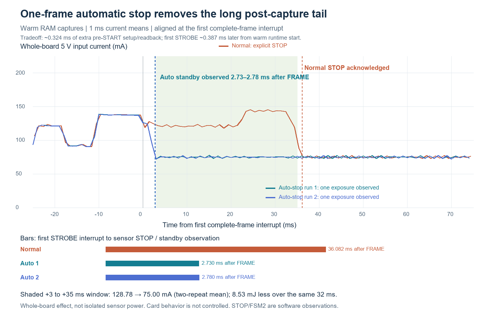

# Sensor automatic stop after one frame

Two warm RAM experiments on the connected VD56G3 captured one complete image
and returned to sensor software standby without sending an explicit STOP.
Both independently recorded a sensor frame-counter increment of one and one
STROBE interrupt. The normal FLASH firmware is unchanged; automatic stop has
not been promoted into the normal cold-boot path.

Both saved images have passed complete SD readback against their original
camera RAM and independent PNG decoding. A final cold boot of the unchanged
normal firmware completed with all ten phase markers and the expected low
current plateau.

## Behavior and timing

The diagnostic writes context 0 repeat count **1** to `0x048C` and next context
**4** to `0x048E`, then reads both values back before START. It also requires a
fresh sensor frame counter of zero. The receiver keeps its existing complete
RAW10 frame checks, snapshot operation, and orderly receiver shutdown. The
successful path then polls for sensor FSM state 2, without a STOP write, and
checks the counter and STROBE count again after the SD payload finishes.

| Observation | Normal warm control | Automatic stop 1 | Automatic stop 2 |
|---|---:|---:|---:|
| Saved slot | 137 | 138 | 139 |
| Sensor frame-counter delta | Not measured | 1 | 1 |
| STROBE interrupt count | Not qualified as a one-frame test | 1 | 1 |
| Complete external PD0 mirror pulses | No diagnostic mirror | 1 | 1 |
| Mirror pulse width, ms | — | 10.984 | 10.984 |
| Explicit STOP writes on successful path | Normal STOP path | 0 | 0 |
| FRAME IRQ to standby observation, DWT ms | 35.935 | 2.717 | 2.769 |

The automatic runs observed FSM 2 and a low STROBE input, then confirmed
unchanged counter and STROBE values after storage completed. All receiver
frame, error, size, canary, storage completion and idle gates passed. The
independently captured PD0 waveform agrees with the interrupt counts; PD0 is
a firmware mirror of the sensor interrupt, **not a separate electrical probe
on the sensor STROBE pin**. Its activation and initial low level are checked,
and boot transitions are excluded.

The timestamps are software observations. The nominal 1 ms poll interval,
I2C reads, marker pulse and publication add latency; the sensor may enter
standby earlier. The chart uses the Joulescope timebase and mapped/observed
GPIO boundaries: about 36.08 ms for normal STOP versus 2.73–2.78 ms for
automatic standby. These are consistent with the nominal-clock DWT timings
above and are not exact physical transition times.

The extra diagnostic configuration/readback costs about **0.324 ms** before
START. The first STROBE marker occurs about **0.387 ms later** than the warm
normal control, measured from the same runtime-begin reference. This is a
small measured startup cost, not a qualified change to cold-boot shutter lag.

## Measured power effect

Across the same **32 ms interval, FRAME +3 ms through FRAME +35 ms**, the
normal control averaged **128.78 mA** at the whole-board 5 V input. The two
automatic-stop runs averaged **75.03 mA** and **74.96 mA**. The mean difference
is about **53.78 mA**, or **8.53 mJ less energy** in that matched interval.
All three windows fall inside SD scan/preparation, reducing duration bias.

| Warm run | Runtime start to awake completion, ms | Energy in that interval, mJ | Matched 32 ms interval, mJ |
|---|---:|---:|---:|
| Normal control | 510.351 | 246.824 | 20.484 |
| Automatic stop 1 | 512.346 | 238.776 | 11.958 |
| Automatic stop 2 | 524.780 | 244.442 | 11.945 |

The shorter post-frame high-current tail is repeatable in these two runs.
Whole-run timing does not show a speedup: SD latency varies and storage still
dominates. The comparison measures the combined system effect of autonomous
sensor stop and its firmware changes, with concurrent card activity. It does
not isolate the sensor rail, establish a cold-cycle energy saving, or include
LTC3621 conversion loss and CR2032 behavior. No intentional camera-to-SD gap
was inserted. Recorded analog windows are finite and contiguous; initial
stream NaNs and unqualified startup behavior remain outside these claims.

## Image and recovery checks

Slots 138 and 139 each passed all **3730 sectors** at 25 MHz, exact equality with all
**1,909,600 original packed RAW10 bytes**, valid leading/trailing slot markers,
and independent PNG sample decoding. Both previews were visually inspected:
the scene is dim but recognizable, with a patterned screen, ceiling and beam.

UART recovery succeeded after each capture/readback, including nine valid
and zero invalid pulses at the exact normal recovery park after the second.
The diagnostic is
RAM-only and retains the existing normal NOR image and recovery prefix.
Automatic-stop cold boot remains unqualified. Offline attempts to fit the
diagnostic into the fixed early receiver and prefix layout are retained as
failed/deferred build evidence; they were never programmed. The normal
error engine and recovery guard were not relocated for this experiment.

The final offline suite passed **250 tests**. Fresh builds reproduced the
tested RAM auto-stop binary, the existing normal RAM binary, and all three
normal FLASH artifacts: receiver, prefix and complete 64 KiB sector. Host
validation requires pre-START readback, complete frame checks, bounded FSM
polling, zero successful-path STOP writes and stable post-save evidence.
READ operations require an all-zero AST1 diagnostic record. Failed records
are retained before ordinary success validation and never grant idle or
reset permission.

The frozen RAM build manifest has an incorrect inherited `storage_overlap`
description mentioning a 200 ms gap. Its source, binary and manifest remain
untouched. The [separate correction](design/ram-auto-v2-manifest-correction.json)
records the actual concurrent behavior; later generated manifests are fixed.

## Evidence and completion status

- [Warm comparison and qualifications](analysis/awake-matched-window-comparison.json)
- [First automatic-stop proof](ram-auto01/capture/verified.json) and
  [second proof](ram-auto02/capture/verified.json)
- [First full-image validation](ram-readback/readback-validation.json)
- [Second full-image validation](ram-auto02-readback/readback-validation.json)
- [Independent RAM source and binary audit](ram-v2-offline-audit.json)
- [Final offline build identities](design/final-build-results.json) and
  [250-test output](design/final-tests.log)

The final normal cold control returned to **8.560 mA at 4.994 V**, with all
ten markers. The target remains powered after that normal boot, not a RAM
diagnostic or recovery park. Slot 140 was proven FREE before the boot; the
resulting photo and SBF were not reread, so final state rests on the current
signature and markers. JS closed at **22:49:49 UTC**, leaving power enabled
and restoring range 128, streams and EXTIO settings. COM8 is closed, BREAK is
released and no helper remains active. See [final state](final-state.json).

No NOR programming occurred. The exact normal recovery prefix was reread
and the normal artifacts rebuilt identically; the complete physical NOR
sector was **not reread during this task**. The [cold control summary](analysis/cold-control-summary.json)
retains the before/after normal traces separately from the warm experiment.
Native recordings and private image bytes stay local with hash inventory;
the compact archive retains proofs, source, analysis, ledgers and charts.
