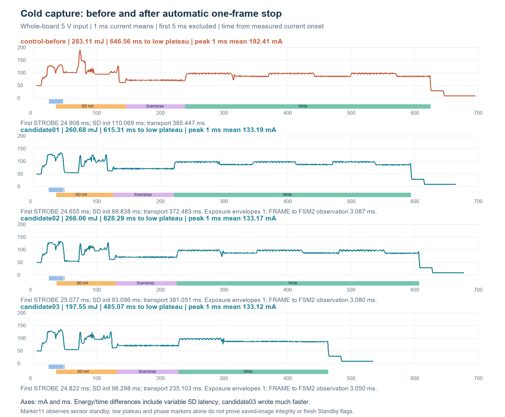

# Sensor single-frame promotion — October 28, 2026

The installed production firmware configures the VD6G context chain to take one frame and return to sensor standby automatically. The cold-awake test proved exactly one sensor frame and one independently counted STROBE, no explicit STOP write, one complete receiver image, and stable sensor standby through the completed SD save. Three measured cold production cycles passed their marker/exposure checks. The user accepted these results and stopped further testing during the third image's readback: the awake image and two cold images are fully verified; the third cold image is only partially read.

## Configuration and scope

The receiver, sensor exposure (1428 coarse units), packed RAW10 slot format, four-bit 25 MHz SD interface, Ethernet power-down, relocated error engine, UART recovery, and normal shutdown policy are retained. Power is regulated bench 5 V through the JS110 into CN5.5, with return CN5.6. CN8/LTC are disconnected; CN10 independently powers ST-LINK, D2/R23 are removed, and U24 remains fitted. The camera and SD are connected. SD CLK/GND remain twisted, without a series resistor or SD signal probes. JS IN0/IN1 observe PD12/PD0 at CN15.21/33, with ground at CN15.20.

The stage-one sensor sequence replaces a redundant final manual-mode write with a four-byte burst `01 00 04 00` to `0x048C`: repeat count 1, next context 4. Manual mode was already established by the preceding exposure/gain register burst. The new transaction completes before START. Register readback occurs after START and the checked late-code load, so it does not extend the pre-exposure setup with diagnostic I²C reads.

The new production selector is `--sensor-single-frame`. Historical `--sensor-autostop` RAM experiments retain AST schema 1 and their qualified one-or-two-frame diagnostic semantics. Production uses AST schema 2 and rejects any result other than exactly one sensor frame and one STROBE. Its `config_begin/end` fields mean **post-START readback**; the frozen compiled prefix audit establishes the pre-START write. There is no pre-START runtime readback claim.

## Cold-awake evidence

[The retained cold inspection](awake-inspect/verified.json) identifies slot **142**, receiver count 1, sensor FRAME_COUNTER 1, STROBE count 1, and zero explicit STOP writes. FSM2 was first observed **2.660 ms after the FRAME callback** and remained FSM2 with unchanged counts at the final read **596.093 ms later**, after payload completion. These timestamps are polling observations, not exact physical transition times. The post-START context readback took **0.222 ms** and read repeat 1 / next 4 / initial counter 0.

The inspector preserved the original 1,909,600-byte camera frame with SHA-256 `f85809a97d9cc3b4dfd6f9b02c2dbf7f1ba82e09b2d8ddfbb4b83d3432bd7804`. [All 3,730 saved sectors were read at 25 MHz](awake-readback/summary.json), with exact original-RAM equality and [independent PNG sample verification](awake-readback/readback-validation.json). Root visually inspected a recognizable patterned screen/ceiling/beam scene. The awake test deliberately retains SRAM; its post-save current is not a Standby result.

The PD0 signal is an IRQ mirror of the observed PA0 exposure STROBE, not a direct sensor probe. Its count is qualified only while the exposure IRQ remains enabled, through the final sensor check/commit boundary. A later continuously low PD0 after shutdown disables IRQs is continuity evidence, not ongoing independent observation of the sensor.

## Cold production comparison

All three production cycles produced all eleven phase markers, exactly one 10.9845 ms exposure envelope before FRAME, no later exposure edges through the final sensor check/commit, and the expected low-current plateau. [Slots 143 and 144](cold-images-readback/partial-summary.json) each passed all 3,730 sectors and independent PNG sample verification; root visually inspected both as recognizable patterned screen/slats/ceiling/beam scenes, without obvious truncation. Their original sensor RAM was lost in Standby, so this is not original-RAM equality. Slot 145 completed five successful 512-sector reads (2,560 of 3,730 sectors); its complete image and PNG are **not verified**.

The [aligned comparison](analysis/cold-promotion-comparison.json) uses one fresh explicit-STOP control and three production auto-stop cycles, all on the same direct 5 V setup:

| Measured quantity | Explicit-STOP control | Auto-stop 1 | Auto-stop 2 | Auto-stop 3 |
|---|---:|---:|---:|---:|
| First exposure STROBE from current onset (ms) | 24.908 | 24.655 | 25.077 | 24.822 |
| FRAME → autonomous standby observation (ms) | Not instrumented | 3.088 | 3.080 | 3.051 |
| Largest 1 ms mean current after +5 ms (mA) | 192.412 | 133.187 | 133.168 | 133.121 |
| Energy from +5 ms to low plateau (mJ) | 283.112 | 260.679 | 266.061 | 197.548 |
| Current onset → low plateau (ms) | 646.557 | 615.313 | 628.292 | 485.067 |
| SD initialization (ms) | 110.069 | 89.839 | 93.097 | 96.299 |
| Slot-header scan/write preparation (ms) | 93.272 | 95.431 | 96.161 | 95.923 |
| Slot transport (ms) | 385.447 | 372.483 | 381.052 | 235.104 |
| Final 100 ms plateau (mA) | 8.674 | 8.647 | 8.548 | 8.551 |

The measured 1 ms peak after the excluded first 5 ms fell about **31%**, with similar first-exposure timing. Median post-5-ms energy was **260.679 mJ versus 283.112 mJ**, about **7.9% lower** in this small comparison. The especially fast third card write is a separate contributor to its lower total energy; these total-cycle differences must not all be attributed to sensor auto-stop. The normal cold control has no sensor-STOP GPIO marker, so its exact cold STOP-tail duration is not inferred from the current trace.

A [guarded hardware-status read](candidate-standby-flags/result.json) after the third cycle and UART recovery found **SBF=1, PDDS=1, STOPF=0**. The reader did not write CPUCR or change power/reset. Its explicit `trial_entry_proven:false` limitation is retained: the generic reader does not independently establish the pre-entry flag-clear history needed to attribute the flag to one particular trial.

## Build and recovery review

[The awake audit](awake-offline-audit.json) and [Standby audit](standby-offline-audit.json) independently checked the packaged executables, manifests and sources. The complete UART guard and all 20 referenced literals are unchanged. The 1,536-byte relocated error engine and its fixed bridge are byte-identical. Stage one still loads exactly 15,804 receiver bytes; remaining code loads after receiver arm with its CRC checked before use. Sensor readback helpers are in the checked late range, while producer and exposure interrupts remain in the early range.

The minimal context burst moves two post-recovery array pointers by eight bytes and moves the second receiver CRC literal by four bytes. Both arrays are unchanged. The entire unrelocated 6,720-byte prefix is pinned to SHA-256 `41216a3b2f921e80f401da7cb82806e350149c50fc132c2266ae3706dd2c2de7`; only the two independently mapped CRC data words at offsets `0xC9C` and `0x1358` may change. The historical prefix checker remains unchanged. Exact new prefix identities are admitted separately, and the RAM operation runner still rejects FLASH images.

| Build | Receiver SHA-256 | Prefix SHA-256 | Full 64 KiB sector SHA-256 |
|---|---|---|---|
| Cold awake | `298a65b0ab2a00a6256826604bf0ebb0656922ee84c3ebe1237c35666ddf3f60` | `5330f1d1f606fb9dfd903dbdc39dac282360b1880d756931049eec1797ef6504` | `185d86f0cf2a17c6b1e81880c1ec0b3263e318d477701fa57496cb72cf706638` |
| Production Standby | `560a8734306436fe95bc1407031e70f1bc5b448949366e1bd007779c1736f646` | `6378483a91b560ffc6b31d74a9dd1205996a14c8030447ffddf7deddc9d23874` | `79a379470927135bc03841098fe070912cad8275e91c5d5985cc066c294cf64e` |

[All 261 offline regression tests passed](offline-tests.json), with exact invocation/log identity and identical before/after source hashes. [Reproduction controls](control-build-results.json) preserve the previous RAM diagnostic, explicit-STOP RAM build, and all three old normal FLASH identities. This preserves the old evidence and provides a qualified rollback artifact.

Both the [awake installation](install-awake/complete.json) and [production Standby installation](install-standby/complete.json) passed independent physical 64 KiB NOR readback and preserved the following 4 KiB. The new awake UART recovery park passed afterward. Exact production UART recovery checks passed after all three measured cold cycles.

## Final handoff after the user stopped testing

[The owner's final record](final-state.json) leaves the production single-frame firmware installed in NOR, selected on the next normal reset or power cycle. There was **no additional normal boot** after the user's stop request. Power was left enabled, COM8 was closed/BREAK released, and no bench helper remained active.

The last verified successful RAM READ terminal was slot 145, payload offset 2,048. During preflight for the next chunk, the debugger halt/register request failed to identify the target and the host process was cancelled. No new READ request or SD read for that chunk is recorded. Present execution/halt state is unverified; this is neither a verified final normal-boot nor a verified Standby handoff. No retry, recovery, power cycle, or final SBF read followed the stop request. The prior guarded Standby result remains qualified only within its stated scope.

## Limits and retained evidence

This qualifies the connected sensor/module, fixed exposure and present SD card/wiring. It is not a production-lot, temperature, long-exposure, or signal-integrity qualification. Sensor silicon revision restrictions and the manual's first-frame caveats remain relevant when changing those conditions. Early inrush/first 5 ms energy remains unqualified; direct 5 V measurements exclude LTC conversion and battery losses. SD timing varies between captures, so local sensor-tail energy and total-cycle energy must be reported separately.

The compact archive retains frozen code, sources, proofs, full NOR verification bytes, analyses, interrupted-read evidence, and chunk/event ledgers. Private images/SD payloads and native current streams remain local and are hash-inventoried omissions. Full image decoding and numerical current reintegration require those local omitted bytes; pure proof and binary/source audits remain replayable offline. The unused `finish_state.py` describes a planned final-cold-boot closure that was abandoned when the user stopped testing; the root-authored `final-state.json` is authoritative.

After sealing, run `python -B archive_single_frame.py --verify .` from the archive folder for the exact-file, source, AST/PHY proof, NOR and image-validation identity replay. `-B` prevents generated Python cache files from changing the sealed file set.
