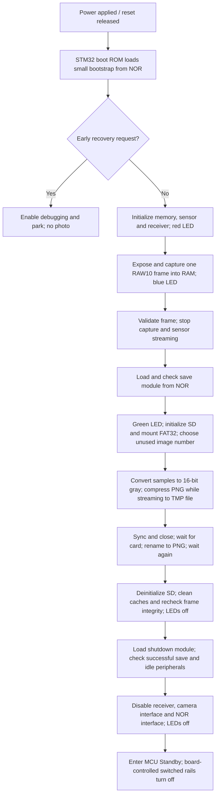

# Capture → PNG16 → FAT32 prototype

**October 23 baseline completed; original v59 restored.** Three unchanged-v59
cold power signatures measured median **2.714624 s / 1.288948 J** on the
JS110-fed board branch. Temporary instrumented firmware measured repeated
same-frame saves at **2.099228–2.104129 s**, with median SD driver write
throughput **2.64996 MB/s**. IMG61–64 passed full PNG readback and every pixel
matched the retained RAW frame. Original v59 was independently read back after
restoration, UART recovery passed, and the final cold boot returned to about
8.07 mA. That final image and SBF were not reread. See the
[baseline report, phase inference limits and final bench state](evidence/2026-10-23-one-bit-baseline/README.md).
The SD wiring remains native one-bit; four-bit operation has not been tested.

**October 20: autonomous cold capture → PNG16 → SD → Standby is installed.**
The installed **v59 Standby image** has verified first-sector SHA-256
`7fda9d00cc7ffb3fbb9e6aac6695cf18545754b5dbfce1520cf30b2da39c4e63`.
It captures one frame and saves a new numbered PNG using the selected
**v8b fast-loop compressor, no row filter, D-cache enabled, `-Os`**.
Successful save now shuts down peripherals and enters MCU Standby. Four
tested Standby cycles each recovered through the existing PE6 UART request
and ST-LINK BREAK/NRST on the first attempt; the retained hardware SBF flag
confirmed Standby entry after every cycle. No boot-jumper changes were needed.
See [low-power evidence and reproducible build](evidence/2026-10-20-low-power/README.md)
and [shutdown implementation](low_power/peripherals.md).

**October 20 follow-up:** after the two [CN10-disconnected power cycles](evidence/2026-10-20-stlink-off/README.md),
the user inspected the SD card and reported that the photos check out. This
resolves the pending user image check for those runs; it is not an automated
byte-for-byte/CRC readback or a new SBF measurement. The original measurement
archive retains its contemporaneous pending status.

## Current power-up to Standby flow



This is the successful path in v59. Failure paths preserve diagnostics and
leave power on instead of pretending shutdown succeeded. Exposure does not wait
for SD initialization or PNG/save-module loading. PNG encoding shifts each
10-bit sample left six bits and uses the selected fast compressor without a row
filter. MCU Standby ends this boot; another photo requires reset/power cycling.
The external LTC regulator remains enabled. The last board-branch idle current
was about 8.23 mA, so this is not full external power removal.

Three complete cold cycles measured **1.410–1.424 J** and **2.96–2.98 s**
from observed current onset to the stable Standby plateau. Terminal board
current was **8.10–8.21 mA**, versus about **80.03 mA** awake. These are
JS110-fed Nucleo-branch measurements, not isolated production-camera
consumption. See [measurement method and limits](cycle-energy.md).

The three measured-cycle files, IMG00040–42.PNG (1.78–1.79 MB), passed full
post-Standby readback, all PNG chunk CRCs and independent decoding. The
original IMG00001.PNG remains byte-identical. These checks use a
[guarded RAM-only READ bridge](low_power/readback_recovery/README.md);
Standby's lost RAW frame cannot be compared again.

The prior v50 awake baseline's first automatic file, `IMG00024.PNG`, was read back in full: every one of
its 1,527,680 pixels exactly matched the retained sensor frame. Three further
cold boots saved distinct files. A requested recovery cold boot reached the
exact early recovery park without writing NOR or the card.

Same-frame v8b benchmark saves took **1.6831–1.6842 s**, versus roughly
**18.8 s** for the initial uncached v5 save, and produced **919,353 bytes**.
These are save-stage measurements, not cold power-to-photo times. Finalized
power analysis gives conditional save-duration bounds of **0.7675–0.8129 J**
across the two runs. See [measurement scope](#timing-and-energy-scope),
[the implementation log](../../docs/decisions/capture-png-sd-2026-10-20.md)
and [hardware evidence](evidence/2026-10-20-hardware/README.md).

The user authorized destructive SD formatting for development and explicitly
left sudden power-loss protection unqualified. Normal firmware never formats
a card. Existing PNG/TMP filenames are skipped, older files are not
overwritten, and full storage stops a save.

## Capture-cycle timing comparison

Starting baseline, October 23: NUCLEO-N657X0-Q / CAM-6G3-073CLR, 1120 × 1364
RAW10 capture, grayscale16 PNG with the cached v8b fast-none encoder, and
native **one-bit SDMMC2 at 25 MHz / 3.3 V**. The table uses one complete cold
trace from the v61b timing overlay of the v59 Standby path. Original v59 is
installed; no hardware was changed to assemble this table. Add future measured
configurations alongside this baseline, retaining the same phase boundaries.

All rows are consecutive, non-overlapping intervals on the same Saleae clock.
Elapsed time starts at the observed target 5 V digital threshold crossing,
not at button press or analog power-good. Values are rounded to 0.1 ms.

| Phase | Current one-bit baseline (ms) | Elapsed at phase end (ms) |
| --- | ---: | ---: |
| Observed 5 V rise → reset release | 1.6 | 1.6 |
| ROM boot, code loading and sensor startup → receiver entry | 21.5 | 23.1 |
| Receiver preparation / wait → first STROBE interrupt | 1.3 | 24.4 |
| Exposure and frame readout/transfer → frame-complete interrupt | 21.9 | 46.3 |
| Frame checks, stop camera, load and enter SAVE code | 457.1 | 503.4 |
| SAVE setup and cold-card initialization | 117.1 | 620.5 |
| Mount FAT32 | 1.7 | 622.2 |
| Pre-write checks, open file, compress PNG and stream writes to SD | 1,629.2 | 2,251.4 |
| Flush buffered tail, sync/close/rename, wait for card ready | 22.0 | 2,273.4 |
| Post-write frame checks, SD deinitialization and cache cleanup | 447.1 | 2,720.5 |
| Load shutdown code, disable peripherals and prepare Standby | 13.3 | 2,733.8 |
| **Total to the checkpoint immediately before Standby WFI** | **2,733.8** | **2,733.8** |

The phase edges are measured, but their names are **inferred from the reviewed
source call order**: the original pulse-width decoder failed qualification.
This is one diagnostic run, not a median or a guaranteed bound. STROBE and frame
markers include interrupt latency; the 21.9 ms row is not exposure time alone.
Actual WFI-to-electrical-Standby latency was not separately resolved. Marker
execution and additional code loading can perturb timing; no correction is
subtracted. See the [exact trace and interpretation](evidence/2026-10-23-one-bit-baseline/phase/v61-cycle-01/ordered-analysis.json).

The 457.1 ms preparation interval includes an uncached full-frame statistics
and checksum scan, sensor/receiver shutdown, and SAVE-code loading/checking.
The 447.1 ms cleanup interval includes a cached post-save frame checksum and
another full-frame checksum after D-cache cleanup/disable. These checks examine
the RAW frame in RAM; they do **not** read back the saved PNG from SD. The
1,629.2 ms interval includes both CPU compression and synchronous filesystem/SD
callbacks, plus pre-write validation and file creation. Internal encoder/write
counters overlap, so do not add them as extra phases to this table.

For comparison, three **unchanged-v59** cold runs measured median **2.714624 s /
1.288948 J** from current onset to the selected low-current plateau. That uses
different start/end observations and is kept separate from the table's
2.733800 s. The retained-frame **2.102061 s** SAVE median also excludes cold
boot/capture and uses an already-powered card; it is not substituted into this
cold-cycle table. See the [baseline report](evidence/2026-10-23-one-bit-baseline/README.md)
and [separate SAVE counters](evidence/2026-10-23-one-bit-baseline/same-frame/README.md).

### Why the frame checks take so long

Source/timing audit, October 23: the current qualification firmware reads the
entire **3,055,360-byte RAW buffer four times for validation**, in addition to
reading the pixels for encoding. These passes look for RAM corruption or cache
coherency mistakes during bring-up. They do not verify the saved file on SD.
The following are recommendations, not changes to the installed v59 firmware.

| Full-frame pass | Cache state | What it establishes | Timing evidence |
| --- | --- | --- | --- |
| Receiver statistics and initial FNV | Off | Byte min/max/sum and reference fingerprint after capture | Included in the 435.518 ms sensor-STOP/statistics bracket below |
| Pre-encode FNV | On | Input still matches the receiver's fingerprint | 61.229 ms including the cheap frame-validity checks |
| Post-commit FNV | On | Encoding/saving did not change the RAW input | No separate timer; the similar pre-encode pass suggests roughly 61 ms, but that is an estimate |
| Post-cache-clean FNV | Off | Physical RAM still matches after cleaning/disabling D-cache | 380.690 ms directly measured |

Those individual measurements come from the **v60 automatic cold-capture run**,
using DWT cycles divided by nominal 400 MHz. They explain the work inside the
v61 table's 457.1/447.1 ms intervals, but are not exact subdivisions of that
different run or its Saleae clock. The cache clean/disable operation itself
takes only **0.034 ms**; the large final cost is the subsequent uncached scan.

The persisted v60 receiver events and loader report give this finer,
consecutive breakdown of the first long interval:

| Frame-complete to SAVE setup, same v60 run | DWT duration (ms) |
| --- | ---: |
| Frame IRQ to main-loop acknowledgement | 0.014 |
| Post-frame register diagnostics, receiver stop and bookkeeping | 1.048 |
| Disable receiver data lanes | 0.009 |
| Sensor STOP/standby acknowledgement, full RAW statistics/FNV scan and snapshots | 435.518 |
| Capture-complete publication to loader start | 0.003 |
| Load and CRC-check the 27,576-byte SAVE module | 6.970 |
| Enter SAVE, fill stack canary, zero 300,472-byte BSS and initialize report | 6.848 |
| **Total to SAVE timing start** | **450.409** |

The intermediate FAST snapshots were not saved, so sensor STOP cannot be
separated exactly from the first RAW scan. The source and the separately
measured 380.690 ms uncached FNV make the scan the leading explanation; the
whole 435.518 ms must not be reported as a measured checksum-only duration.
The second long interval contains the untimed cached post-commit FNV, SD
deinitialization, stack-watermark/report work, the 0.034 ms cache operation,
and the 380.690 ms uncached FNV. Its subcomponents are not all individually
metered. See the [replayable source/counter audit](evidence/2026-10-23-one-bit-baseline/analysis/phase-audit.json).

**Recommendation for normal operation:** retain cheap frame-completion,
error-history, byte-count, address/geometry/format and canary checks; proper
DMA/receiver/sensor shutdown; sample-range validation already in the encoder;
PNG chunk CRCs and zlib checksum; SD CRC/error/timeout handling, exact write
counts, sync/close/rename and card-ready checks; loaded-code CRC verification;
and real cache/ownership transitions. Move repeated whole-RAW fingerprints,
byte statistics, per-shot sensor clock/ROM register dumps and full
stack-watermark scans to a diagnostic
profile. Image statistics currently do not reject a black or white frame.

This offers approximately a second of avoidable work across the cycle, not
a measured optimized result. An intermediate experiment could cache the first
scan after DMA stops, with correct invalidation, while preserving its existing
validation semantics. A fingerprint accumulated during the encoder's existing
pixel traversal is another option, but does not provide an independent
before/after RAM comparison. None of these substitutes for SD-file readback.

The current shutdown/maintenance proofs explicitly require successful
post-clean validation and matching fingerprints. A production profile must
change/version those requirements honestly while preserving completed/idle
storage and recovery ownership. Do not simply skip the scans and set their
success flags. The diagnostic profile remains useful for regressions and
full host readback comparisons.

### PNG and SD pipeline: measured work and overlap

The same v60 automatic SAVE report gives the following **disjoint accounting**.
It is a separate DWT measurement, not a splice into the v61 Saleae table.
This run produced a 1,458,185-byte PNG; the later verification addendum confirms
full readback and exact pixels. SD initialization is cold in this run.

| Work within SAVE | Time (ms) | Scope |
| --- | ---: | --- |
| SD initialization/setup | 122.558 | Before mount/encode |
| Mount FAT32 | 1.694 | Before validation |
| Initial RAW checks/FNV | 61.229 | Before file creation |
| PNG encoder CPU work, excluding output callbacks | 930.736 | Conversion, range checks, DEFLATE, Adler/PNG CRCs and framing |
| Output callbacks | 580.053 | Buffer copies, filesystem work, synchronous SD transfers and waits |
| Final buffered tail and file commit | 24.642 | Flush, sync/close, card-ready, rename and card-ready |
| Other work before legacy TOTAL checkpoint | 112.324 | Untimed file open/name search, cached post-commit FNV, deinit and bookkeeping |
| D-cache clean/disable | 0.034 | Actual cache operation |
| Final uncached RAW FNV | 380.690 | Diagnostic pass |
| Other work after TOTAL through COMPLETE | 0.441 | Stack/report/marker/completion overhead outside the timed cache and FNV scopes |
| **SAVE COMPLETE** | **2,214.401** | Excludes receiver checks and SAVE-module loading/entry |

Rounding can affect the displayed sum. The encoder's reported 1,510.789 ms
**includes** its 580.053 ms callbacks; only subtracting callbacks yields the
930.736 ms CPU row. Driver read/write/ready counters are nested within broader
scopes and cannot be added again. Three retained-frame repetitions independently
gave 931.625–931.870 ms encoder CPU work and 555.151–561.849 ms callbacks, with
an already-powered card's shorter 26.558 ms initialization.

The existing counters cannot split conversion, DEFLATE and checksum CPU work,
or isolate file creation and the cached post-commit hash. File creation calls
`f_getfree`, searches from IMG00001 for an unused PNG/TMP pair, and opens the
new TMP file. The cost can grow as files accumulate. The 112.324 ms residual
must not all be attributed to file creation. Before another optimization
comparison, add separate DWT scopes for name lookup/open, the post-commit hash,
deinit, sample conversion, compression and PNG checksum work. Keep timings
disjoint or explicitly record nested scopes; do not subtract cross-clock
Saleae and DWT numbers to fill missing timers.

Currently the CPU compresses into one 32 KiB output buffer. When it fills,
encoding stops while `f_write` feeds the SDMMC FIFO and waits for transfer/card
completion. The SD driver disables IDMA. This streams the image without a full
PNG buffer, but **compression and SD output do not run concurrently**.

Two output buffers and SDMMC IDMA could let the CPU compress buffer B while
the controller sends buffer A, including useful CPU work during card busy
intervals. ST's N6 driver implements
[`HAL_SDEx_DMALinkedList_WriteBlocks`](https://raw.githubusercontent.com/STMicroelectronics/stm32n6xx-hal-driver/main/Src/stm32n6xx_hal_sd_ex.c),
so the controller has an appropriate asynchronous transfer mechanism. Two
32 KiB buffers require 64 KiB total plus any metadata/bounce/descriptor storage.
The design must clean DMA source cache lines, retain buffers until completion,
preserve filesystem ordering and error propagation, and drain outstanding work
before sync/close/shutdown. Merely replacing the polling loop with blocking DMA
does not create overlap; the producer and filesystem/driver need coordinated
asynchronous progress without violating FatFS buffer-lifetime assumptions.

An idealized pipeline could approach the larger of roughly 0.93 s encoding
and 0.55–0.58 s output, plus fill/drain and serial metadata work, instead of
their sum. This suggests an opportunity to hide much of about half a second,
not a promised saving: callback copies/FAT work still consume CPU and DMA can
contend for memory. Four-bit bus savings and overlap savings must not simply
be added, since they target some of the same waiting time. Cold SD startup
could also be advanced asynchronously after exposure without putting blocking
card initialization on the exposure-critical path. Energy effects require new
measurement. First priority is the diagnostic scans; finer timers and output
overlap follow. No firmware or bench state was changed for this audit.

## Data and execution

The 1120 × 1364 RAW10 frame stays at `0x34000000`, right-aligned in little-endian
16-bit words. PNG preserves every sensor bit as grayscale16 `sample << 6`,
with `sBIT=10`. There is no gamma transform, black-level correction or fabricated
capture timestamp. FAT dates use a documented 2000-01-01 placeholder until an
RTC is integrated.

The receiver completes and validates its first frame, stops capture and the
sensor, then loads the save module from NOR offset `0x6000`. The loader reuses
the verified finite XSPI1 read configuration, checks the exact module CRC and
executes it in high SRAM. No SD initialization, PNG module load or compression
is added before exposure. V59 loads its 3,764-byte shutdown module from NOR
offset `0xE000` only after save completes. Its early receiver is 15,560 bytes,
564 bytes larger than v50; its effect on exposure timing still needs a separate
measurement. The existing first-frame deadline guard remains unchanged.

The module checks capture geometry, error history, frame count, RAW10 format,
DMA byte count, frame canary and checksum. It uses native **one-bit SDMMC2 at
25 MHz, 3.3 V**, matching the existing breakout. A 32 KiB sink combines small
PNG chunks into filesystem writes. There is no second frame buffer, heap,
storage DMA or RTOS.

Each save creates `IMG00001.TMP` or the next unused number, writes the PNG,
syncs/closes it, waits for card readiness, renames it `.PNG`, then checks
readiness again. This identifies incomplete saves but does **not** establish
atomicity or protect older files from an arbitrary power cut inside the card's
flash translation layer. Failures preserve diagnostics and leave power on.

Red indicates boot, blue acquisition and green saving; success turns the LEDs
off and enters Standby. Standby loses the frame and high-SRAM diagnostics and
disables ordinary debug access. Recovery therefore sends the qualified UART
pulse train across an NRST pulse, then verifies the exact early recovery park.
It does not resume the completed capture. The LTC regulator is not switched
off by this firmware; Nucleo standby overhead remains.

Both the late-loader `LPL1` and completion `LPM1` records own the terminal path.
The ordinary maintenance helpers refuse these states even if capture or SAVE
has completed. Never bypass those guards to halt an active shutdown.

## Selected compressor and measured tradeoff

The original miniz stored mode still performed unnecessary dictionary/literal
work. V7 replaced it with direct streaming stored-DEFLATE blocks, one per row.
That reduced the uncompressed path to **1.9541–1.9616 s** for 3,080,000 bytes,
with a complete readback and exact pixels.

V8b enables the dedicated fast matcher, replacing misaligned typed-pointer
accesses with byte-pointer traversal and defined bytewise little-endian reads.
Its match-distance token writes exactly two bytes. The original license and
upstream records remain intact; the [local patch is explicit](../png-encoder/README.md#dependency-provenance).
It accepts a larger compressed file than the older general match loop in
exchange for lower CPU cost.

| Frozen module and mode | Runs | PNG bytes | COMPLETE target time |
|---|---:|---:|---:|
| V7 direct stored DEFLATE | 2 | 3,080,000 | 1.9541–1.9616 s |
| V7 general fast compressor, no filter | 2 | 746,618 | 2.0899–2.1387 s |
| **V8b dedicated fast loop, no filter** | **2** | **919,353** | **1.6831–1.6842 s** |
| V8b direct stored DEFLATE | 1 | 3,080,000 | 2.3158 s |

These use the same retained frame, a powered previously used card, and new
filenames. V8b also adds strict-alignment compiler settings, so this compares
complete builds rather than an isolated matcher-only change. Card/callback
time varied. Fast-none is selected for the prototype because it beat the
direct stored path on measured complete time, conditional energy and size
for this frame. Scene noise and card behavior can change that result.

The selected benchmark file `IMG00023.PNG` received full host verification:
919,353 bytes, SHA-256
`2e29c4193146c4e3cbbe5a9f7dbdc7ec2c2c634e546c0181d613249b8795cec6`.
Every PNG chunk CRC and all 1,527,680 pixels passed.

The `-O2` experiment completed its filesystem operation, but the strict final
CPU-context check rejected `CONTROL=0x0C`. Compiler-generated FP/vector
instructions set FPCA/SFPA. After exact successful code/terminal/card-idle/
cache-off proof and `FPCCR.LSPACT=0`, `CONTROL=0` was restored and verified
without reset. The strict guard was not relaxed. That run is excluded from
qualified comparison tables. `-O3` was built but never executed.

## Automatic capture/save and recovery

V50 embeds the selected v8b module after the preserved early recovery and
sensor/receiver sequence.

| Cold boot | New file | Bytes | Save-module COMPLETE |
|---|---|---:|---:|
| First | `IMG00024.PNG` | 869,254 | 1.7403 s |
| Second | `IMG00025.PNG` | 905,179 | 1.6865 s |
| Third normal boot, after recovery | `IMG00026.PNG` | 918,279 | 1.7101 s |
| Final normal boot | `IMG00027.PNG` | 970,610 | 1.7692 s |

These are newly captured frames, not repetitions of the fixed benchmark image.
Each save reported success, zero card errors and idle/deinitialized media.
The first file's complete four-chunk readback verified grayscale16/`sBIT=10`,
all PNG CRCs and exact equality to the original sensor samples. Its SHA-256 is
`58666a754ae3e646efb75dbb5179e31f85921cb0b10629a25875dc194f60b9dd`.
The LED panel is discernible in this dark image at the existing fixed short
exposure; exposure tuning and the potentiometer were not part of this change.
Images and RAW frames remain local.

After the second normal boot, C0 VCP recovery passed on a cold cycle: nine good
pulses, zero bad pulses, request selected, exact early park, `CCR=0x201`,
`CONTROL=0`, and idle XSPI. This branch performed no NOR or card write.
See the [first automatic readback proof](evidence/2026-10-20-hardware/results/download-v50-auto-01/verified.json)
and the hardware archive for repeated boot/recovery records and final state.

After the first three cold saves and recovery, the original `IMG00001.PNG`
was read in full again: all pixels and its original SHA-256
`466e42c170b5af6a962df03d853d688b6cfb17da68f38c3ef157692457494330`
still matched. This verifies preservation through these completed operations;
it is not an arbitrary-power-loss test.

The historical v50 final normal boot left `IMG00027.PNG` complete, LEDs off (phase 0,
active-low off mask `0x501`) and the CPU awake at the `0x343022D8` completion
loop, explicitly resumed after inspection. The card was idle and deinitialized.
At **06:55:51 UTC**, the JS110 helper stopped cleanly and restored range 128;
the last measured input was 4.881844 V at 80.1278 mA. At that checkpoint the target remained
powered, COM8 was closed, BREAK released and JP1/JP2 on pins 1–2.
See [historical bench state](evidence/2026-10-20-hardware/results/final-state.json);
the [v59 archive](evidence/2026-10-20-low-power/README.md) supersedes it.

## Timing and energy scope

The initial v5 save took 18.8667 s; the later same-frame energy run took
18.7987 s. Both used D-cache disabled. V6b cache ownership reduced the
comparable fast-none COMPLETE interval from 19.0995 s to about 2.09 s;
v7/v8b then improved the encode path. Older v5 TOTAL measurements do not
include all of v6b's subsequently added completion diagnostics.

**COMPLETE** includes stack checking, owned-cache cleanup and the uncached
final frame checksum. **TOTAL** ends before those steps. The uncached frame
recheck alone takes about 380.7 ms. COMPLETE starts inside `save_main`, so it
excludes NOR module loading, entry BSS/stack initialization and final return/
parking. It is not a full cold power-to-file time. Encoder wall time includes
output callbacks; encoding, callback, SD and busy intervals overlap and must
not be added as independent costs.

Finalized JS110 power-sample analysis bounds the selected COMPLETE interval at
**0.7675–0.8129 J**, versus **0.9585–0.9774 J** for the two v7 direct-stored
runs. These are conditional bounds using the reported 400 MHz clock and an
explicitly assumed **±50 ms UTC alignment uncertainty**. The analysis includes
every possible placement of that fixed duration inside the enlarged host
bracket, using chunk sums/extrema. It does not choose a favorable waveform
alignment. Whole host-bracket energy includes setup and polling tails and
has a different scope.

The power stream finalized with contiguous finite power samples and zero
dropped chunks. The bounds exclude calibration, clipping, CPU-clock error and
current bypassing the JS110. The measured boundary includes Nucleo overhead.
They are neither isolated DUT energy nor full cold-cycle energy; no baseline
is subtracted from the COMPLETE bounds. See the
[final analysis and portable replay](evidence/2026-10-20-hardware/energy-analysis/README.md).

For future collection, the sole JS110 owner can use
`js110_session.py --power-stream-log <new.jsonl>`. This adds driver power-sample
sums and restores additional settings afterward. `energy.py` rejects gaps,
nonfinite data and old current/voltage-only logs, and bounds partial chunks
with supplied timing uncertainty. `energy_sliding.py` adds all-placement
fixed-duration bounds. Native sample IDs are preferred when external markers
actually establish synchronization.

## Memory and cache ownership

| Region | Use |
|---|---|
| `0x34000000..0x342E9EFF` | Original RAW10 frame |
| `0x342E9F00..0x342E9F1F` | Capture overrun canary |
| `0x34300000` | Receiver |
| `0x34320000..0x3439FFFF` | Save code, encoder and filesystem workspace |
| `0x343A0000..0x343AFFFF` | Reserved 64 KiB save stack |
| `0x343B0000` | Stack top |
| `0x343C0000..0x343C1FFF` | V59 late shutdown code; mutually exclusive with the historical maintenance helper |
| `0x343F9B00`, `0x343F9C00`, `0x343F9D00` | Late-loader, completion and peripheral-shutdown proofs |
| `0x343F9E00` | NOR save-loader proof |
| `0x343F9F00` | Explicit bench request |
| `0x343FA000` | Save report |
| `0x343FA200`, `0x343FA400` | Card and filesystem snapshots |

`save_entry.S` temporarily lowers MSPLIM from the receiver's 4 KiB stack limit
to the reserved 64 KiB floor, preserving it for return, and fills lower stack
with a canary. The compressor alone needs more than 5.5 KiB of stack.
The standalone linker rejects overlap and code exceeding its 40 KiB NOR
module window; the v59 packer additionally limits SAVE to the 32 KiB before
the late module at `0xE000`.

The selected module is **27,420 bytes** of code/data and **300,472 bytes** of
BSS, SHA-256
`91e1edfa43f95a9608b94457cfbf900c6f51d5ecd10d2b3b7667c84d40cd3844`.
Its entry is `0x34320001`, bench entry `0x34320051`, terminal park
`0x3432006E`. READ reuses encoder scratch for 256 KiB chunks; SAVE retains a
32 KiB output buffer. Exact buffer addresses come from the reviewed manifest.

D-cache must be disabled on entry; the cached variant also rejects an enabled
inherited MPU. After frame validation, it enables its own D-cache through the
CMSIS invalidation sequence. Capture DMA has stopped and SD is CPU-polled.
After card/filesystem completion it checks stack canaries, cleans/invalidates/
disables its owned D-cache, and checks the frame again uncached. It finalizes
diagnostics, disables I-cache, then publishes DONE after barriers. Intermediate
cached progress is not proof of completed I/O. Qualified reports have matching
pre/post/post-clean checksums and final `CCR=0x201`, both caches disabled.

## Reproducible build

The pinned CubeN6 headers and GCC toolchain come from
`capture-timing/build_raw10.py`. Frozen v45b remains the capture/recovery base.
Builders create new directories and never operate hardware:

```powershell
python firmware/capture-sd/build_module.py --out tmp/bringup/my-save-module --data-cache
python firmware/capture-sd/build.py `
  --base tmp/bringup/capture-vcp-recovery-v45b-20261020 `
  --module tmp/bringup/my-save-module `
  --out tmp/bringup/my-capture-sd --awake
```

`-Os` is default, with explicit `-mno-unaligned-access`. The canonical cached
build reproduces the tested v8b binary exactly. `--optimization O2/O3` are
experimental alternatives. Keep `--awake` for this historical awake-build
example; omitting it without `--completion` selects the unqualified legacy
WFI path. V59 uses `--completion standby`; its exact portable recipe is in
the [low-power archive](evidence/2026-10-20-low-power/README.md).
The builder verifies input hashes, memory bounds and
byte identity of early recovery code/literals. A successful build does not
waive the exact maintenance park, allowlist or programming readback checks.

## Guarded RAM operations and readback

`prepare_maintenance.py --layout raw10` requires an intact completed capture.
After an automatic save, also pass
`--save-build <module-directory> --save-sha256 <reviewed-module-sha256>`.
It verifies exact live code, loader return, successful filesystem result and
idle/deinitialized media before its first halt. Active/failed records are
rejected even if the capture trace says event 40. Nonce-zero automatic saves
enter subsequent RAM operations only through this checked maintenance park.

The bench runner accepts that exact park or its own exact successful park,
and refuses active/failed/unknown state, altered code, stale requests and
non-idle media. It never resets, changes target power, sends NOR commands or
automatically retries a storage failure.

```powershell
python firmware/capture-sd/bench.py format `
  --build tmp/bringup/my-save-module --out tmp/bringup/sd-format-01 `
  --expected-sha256 <reviewed-module-sha256> --format-card --execute
python firmware/capture-sd/bench.py save `
  --build tmp/bringup/my-save-module --out tmp/bringup/sd-save-01 `
  --expected-sha256 <reviewed-module-sha256> --mode fast-none --execute
python firmware/capture-sd/readback.py `
  --build tmp/bringup/my-save-module --expected-sha256 <reviewed-module-sha256> `
  --out tmp/bringup/sd-download-01 --name IMG00023.PNG --bytes 919353 `
  --frame <local-raw-frame.bin> --execute
```

Every operation needs a new output directory. READ capacity is manifest
controlled: current modules allow 256 KiB, older modules only 32 KiB. Full-file
readback checks PNG structure/CRCs and every pixel against the retained RAW
frame, using the same gates for each chunk. Offline revalidation is
`readback.py --file <PNG> --frame <RAW-frame>`. Images remain local.

The first v4 format failed because TX refills stopped at 144 words before
the N6's 256-word FIFO startup condition. V5 corrected this with bounded
fill-until-full/final-word behavior. Independent CMD13/DAT0 ready evidence
preceded the controlled restart; the failed record was never silently treated
as idle. See [the incident](../../docs/decisions/capture-png-sd-2026-10-20.md#first-format-failure-and-correction).

## Verification and remaining qualification

```powershell
python firmware/png-encoder/test_png16.py
python firmware/capture-sd/fs/tests/test_photo_fs.py
python firmware/sd-storage/test_sd_driver.py
python firmware/capture-sd/test_save_cache.py
python firmware/capture-sd/bench.py --self-test
```

Canonical encoder tests pass 16 cases, including 432 ASan/UBSan C scenarios;
actual-FatFs integration passes 14. Tests cover exact pixels, all three modes,
dictionary/tail boundaries, alias checks, failure injection, no-overwrite
behavior, cleanup and refusal to halt uncertain storage operations.

V59 Standby entry and UART reset recovery are bench-qualified for the tested
cycles. A current-threshold-to-Standby energy measurement does not independently
identify electrical power-good, exposure, or filesystem completion timestamps.
LTC regulator-off shutdown, arbitrary power loss, long retention,
card-to-card variation and isolated production power remain unqualified.
The RX abort drain bound is still 64 words versus the N6's 256-word FIFO:
a read fault with more queued data can leave `media_idle=0` and require
separate diagnosis. It fails closed; it does not reset/retry automatically.
That cleanup path needs later isolated qualification, without changing the
currently tested binary.
