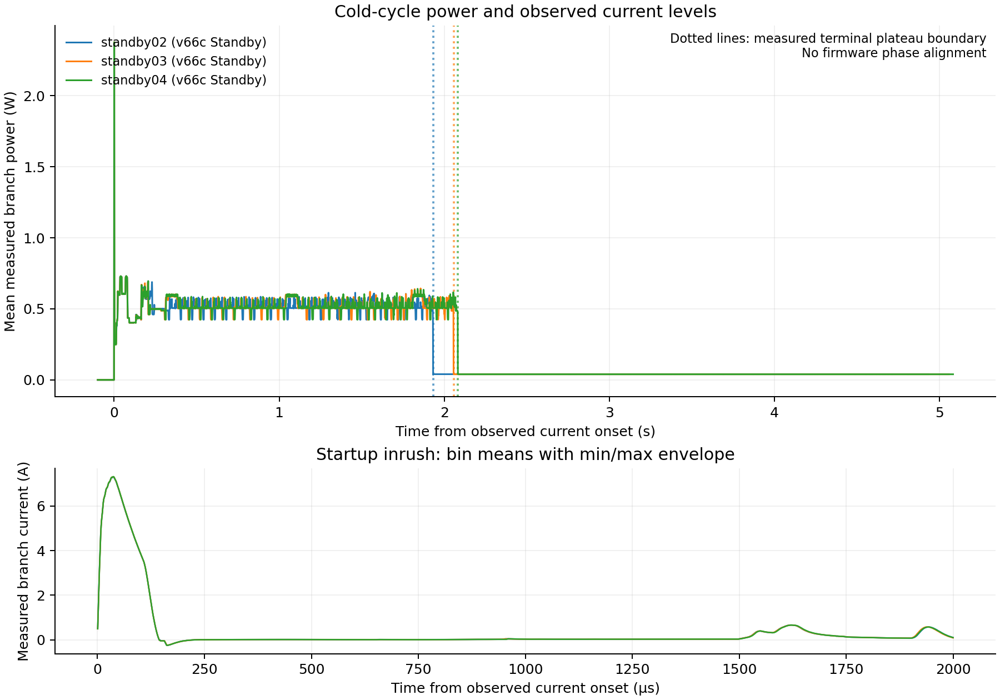

# v66c normal-profile cold-cycle energy

Three independent finalized native 2 MHz recordings passed hash, CRC, sequence,
coverage and finite-window checks. None had dropped chunks or a sample gap.
The 71 startup nonfinite current samples in each recording precede the selected
off/cycle window. This analyzer did not interpolate or repair samples. It
integrates delivered float samples: finite values do not prove that the
instrument/driver left the analog samples unmodified. Configured autorange
suppression/interpolation remains as recorded in the original settings.

| Trial | Current onset to quiet tail | Measured energy | Quiet-tail current |
|---|---:|---:|---:|
| standby02 | 1.933433 s | 0.992903 J | 8.172 mA |
| standby03 | 2.057802 s | 1.061503 J | 8.070 mA |
| standby04 | 2.082825 s | 1.080464 J | 8.057 mA |

Median measured energy is **1.061503 J**, range **0.992903–1.080464 J**.
Median current-onset-to-quiet-tail duration is **2.057802 s**, range
**1.933433–2.082825 s**. Each additional one-second quiet-tail confirmation
costs 0.03943–0.03998 J and is reported separately, not included in those cycle
energies. Pretrigger integration contributes zero in these delivered samples.

The exact installed sector is
`8129f9cc79e92c678207b4aee838810cc805d0b860c40b2f77b434ae746c8b61`.
Each current plateau was followed by warm UART recovery, an exact early park
and a positive Standby flag. The owner separately attests that this exact
firmware remained installed, no SWD ran during capture/plateau, and there was
no intervening target power-off before the flag read. The reader's original
`trial_entry_proven=false` is preserved: historical SBF alone is not trial
attribution. The separate history attestation provides that context. File
readback is another independent qualification; these energy records do not
inspect PNG pixels.

The boundary method and numerical thresholds are identical to the prior v59
baseline. The old median was 1.288948 J / 2.714624 s; the new observed medians
are 17.65% lower energy and 24.20% shorter duration. This is descriptive:
the earlier records were current-signature-only, and the frames, card state,
firmware layout and capture dates differ. Do not treat it as a controlled
same-frame experiment attributing every difference to a single code change.

These are Joulescope **board-supply branch** measurements using IN+ voltage.
They include board overhead and do not account for paths bypassing JS110.
They are not isolated MCU energy, battery energy, or a measurement of the
LTC3621 shutdown current. The ~39–40 mW remaining tail belongs to this bench
configuration. Startup inrush is retained in the native sample integrals;
range/suppression settings and original sample extrema are archived. No extra
analog calibration, clipping guarantee or bypass correction is inferred.

The quiet-tail boundary is selected in 1 ms bins and can include analog
settling. It is not an exact WFI timestamp. The independently clocked Saleae
pre-WFI markers are 1.930102, 2.054303 and 2.080342 seconds after reset release.
Those different physical boundaries and clocks are not silently aligned, and
the phase plot is not used to assign energy to individual firmware phases.

The PNG/SVG figures use native-bin means with every sample retained in the
sum; the startup panel also preserves min/max envelopes. Dotted lines mark
the observed quiet-tail boundary, not exact WFI entry.

`records/*/power-compact.json.gz` retains count, signed sum and extrema on
explicit native-ID bin edges. `raw-manifest.json` and the compressed chunk
index preserve identities, coverage and recorder settings. The original
multi-gigabyte streams remain local. Running `python ../replay.py` validates
the hashes and independently reproduces all twelve compact energy integrals,
the three phase/SBF associations and summary statistics without instruments.
It cannot rerun within-bin onset detection or image-pixel verification.

`../prepare_energy.py` documents the original raw analysis/export recipe. It
must only be rerun after all recorders stop; its local source-root paths are
not needed for compact replay. The frozen numeric support code is in
`support/`. Full image payloads and SD sector contents are excluded.
