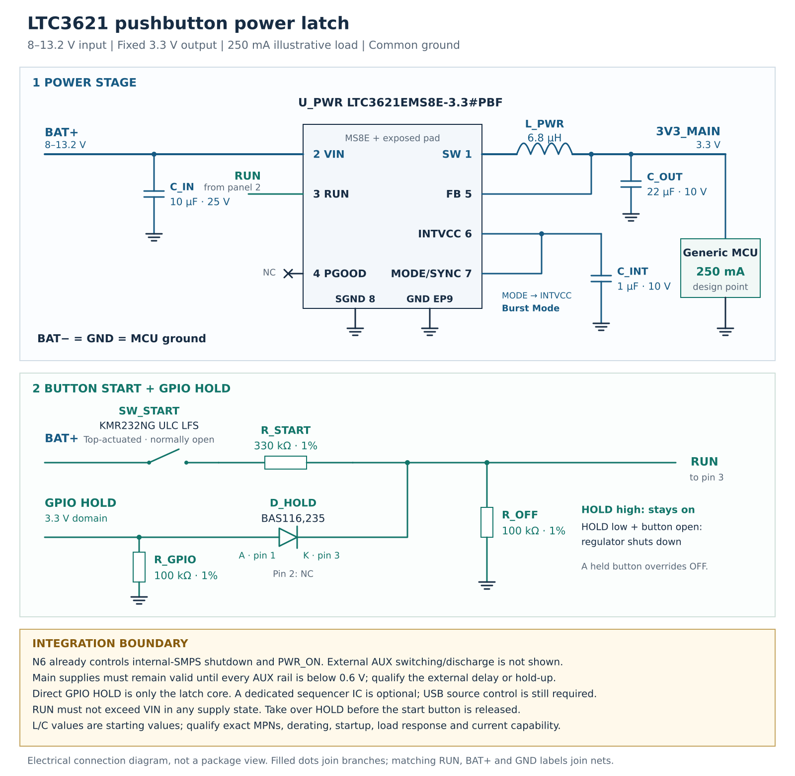

# Global X Camera power design

**Updated:** October 14, 2026, America/New_York. **Status:** the user has locked **four CR2032 cells in series through LTC3621** for the prototype and clarified the Standby handoff below. The detailed pushbutton-start circuit remains an unimplemented, untested engineering study originating September 7.

Use the [October 13 decision register](docs/decisions/2026-10-13-project-baseline.md) and [current specification](spec.md) for the accepted behavior. This study distinguishes that behavior from historical calculations, proposed component values and the unchanged recovered CAD.

The selected prototype camera is **CAM-6G3-073CLR / VD56G3, 73° diagonal field of view**, as recorded in [spec.md](spec.md). Recalculate and qualify its complete startup/capture/save load before sizing the implementation. The recovered CAD still uses CAM-5G0-079CLR / VD55G0, TPS62132/TPS62825 and the AO3401A latch; this decision has not changed the schematic or BOM.

The retained implementation study uses **LTC3621EMS8E-3.3#PBF**, converting approximately **13 V to 3.3 V at 250 mA**, with a momentary button asserting RUN and an MCU GPIO holding it high through a low-leakage diode. The exact ordering suffix, output/load point and component values are not additional locked decisions or qualified bounds for VD56G3. This study replaced the discrete PMOS latch as the investigation baseline on September 7. The [September 5 PMOS proposal](docs/power/pmos-latch-2026-09-05.md), including its transistor resistance calculations, is preserved for comparison.

**Future option:** mechanical frame-advance winding/driving a spring remains open beyond this battery-powered prototype. The [shutter-motion study](docs/power/shutter-energy-harvesting.md) is prior energy-envelope work; it does not select a mechanism or generation topology. VD5943 with potentially custom optics likewise remains a future direction, not the prototype camera.

**FD-03 — Series-capacitor start pulse, deferred October 13:** investigate a capacitor in the shutter-start path to permit eventual shutdown even with the button held. Qualify reset/rearming, pulse duration through reliable boot-to-HOLD takeover, leakage, transients, bounce and rapid repeat presses. SPST with a reset bleed and SPDT reset switching are alternatives, neither selected. This series capacitor is distinct from the optional RUN-to-ground C_RUN shutdown delay in §6. Retain the existing divider/HOLD prototype baseline; no component values or hardware/firmware changes are selected by this future direction.

**The user-confirmed room-temperature OFF target is 0.1 µA (100 nA) for the complete main power path, superseding the earlier <1 µA target. It has not been demonstrated.** This includes regulator shutdown current and input-capacitor, switch, PCB and other pack-connected leakage. The retained RTC cell-tap drain is additional and excluded from the 100 nA target; it must be measured and budgeted separately. The regulator's 0.1 µA typical shutdown current alone equals the target at its stated test condition, before external leakage. Its 1 µA maximum at 12 V and 25°C is a component specification, not the current project target or a board guarantee. The exact regulator also has only prototype-scale stock verified. These remain qualification requirements.

**The STM32N6 already provides autonomous internal-SMPS shutdown and a hardware PWR_ON output.** The remaining board requirement is to switch/discharge its external auxiliary rails and keep the main supplies valid until shutdown completes. The direct GPIO latch below does not establish that external ordering; a separate sequencing IC is not inherently required. See §6.

**Power fundamentals review, October 14:** the [current rail/phase and conversion review](docs/power/2026-10-14-power-tree-review.md) recommends **5.0 V from LTC3621 for the Nucleo bench**, retaining its existing regulators and the camera adapter. This is an unapproved proposal; exact source feed/isolation and measured loads remain open. The selected camera requires **2.8 V, 1.8 V and 1.15 V**. A separate custom-board 3.3 V candidate remains open. The 3.3 V circuit and values below are still the historical study, not the selected bench implementation.

**Direct 3.3 V follow-up:** the user asked about bypassing the 5 V stage. The [Nucleo modification study](docs/power/2026-10-14-power-tree-review.md#direct-33-v-nucleo-operation--feasibility-study) identifies a feasible circuit direction: separate direct 3.3 V main and PWR_ON-switched 3.3 V auxiliary feeds, retaining lower-voltage regulation. It is not a documented jumper mode or verified rework recipe; exact isolation links and USB handling remain open. Investigate this before freezing the output voltage.

## 1. Requirements and scope

| Item | Working basis |
| --- | --- |
| Input | Four series CR2032 cells are selected. Approximately 13 V and the earlier 8–13.2 V range remain calculation assumptions until exact cells, contacts and operating limits are qualified. |
| Output | 3.3 V, approximately 250 mA = **0.825 W** in the September 7 study. This is not a measured or qualified bound for the selected VD56G3 prototype; output and current sizing remain to be reconciled. |
| OFF | Button released, HOLD low or high-impedance, no USB/debugger/other external power. **Room-temperature main-path target: 0.1 µA (100 nA)** including regulator and all external pack-connected leakage. Retain the RTC cell tap; measure and budget its additional drain separately, outside this target. |
| Start | Button must remain closed until the MCU asserts HOLD. No guaranteed minimum pulse extension is provided. |
| Presses while busy | **Approved October 13:** ignore additional shutter presses during capture/save, finish the current operation unless a fault requires abort, and queue no exposure. Require an actual main-capture power cycle after shutdown and a fresh press after ready; a busy press held through completion must not trigger another shot. |
| Cold-start exposure deadline | **User-approved: ≤50 ms from shutter-button press to start of exposure, starting fully powered off.** Establish a deterministic design budget and qualify it on hardware; no runtime late-exposure error code/policy is selected. Exposure duration, readout, save and shutdown may follow and are measured separately. Compliance has not been demonstrated. |
| Shutdown | **Approved October 13:** lowest attainable power state; an actual power cycle of the main capture electronics is required before another image, while RTC backup may remain powered. After successful save, prepare shutdown and enter N6 Standby so ordinary HOLD becomes high impedance. A held button keeps the buck enabled in Standby until release permits power-off; no automatic wake/retake. AUX must fall below 0.6 V before main supplies leave their valid range in the controlled shutdown design. |
| F-01: low battery | **Approved October 13:** at any cycle phase, one red LED flash while power permits, then abort to shutdown. This abnormal abort does not require successful image commit; preserve already committed photos. Detection, thresholds and interrupted-write handling remain unimplemented or unqualified. |
| F-02: abrupt power loss | **Approved October 13:** the current uncommitted photo may be lost, but previously saved photos must be preserved. Mark allocation USED at save start and DONE only on successful completion. Retain bytes already written; USED without valid DONE remains occupied/possibly corrupt and is not automatically erased or reused. Recover committed records without automatic retake. Completion energy for the current save is not required; device-level power-fail isolation/recovery still needs qualification. See [F-02](docs/decisions/failure-response-review.md#f-02-abrupt-power-loss--approved). |
| Other detected capture faults | **Approved October 13:** two red flashes for camera initialization, three for frame capture, four for unresponsive storage, five for new-photo write/readback/commit, six for damaged index/allocation; then abort to shutdown. Preserve prior photos and retain incomplete allocations conservatively. See the [complete response map](docs/decisions/failure-response-review.md#accepted-response-map). |
| Boot/hang and USB transitions | No additional prototype response for boot/hang is selected; a stuck HOLD can keep power enabled. USB insertion/removal is allowed without a separate error code, subject to photo preservation and safe source handling. Controlled shutdown and uninterrupted operation are not guaranteed by these policy decisions. |
| Ground | Battery negative, converter ground and all logic grounds stay connected. |
| Scope | The drawing specifies the start/hold core and a provisional buck power stage. STM32N6 main/AUX sequencing, USB source selection, and input protection require integration before schematic release. |

The earlier 1.2 A / 3.96 W estimate is superseded **for these calculations**, but remains an unverified peak-load concern in the [original power review](docs/review/power-review.md). A 1 A-rated converter is not a substitute for measuring boot, capture and storage-write peaks. The former ambiguous 50 ms shutter-to-acquisition wording is superseded by the locked **≤50 ms from shutter-button press to start of exposure from fully powered off** requirement. Buck startup is one part of that interval; exposure duration, frame readout, save and shutdown are measured separately and may occur afterward.

The [complete power supply tree](docs/power/power-tree.md) traces batteries and USB-C through every existing regulator and switch to the powered devices and STM32 supply groups. It shows the **recovered TPS62132 wiring**, with the proposed LTC3621 replacement and main/AUX split marked separately; this document's LTC3621 proposal has not yet been applied to the schematic. [Open the vector diagram](docs/power/power-tree.svg).

The [rail current budget and dual-buck assessment](docs/power/current-budget.md) estimates 150–250 mA active on 1.8 V and 50–100 mA of direct 3.3 V loads for the earlier camera. These are unmeasured operating allocations, not guaranteed maxima for the selected prototype. In the existing cascaded architecture the 3.3 V regulator also supplies the converted 1.8 V load; the 250 mA design point above is not a qualified hot-corner or startup limit. LTC3622 remains a historical comparison and does not replace the locked LTC3621 choice.

A further [1.8 V digital architecture assessment](docs/power/1v8-memory-assessment.md) identifies 1.8 V NOR/NAND candidates that could eliminate battery-derived 3.3 V. It retains the earlier camera's 2.8 V and USB-only 3.3 V, and requires changes to RTC backup and the GPIO hold interface. It remains prior architecture research; integrate any adopted rail changes with the locked LTC3621 and CAM-6G3-073CLR choices. The circuit below remains the earlier 3.3 V implementation study.

## 2. Power ON/OFF circuit

### 2.1 Complete connection diagram



[PNG version](docs/power/ltc3621-pushbutton.png). Matching net labels connect the two panels. Descriptive references such as `D_HOLD` are local to this proposal; they do not rename the recovered schematic's D1, D2 or D3. Pin numbers apply to **MS8E**, not the DFN package.

The enable portion, in compact form:

```text
BAT+ ---- normally-open SW_START ---- R_START 330k ----+---- RUN (U_PWR pin 3)
                                                     |
HOLD GPIO ---- D_HOLD anode |>| cathode ---------------+
    |                                                |
 R_GPIO 100k                                       R_OFF 100k
    |                                                |
   GND                                              GND

BAT+ also connects directly to U_PWR VIN.
U_PWR output supplies the 3.3 V logic domain.
All grounds are common.
```

Use **D_HOLD = Nexperia BAS116,235**, with **pin 1 anode at HOLD**, **pin 3 cathode at RUN**, and **pin 2 unconnected**. R_GPIO is a recommended addition to the handoff: it defines the unpowered/high-impedance GPIO node and shunts the diode's small reverse leakage. It consumes current only while HOLD is high or another source is injecting current into that node.

### 2.2 Operation

1. **OFF:** the button is open and the GPIO is low or unpowered. R_OFF pulls RUN toward ground. The 330 kΩ branch is disconnected by the button; it does not continuously draw 30 µA.
2. **Button press:** the 330 kΩ / 100 kΩ divider raises RUN. The buck ramps 3.3 V and starts the processor. D_HOLD blocks a forward path from RUN into the unpowered GPIO, although its reverse leakage is nonzero.
3. **Firmware takeover:** configure a suitable **3.3 V-domain ordinary GPIO** and drive HOLD high as early as the boot flow permits. The diode supplies RUN after the button is released. Do not select a 1.8 V-domain GPIO on the assumption that it has the same margin.
4. **Standby handoff, clarified October 13:** on successful save, finish the required save checks; on low-battery or other detected capture-fault abort, do not wait for a successful commit. Prepare peripherals and the required shutdown sequence as available power permits, then enter genuine N6 Standby with HOLD still driven until entry. An ordinary HOLD GPIO becomes high impedance; R_GPIO defines its released state and R_OFF discharges RUN after the diode ceases sourcing. With the button open, the buck disables after any qualified delay. With the button held, its divider keeps the buck enabled while the MCU remains in the lowest attainable state until release permits power-off. No automatic wake/retake is allowed: another image requires an actual main-capture power cycle. The direct GPIO-to-diode drawing alone does not establish AUX-then-main timing; see §6.

A short tap or contact bounce can remove power before firmware takes over. Soft-start alone does not provide a boot-time latch. An optional RUN-to-ground capacitor remains unselected and requires the timing qualification in §6. This circuit provides neither debounce nor a forced long-press shutdown. A stuck-high GPIO or crashed firmware can keep it on indefinitely.

The held-button Standby state is not the 100 nA button-released OFF state. Its draw includes the divider's calculated approximately 18.6–30.7 µA across the assumed 8–13.2 V range, enabled-regulator consumption and battery-equivalent MCU/peripheral loads, plus separate RTC cell-tap drain. Measure the integrated state; MCU Standby current alone is not the complete battery budget.

The button cannot be sensed independently merely by reading RUN: HOLD keeps that node high. The accepted policy is to ignore additional presses during capture/save, without queuing a shot; another image requires an actual main-capture power cycle after shutdown and a fresh press after ready. A fresh press alone does not substitute for the power cycle. If input handling needs independent button-state information while powered, use a separately reviewed sensing interface or second contact. This policy does not itself select that hardware.

**F-01 low-battery abort, approved October 13:** detection at any point in the cycle, including post-save shutdown, requires one red LED flash and abort to the shutdown state, not completion of a successful-save sequence. Indication and controlled shutdown are possible only while sufficient power remains; no battery measurement circuit, cutoff threshold or warning/hold-up energy is established. Preserve committed photos, including the current image if already valid and durably committed; do not report an incomplete or unverified image as saved. Interrupted writes follow the accepted USED/DONE policy; the physical format and recovery remain to implement and qualify. The recovered [BOM](bom.txt) specifies green/yellow-green LED1, ROHM SML-P11MTT86R, so the red indication requires a hardware/BOM change still to be selected and qualified. This document does not change the CAD.

### 2.3 Proposed parts

| Ref. | Part / value | Selection basis and limits |
| --- | --- | --- |
| U_PWR | **ADI LTC3621EMS8E-3.3#PBF** | Fixed 3.3 V, 1 MHz, 1 A; VIN 2.7–17 V. MSOP-8 with exposed pad. Do not substitute the 2.25 MHz `-23.3` version without reviewing the magnetics. |
| D_HOLD | **Nexperia BAS116,235** | SOT-23. Reverse current maximum 5 nA at 75 V/25°C, 80 nA at 75 V/150°C; these are pulsed test limits. Forward voltage maximum 0.9 V at 1 mA/25°C. |
| R_START | **Yageo RC0603FR-07330KL**, 330 kΩ | 0603, 1%, 100 mW, 75 V working-voltage class. |
| R_OFF, R_GPIO | **Yageo RC0603FR-07100KL**, 100 kΩ each | Same series. GPIO pulldown included in the calculations and diagram. |
| SW_START | **C&K KMR232NG ULC LFS**, current code **Y78B23224FP** | Normally-open, top-actuated, ultra-low-current contact: 32 V maximum, 1 µA minimum at 1.8 V; insulation resistance at least 1 GΩ. Mechanical fit remains to be checked. |
| L_PWR | **6.8 µH**, shielded; MPN pending | Starting value for the 1 MHz design. Select saturation margin above the 1.8 A maximum peak-current-limit specification, including tolerance and temperature; verify DCR and heating. |
| C_IN | **10 µF, 25 V ceramic**, MPN pending | Permanently across the battery. Effective capacitance at 13.2 V, insulation/leakage and hot-plug ringing must be checked. |
| C_OUT | **22 µF, 10 V ceramic**, MPN pending | Starting output value; qualify effective capacitance and the complete downstream capacitor bank. |
| C_INT | **1 µF, 10 V ceramic**, MPN pending | Local INTVCC bypass. Ensure at least the required 1 µF effective capacitance across tolerance/bias/temperature, increasing nominal value if necessary. |

Sources: [ADI LTC3621 Rev. D](https://www.analog.com/media/en/technical-documentation/data-sheets/ltc3621-3621-2.pdf), [Nexperia BAS116](https://assets.nexperia.com/documents/data-sheet/BAS116.pdf), [Yageo RC series](https://www.yageogroup.com/content/datasheet/asset/file/PYU-RC_GROUP_51_ROHS_L), [C&K KMR2 series](https://www.ck-components.com/media/1479/kmr2.pdf). The inductor and capacitors are provisional electrical values, **not a released procurement BOM**.

The earlier side-actuated **KMS223G LFG** has a **1 mA minimum contact load** and is unsuitable for this approximately 19–31 µA divider without separate low-load qualification. The ULC switch changes the actuator geometry. If side actuation remains mandatory, a suitable ultra-low-current side switch is still needed. A Schottky diode is not an automatic improvement over BAS116: its lower forward drop may come with substantially greater hot reverse leakage.

### 2.4 Buck pin wiring

| MS8E pin | Connection |
| --- | --- |
| 1 SW | L_PWR input; keep the switching node small. |
| 2 VIN | BAT+; C_IN directly to the local power ground. |
| 3 RUN | The control node shown above. |
| 4 PGOOD | Unconnected in this minimum circuit. If used by a sequencer, add a pull-up to an appropriate switched logic rail and review its behavior during startup/shutdown. |
| 5 FB | **Directly to 3.3 V output**, sensed at C_OUT; no external divider for this fixed-output part. |
| 6 INTVCC | C_INT to ground. Do not use as a general-purpose supply. |
| 7 MODE/SYNC | **Connect to INTVCC for Burst Mode**, the efficiency-oriented baseline. Connecting to GND instead selects pulse-skipping for lower ripple; qualify camera noise and efficiency before choosing the final mode. |
| 8 SGND | Quiet signal-ground return, joined to power ground as shown in the manufacturer's layout. |
| 9 exposed pad | Solder to ground with appropriate copper and thermal vias. |

[Manufacturer pin definitions and layout guidance, pp8 and 15–16](https://www.analog.com/media/en/technical-documentation/data-sheets/ltc3621-3621-2.pdf#page=8).

## 3. Start and HOLD calculations

### 3.1 Button divider

With the GPIO unpowered and neglecting the small leakage terms:

```text
V_RUN = V_BAT × R_OFF / (R_START + R_OFF)
      = V_BAT × 100k / 430k
I_BUTTON = V_BAT / 430k
```

| Battery | RUN, nominal | Button current, nominal |
| ---: | ---: | ---: |
| 8 V | 1.860 V | 18.605 µA |
| 13 V | 3.023 V | 30.233 µA |
| 13.2 V | 3.070 V | 30.698 µA |

The datasheet gives RUN high at **1.0 V**, low at **0.3 V**, and a maximum RUN input current of **20 nA** under its 25°C table conditions (input current tested at RUN=12 V). With 1% resistors, the low corner at 8 V is:

```text
R_START = 333.3k; R_OFF = 99k
V_RUN = 8 × 99 / (333.3 + 99) − 20nA × (333.3k || 99k)
      ≈ 1.831 V
```

The high corner at 13.2 V is approximately **3.119 V**, allowing a 20 nA source current in the opposite direction. These calculations use the stated current limit as a screening allowance at the actual RUN voltage; they are not a full-temperature guarantee. Diode leakage adds only a small correction: 80 nA across approximately 77 kΩ is about 6 mV.

At 13.2 V, R_START dissipates approximately **0.311 mW** and R_OFF approximately **0.094 mW** during button-only startup. Ordinary 0603 power ratings provide ample margin.

### 3.2 MCU HOLD margin

At 25°C, a conservative screening calculation uses the regulator's minimum fixed output, a 0.4 V GPIO output-high allowance, and the diode's 0.9 V limit:

```text
V_RUN,HOLD ≥ 3.267 − 0.4 − 0.9 ≈ 1.967 V
```

This is approximately **0.967 V above the 1.0 V RUN-high requirement**. The GPIO supplies roughly 20–30 µA through R_OFF plus about 33 µA through R_GPIO. A total below approximately 70 µA is a useful nominal load bound for GPIO selection. BAS116's 0.9 V limit is specified at 1 mA, above this actual diode current; cold-temperature forward voltage and the selected GPIO's exact supply-domain limits still require qualification. [STM32N657 output levels, Table 65](https://www.st.com/resource/en/datasheet/stm32n657x0.pdf#page=171).

While the button starts the system, 5 nA / 80 nA of reverse diode current into the GPIO produces only **0.5 mV / 8 mV** across R_GPIO=100 kΩ. These are simple resistor/leakage bounds, not a replacement for checking the processor's unpowered-I/O requirements.

RUN's absolute upper limit is **VIN**, not a fixed 3.3 V or 5 V. A USB-powered MCU must not drive HOLD high when battery VIN is absent or below the diode-fed RUN voltage. R_OFF does not clamp this condition.

## 4. OFF-current budget

The locked target is **0.1 µA (100 nA) at room temperature for the complete main power path**. It includes regulator shutdown current plus input-capacitor, open-button, PCB, protection and other pack-connected leakage. Main loads are switched. The user has retained the RTC backup directly from one cell and approved measuring and budgeting its additional drain separately, outside the 100 nA target. This accounting decision makes no hardware change.

### 4.1 What is specified

The LTC3621 shutdown-current entry is **0.1 µA typical, 1 µA maximum**, at **VIN=12 V, RUN=0 V, TJ=25°C**. It is not marked as a full-temperature limit. Selecting an I-grade part does not create a temperature guarantee for this otherwise room-temperature-only row. The E-grade and I-grade guarantees also differ for other parameters; choose the operating-temperature grade before release.

At that typical reference, the regulator uses all 100 nA before external main-path leakage. The user proposed screening regulators and rejecting high-leakage parts. Treat this as a candidate qualification method: measure the distribution at the intended battery voltages and room-temperature test condition, define an acceptance cutoff that leaves the required allowance for other main-path leakage, and establish yield. No cutoff, passing yield or assembled-board compliance has been demonstrated; component screening alone does not measure the other paths.

The table separately lists switch leakage without enough bias/test detail to establish how those entries combine with VIN shutdown current. Do **not** blindly add all internal MOSFET leakage maxima as parallel battery branches, or claim the 1 µA entry is a proven complete-converter bound under arbitrary output bias. Obtain ADI clarification if a contractual maximum is required. [Electrical table and notes, pp4–5](https://www.analog.com/media/en/technical-documentation/data-sheets/ltc3621-3621-2.pdf#page=4).

### 4.2 External paths and a transparent example

```text
I_OFF,pack = actual converter input current in shutdown
           + input-capacitor leakage
           + open-switch/PCB/protection leakage
           + any other always-connected pack loads
```

The following is the **historical illustrative 13 V planning calculation** from the earlier <1 µA review, retained to expose the unqualified terms. It is neither a predicted production maximum nor a claim that the regulator's 12 V test applies unchanged at 13 V. It does not establish the current 100 nA target.

| Contribution | Illustrative current | Basis |
| --- | ---: | --- |
| Regulator | 0.100 µA typical reference / 1.000 µA specified-limit reference | Carry the 12 V/25°C table values into a scenario; actual 13 V/temperature behavior remains unbounded by this calculation. |
| Open button | 0.013 µA | 13 V / (1 GΩ + 430 kΩ), using the switch's minimum insulation resistance as a screening resistance. Environment/test-condition differences require validation. |
| C_IN | 0.130 µA | **Assumed** insulation resistance of 100 MΩ: 13 V / 100 MΩ. No selected capacitor guarantees this number yet. |
| PCB, protection, sequencing, other always-on loads | Unallocated | Must be added from the implemented design and measured assembly. |
| Arithmetic subtotal | **0.243 µA / 1.143 µA** | Typical-reference / specified-limit-reference cases, before unallocated terms. |

Both illustrative subtotals exceed the current 100 nA target. The earlier review also found that its **historical <1 µA guaranteed scenario** failed using the regulator's specified-limit reference. Neither conclusion is a measured production result. The current decision retains LTC3621 and requires qualification of the actual circuit and proposed screening approach.

In steady shelf-OFF, RUN and HOLD are both near ground. **Do not add BAS116's full reverse-current limit as an independent permanent battery branch.** Nor should the 100 kΩ pulldowns be charged against the battery as if their upper nodes were at 3.3 V. Button insulation leakage alone would raise RUN only about 1.3 mV at 13 V. A 20 nA source-current screening allowance adds about 2 mV across R_OFF; this is still well below the 0.3 V low criterion, subject to temperature and contamination qualification.

The battery-connected C_IN is especially important here: unlike the prior upstream PFET topology, it remains energized while OFF. Protection devices, voltage dividers and any sequencer powered from BAT+ also consume the shelf-current budget. The existing RTC tap draws from one cell, so it requires a **separate per-cell** lifetime/imbalance budget even if a whole-pack ammeter does not include that tap current.

For the recovered **RV-3028-C8** in Level Switching Mode, the local application manual specifies **140 nA typical / 210 nA maximum from VBACKUP at 3.0 V, VDD below 2.0 V and 25°C**. Its separate 70 nA typical / 90 nA maximum VDD timekeeping row is not the specified backup-mode draw. These are manufacturer test-condition values, not measurements of this camera. This additional drain must be measured and budgeted at the tapped cell, outside the user-approved 100 nA main-path target. Do not add currents at different supply voltages as though they were one measured pack current, or omit the RTC from per-cell lifetime estimates. [RV-3028-C8 application manual, §6.2, p97](datasheets/sensors_timing/RV-3028-C8_application_manual.pdf#page=97).

For scale, continuous **1 µA uses 8.76 mAh/year**, or 87.6 mAh in ten years, before cell self-discharge. A sub-microamp latch by itself does not establish ten-year battery life.

## 5. ON-state power, resistance and voltage regulation

### 5.1 Battery current and converter loss

```text
P_OUT = 3.3 V × 0.250 A = 0.825 W
P_IN = P_OUT / efficiency
I_BAT = P_OUT / (efficiency × V_BAT)
P_LOSS = P_IN − P_OUT
```

| Assumed efficiency | Battery current at 13 V | Converter loss |
| ---: | ---: | ---: |
| 85% | 74.66 mA | 145.59 mW |
| 90% | 70.51 mA | 91.67 mW |
| 95% | 66.80 mA | 43.42 mW |

These are sensitivity cases, **not measured or guaranteed efficiencies**. At 90%, battery current is approximately **114.58 mA at 8 V** and **69.44 mA at 13.2 V**. Every series cell carries that current. The lower 250 mA output assumption improves the earlier budget, but it still requires selected-cell pulse/sag testing. These figures omit the button's approximately 30 µA while pressed and any loads omitted from the 250 mA assumption.

### 5.2 Why there is no single series-switch voltage drop

This proposal regulates the output. Its internal MOSFET losses affect efficiency and temperature; they do not subtract a fixed `I × RDS(on)` drop from 3.3 V while the loop remains in regulation. The datasheet lists typical top/bottom resistances of **0.37 Ω / 0.15 Ω** under the resistance rows' VIN=5 V test condition. They are not maximum resistance guarantees at 13 V, and neither the old PMOS pair's resistance nor a single internal FET resistance is the converter's output resistance.

The specified fixed output is **3.267–3.333 V at 25°C**, or **3.250–3.350 V** for the table's extended-temperature entry within the relevant grade conditions. Allow additional transient, ripple and PCB-distribution error when checking the MCU and downstream regulators. The input-to-output difference of roughly 9.7 V is converted by the buck; it is not dissipated as though this were a linear regulator. [ADI electrical specifications, pp4–5](https://www.analog.com/media/en/technical-documentation/data-sheets/ltc3621-3621-2.pdf#page=4).

### 5.3 First-order power-stage sizing

For 13 V input, 3.3 V output, 1 MHz and 6.8 µH, an ideal continuous-conduction screening model gives:

```text
Duty ratio D ≈ 3.3 / 13 = 0.254
Inductor ripple ΔI ≈ V_OUT × (1 − D) / (L × f) = 0.362 A peak-to-peak
Peak current at 250 mA average ≈ 0.250 + ΔI/2 = 0.431 A
```

Actual Burst Mode waveforms, losses and tolerance change these values. Normal-load peak current alone is insufficient to rate the inductor: startup and faults can reach the converter's current limit. Verify saturation above the specified 1.8 A upper limit with temperature/tolerance margin, as well as RMS heating and DCR.

A concrete magnetic candidate is **Coilcraft XGL4020-682MEC**: 6.8 µH ±20%, 70 mΩ maximum DCR at 25°C, and 2.5 A at a 20% inductance reduction at 25°C. This is a candidate for the thermal/bias and procurement checks, not a fully qualified BOM selection. Its saturation specification describes an allowed inductance reduction, not a hard current cutoff. [Coilcraft specifications and derating links](https://www.coilcraft.com/en-us/products/power/high-voltage-inductors/xgl/xgl4020/xgl4020-682/).

The proposed 22 µF output capacitor is a starting point, not authority to remove required local bypassing. Conversely, do not carry over the old nominal **210 µF** reservoir without checking startup. Charging 210 µF to 3.3 V in a linear **0.8 ms** ramp would require **0.866 A** just for that capacitor, or **1.116 A** including a simultaneous 250 mA load. This exceeds the nominal 1 A output rating and can alter startup timing; it is a screening example, not a prediction of the actual nonlinear startup waveform. Real loads, capacitor bias and ramp behavior must be measured.

## 6. Camera integration requirements

### STM32N6 sequencing and firmware handoff

**The recovered design uses the N6's internal SMPS, with external L3, to generate VDDCORE.** On entering Standby, the N6 turns that converter off, powers down the core domain and drives its hardware `PWR_ON` output low. This already performs the internal core-control portion without another CPU instruction. `PWR_CR1.MODE_PDN` enables the internal SMPS output pulldown; its reset default leaves that output high-impedance during shutdown. Configure and qualify discharge rather than equating stopped switching with an already-discharged rail. [RM0486 §13.4.2, p356, and PWR_CR1, pp385–386](https://www.st.com/resource/en/reference_manual/rm0486-stm32n647657xx-armbased-32bit-mcus-stmicroelectronics.pdf#page=356).

The internal converter does not itself disconnect its **external 1.8 V inputs**, the separately supplied camera/USB/ADC analog domains, or the external I/O-bank supplies. ST still requires auxiliary rails to fall below **0.6 V before the main rails leave their valid range**. In the recovered design, U7's single 1V8 output joins main `VDDA18AON` to auxiliary `VDDSMPS`, `VDDA18PMU` and other 1.8 V consumers. Stopping VDDCORE internally cannot separate or discharge those tied external nodes. [STM32N6 supply groups and sequencing, pp7–10](https://www.st.com/resource/en/application_note/an5967-getting-started-with-hardware-development-for-stm32n6-mcus-stmicroelectronics.pdf#page=7), [project MCU review](docs/review/mcu-review.md).

The integration direction is to separate the 1.8 V always-on branch from the auxiliary branch, use `PWR_ON` to control suitable auxiliary enables/discharge, and ensure the main 3.3 V and 1.8 V AON supplies remain valid through that discharge. This can potentially use the built-in N6 control plus external switches/regulators and qualified hold-up or delay; a dedicated sequencing IC is only one option. The external circuit and its OFF-current allocation remain unimplemented.

The normal successful-save shutdown contract is: firmware completes storage operations and required save verification, prepares peripherals and the shutdown configuration, then enters genuine Standby; N6 hardware turns off its internal SMPS and signals external AUX shutdown; the board keeps main power valid until all required AUX rails have discharged, then permits main power to fall. **F-01 low-battery abort does not wait for successful commit:** enter the lowest attainable state using the shutdown preparation that remaining power permits. Rail collapse does not guarantee this controlled sequence or a visible flash. In either case, taking another image requires an actual main-capture power cycle; RTC backup may remain powered. `PWR_CR1.POPL` controls the minimum **PWR_ON-low interval** for Standby/restart; it does not by itself delay the main buck turning off. Simply replacing the GPIO connection with a direct `PWR_ON`-to-RUN connection does not establish the necessary discharge margin or USB source policy.

**October 13 handoff clarification:** keep an ordinary HOLD GPIO high until Standby entry, when it automatically becomes high impedance without pulls; retain R_GPIO and R_OFF. Select a pin outside the RESET/PWR_ON, configured RTC and enabled WKUP exceptions. **Stop mode leaves I/O configuration unchanged** and does not perform this release. Configure wake sources so a held shutter does not retrigger the MCU. [RM0486 §13.7.6, p381, and §13.7.7, p383](datasheets/processor/STM32N6_RM0486_reference_manual.pdf#page=381).

An optional **C_RUN from RUN to ground** could extend enabled time as it discharges through R_OFF after the diode ceases sourcing; the diode also isolates this node from a low GPIO. It delays buck disable rather than independently supplying MCU power. No value is selected. Dimension and qualify any delay so AUX falls below 0.6 V before main power becomes invalid, including worst-case thresholds, tolerances and leakage. Also check its added startup delay against the 50 ms exposure-start deadline and its behavior on rapid represses. The external PWR_ON/AUX circuit and this optional delay remain unimplemented.

The dedicated N6 `PWR_ON` output asserts before firmware; it is not interchangeable with a policy-controlled HOLD GPIO. Connecting it directly could restart the battery converter during USB boot. Choose the GPIO, reset state, boot-stage assertion point and brownout behavior explicitly. A guaranteed short-tap start may ultimately require hardware hold time because boot latency can precede application code.

The LTC3621 does not specify a guaranteed active output-discharge function. R_OFF discharges **RUN**, not the 3.3 V rail. Leakage can charge an otherwise unloaded output over a long interval; provide a defined discharge path if the final rail-OFF requirement demands one. A permanent output bleeder adds ON power and requires a documented worst-case OFF-voltage/current calculation. The fixed-output feedback current has no usable minimum discharge guarantee.

### USB, debugger and battery isolation

**USB behavior updated October 14:** USB supplies a **PTP camera interface with explicit per-photo deletion**, replacing drive/filesystem emulation. The shutter has no operation in USB mode; connecting/downloading alone never deletes photos. USB must not enable the battery converter. PTP transfer/delete recovery and the safe power-source circuit remain separate implementation tasks; see the [accepted USB interface](docs/decisions/usb-photo-access-review.md).

The drawing is a **battery-only core**. It does not retain the old two-PMOS bidirectional OFF isolation. A synchronous buck's output can backfeed VIN through internal structures; RUN low is not proof of reverse-current blocking. Do not parallel a USB-derived 3.3 V supply onto this output, or preserve the old SYS_IN diode topology unchanged, without a reviewed source-selection circuit.

Source selection must both prevent charging the primary-cell stack from USB and prevent HOLD from exceeding VIN when the battery is absent. The same review includes debugger-powered I/O and peripheral backfeed. USB-only operation must leave the battery path disabled according to the intended policy.

**Implementation direction, not a completed circuit:** detect the actual USB source upstream of any merged system rail using a voltage-compatible signal; keep HOLD inactive on USB startup. A reverse-blocking diode or equivalent source-isolation device can address reverse power flow, but does not by itself inhibit RUN. The button still asserts RUN electrically even if firmware ignores it, so provide a USB-controlled hardware inhibit if the battery regulator must remain disabled while USB is present. Any RUN clamp must account for current from the button divider and the GPIO/diode path rather than shorting an actively driven GPIO. Qualify USB insertion/removal, boot/reset and either button state, including the transition during a save.

For the **NUCLEO-N657X0-Q**, the target MCU's user USB port is **CN8**, while **CN10** serves ST-LINK. UM3417 Rev 3 specifies **CN9 pins 3–4** to select power from the user USB sink path. Account for either USB power source used during bench work when inhibiting the external battery path. This identifies the board's USB/power options, not a completed external LTC3621 wiring plan; its regulator output/injection point and jumpers still require reconciliation. [UM3417 board layout and USB power selection, pp10 and 19](https://www.st.com/resource/en/user_manual/um3417-stm32n6-nucleo144-board-mb1940-stmicroelectronics.pdf#page=19).

### Input range, protection and layout

Seventeen volts is the regulator's **absolute maximum VIN as well as the top of the operating range**. Fresh-pack voltage of 13.2 V leaves 3.8 V of static headroom, not permission for arbitrary hot-plug ringing. Its higher internal overvoltage shutdown threshold does not override the 17 V absolute limit. Measure input transients with the actual battery holder, wiring and C_IN, and include the leakage of any added protection.

Place C_IN next to VIN and the power-ground/exposed-pad return; keep the high-current switching loop compact. Keep SW copper and the inductor away from FB, RUN, camera analog supplies and MIPI routing. Sense VOUT from the output capacitor with a quiet return. Solder the exposed pad and use the manufacturer's ground layout as the starting point. Review effective MLCC capacitance at bias, inductor saturation, thermal copper, output ripple and load-step response before routing release.

The converter's low-voltage lockout is not a four-cell end-of-discharge policy. An enforced battery cutoff/imbalance policy remains needed; any monitoring circuit must fit the OFF-current budget.

## 7. Sourcing evidence

Stock is per exact part and timestamp; it is not a reservation. No parts were ordered.

| Part | Observation | Evidence |
| --- | --- | --- |
| LTC3621EMS8E-3.3#PBF | **95 immediately available**, Mouser SKU 584-C3621EMS8E-3.3PF; restricted availability | Live page, September 7, 2026, approximately 11:01–11:02 EDT; subsequent verification overlay prevented further inspection. [Mouser](https://www.mouser.com/en/ProductDetail/Analog-Devices/LTC3621EMS8E-3.3PBF?qs=hVkxg5c3xu9zrKdTnOms5g%3D%3D) |
| LTC3621IMS8E-3.3#PBF | **100 shown**, 10-week standard lead time | Distributor web retrieval marked crawled September 7; browser confirmation blocked. A secondary availability indication, not a live browser verification. [DigiKey](https://www.digikey.com/en/products/detail/analog-devices-inc/LTC3621IMS8E-3-3-PBF/4840617) |
| LTC3621EMS8E-3.3#TRPBF | Not normally stocked; orderable, MOQ 2,500, 10 weeks shown | Distributor web retrieval marked crawled September 7. Orderability is not immediate stock. [DigiKey](https://www.digikey.com/en/products/detail/analog-devices-inc/LTC3621EMS8E-3-3-TRPBF/4840602) |
| BAS116,235 | **62,248 available**, Mouser SKU 771-BAS116/T3 | Live page, September 7, 11:02 EDT. [Mouser](https://www.mouser.com/en/ProductDetail/Nexperia/BAS116235?qs=me8TqzrmIYVkLoj2nMXKnA%3D%3D) |
| KMR232NG ULC LFS / Y78B23224FP | DigiKey 31,226; Mouser 20,727 | **Earlier September 5 observations**, not refreshed September 7. [DigiKey](https://www.digikey.com/en/products/detail/c-k/KMR232NG-ULC-LFS/2176545), [Mouser](https://www.mouser.com/en/ProductDetail/CK/KMR232NG-ULC-LFS?qs=sGAEpiMZZMtFyPk3yBMYYJs5pV9KTQMgt8Np%2FpAqkuI%3D) |

The diode has deep verified stock. The **regulator does not meet the earlier “well-stocked” procurement objective on the evidence obtained**; it is suitable to investigate for a small prototype build, with production sourcing unresolved. Resistor stock for these new values and the final magnetic/capacitor MPNs still need a procurement check. Neither manufacturer orderability nor a large minimum reel order proves inventory.

## 8. Qualification plan and supporting files

Before implementing this as the camera's released power circuit:

1. Complete the main/AUX sequencing and USB/reverse-current design; identify the actual HOLD GPIO and its earliest boot assertion.
2. Select the inductor and capacitors with bias, leakage and current data; confirm battery pulse capability at the measured workload.
3. Measure RUN, HOLD, 3.3 V and all required auxiliary rails during start, button bounce/release, normal shutdown, reset and brownout. Establish the minimum successful button duration.
4. Measure main-path OFF current against the 100 nA room-temperature target after all rails settle, including the assembled input capacitor, switch, protection, PCB and other pack-connected leakage. Measure and budget the retained RTC cell-tap current separately as additional drain. Characterize battery-voltage and storage-temperature corners. If regulator screening is used, establish its cutoff and yield. Use a fixture whose own leakage/burden does not dominate a 100 nA result.
5. Check button held during shutdown, ignored busy presses, main-power-cycle/fresh-press rearming, firmware failing to assert/release HOLD, output prebias, USB insertion/removal, battery removal during USB operation, and debugger attachment. Verify no queued or automatic retake, prohibited reverse battery current or RUN-over-VIN condition. Exercise F-01 at every cycle phase; qualify detection, one red flash where power permits, abort and preservation/recovery without assuming hold-up energy or successful commit.
6. Check input overshoot, output ripple/load steps, startup current, regulation and temperature with the final layout and actual capture/write workload.

The arithmetic is recorded in [ltc3621-calculations.json](docs/power/ltc3621-calculations.json), generated by [the calculation model](tools/calculate_ltc3621_power.py). Diagram source: [build_ltc3621_diagram.py](tools/build_ltc3621_diagram.py). The [datasheet library](datasheets/README.md) records downloaded PDFs and provenance; web-only references remain clearly separate from downloaded files.

Local references added for this proposal: [LTC3621 Rev. D](datasheets/candidates/power-latch/ADI_LTC3621.pdf), [BAS116](datasheets/candidates/power-latch/Nexperia_BAS116.pdf). The LTC3621 archive is an unchanged distributor-hosted manufacturer document with an Arrow.com footer; the official ADI binary download timed out, so byte identity with that server's copy has not been established. Its revision, page count and requested ordering codes were verified, and the electrical review used ADI's readable official document. The BAS116 PDF was downloaded directly from Nexperia. Each has an adjacent provenance record.
